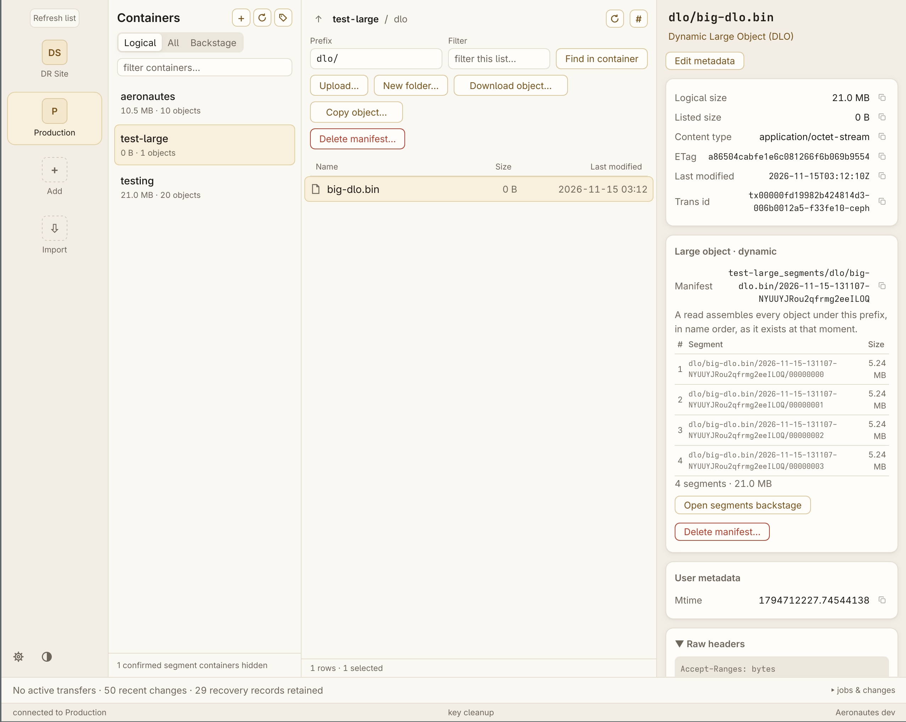

# Aeronautes

[](https://github.com/csmart/aeronautes/actions/workflows/ci.yml?query=branch%3Amaster+event%3Apush)

**Aeronautes** (a living genus of swifts; “air sailor”) is a beautiful, performance-first
**desktop operator workbench for OpenStack Swift / SwiftStack**.
It makes Swift's control-plane semantics explicit and uses rclone and native Swift features to move bulk data.

> **Open-source software, no warranty.**
> Aeronautes is licensed under the [Apache License 2.0](LICENSE) and provided "as is", without warranties or conditions of any kind, as set out in that licence.
> **This early release is not recommended for production or valuable data.**
> Use dedicated test accounts and disposable containers, keep independent backups, and read the [known limits and remaining acceptance checks](#before-trusting-a-release-against-production) before using it.

The mantra: **the inspector is the product; transfers are a first-class superpower; performance and
beauty are features.**



*The current browser and DLO inspector: logical versus listed size, the exact manifest and its segment table.
Captured during preparation for 0.5.0; [earlier screenshots](docs/assets/screenshots/) record previous development stages.*

## Download and install

Get [Aeronautes 0.5.0 from GitHub Releases](https://github.com/csmart/aeronautes/releases/tag/v0.5.0).
The repository and its downloads are private; sign in with an account that has repository access.
Choose `amd64` for x86-64/Intel/AMD or `arm64` for ARM64/aarch64, including Apple Silicon.

| Platform | Available downloads | Install or run |
| --- | --- | --- |
| Fedora Linux | RPM for amd64 and arm64 | `sudo dnf install ./<downloaded-file>.rpm` |
| Ubuntu 24.04 | DEB for amd64 and arm64 | `sudo apt install ./<downloaded-file>.deb` |
| Other Linux with GTK 4 and WebKitGTK 6 | tar.gz for amd64 and arm64 | Extract and run `./aeronautes`, keeping `rclone` beside it. |
| Windows | Portable ZIP for amd64 and arm64 | Extract the whole ZIP and run `aeronautes.exe`, keeping `rclone.exe` beside it. |
| macOS | App-bundle ZIP for Intel and Apple Silicon | Extract and move `aeronautes.app` to Applications. |

All builds are **unsigned**, and macOS builds are **not notarised**.
Windows SmartScreen and macOS Gatekeeper may warn or block launch.
Linux is the reference platform; Windows and macOS bundles are available for testing while their native acceptance remains incomplete.
There is no Windows MSI/EXE installer or macOS DMG/PKG installer in this release.
**Use dedicated test accounts and containers first:** the [valuable-data hold and remaining acceptance checks](#before-trusting-a-release-against-production) still apply.

The Linux packages install the application in `/usr/local/bin`, its verified rclone in `/usr/local/libexec/aeronautes`, and an application-menu entry.
They install the GTK 4 and WebKitGTK 6 dependencies; tarball users must supply those libraries separately.
Every bundle includes rclone v1.74.3, its licence notices and a build identity; the release also provides SHA256 checksums and per-platform provenance records.
Run `aeronautes --version` to inspect the version and source revision, and `aeronautes --engine` to verify the resolved transfer engine.

## What it is

- A **Swift-native** operator tool — containers, objects, prefixes, **segments**, DLO/SLO manifests,
  storage policies, ACLs, versioning, quotas — not a file-manager metaphor. TempURL key slots are
  set and cleared from the inspector (key values are never shown), and CORS and staticweb are
  edited as typed fields over their metadata rows.
- **0.5.0 scope**: browse, inspect, download, upload of files and folders, copy between containers and accounts, deletion of an object, a selection, a prefix or a container, object, container and account metadata read and write, container creation and prefix-marker creation, and pause and resume of an upload, download or copy, with up to four jobs running at once (two by default).
  Mirror execution and benchmarks are refused in this build under [ADR 0052](docs/adr/0052-v1-capability-gate.md), whose decisions 9 and 11 to 14 record when upload, object deletion, copy, marker and manifest deletion and bulk deletion each joined that scope.
- **Safety-first**: heuristics never authorize destruction; object-metadata edits never silently drop keys.
- **Bookmarks and settings**: TempAuth v1 and Keystone v3, import from rclone.conf or clouds.yaml with secure.yaml, system-keyring credentials, configuration backup and restore without credentials, and searchable settings with diagnostics.
- **Cross-platform builds** for Linux, macOS and Windows on **x86_64 and aarch64**.
  Linux remains the supported release scope; downloadable Windows and macOS builds do not establish completed native acceptance.

## What it is not

- Not a `python-swiftclient` port, not a general S3 browser, not a FUSE mount, not a Keystone UI (v1).

## Stack

Go core · `github.com/ncw/swift/v2` (wrapped) · **Wails v3** desktop shell · Svelte 5 + TypeScript UI ·
pinned rclone subprocess for bulk movement · SQLite (non-secret state) · OS keychain for secrets
(session-only fallback when no keychain is reachable; an encrypted vault is a proposed
future option, ADR 0006).

## Documents

- [`docs/DESIGN.md`](docs/DESIGN.md) — authoritative product + engineering design (66 sections).
- [`docs/REQUIREMENTS.md`](docs/REQUIREMENTS.md) — compact normative requirement IDs for phase gates.
- [`docs/adr/`](docs/adr/) — architecture decision records, numbered from 0001; each states its own status.
- [`docs/assets/screenshots/`](docs/assets/screenshots/) — the current app and historical development captures.
- [`docs/rclone.md`](docs/rclone.md) — the exact pinned-rclone flag surface and measured behaviours.
- [`docs/RELEASING.md`](docs/RELEASING.md) — the six-target release pipeline (unsigned for now, on purpose).
- [`docs/CI.md`](docs/CI.md) — required PR checks, merge rules and coverage artifacts.
- [Full project audit, 5 September 2026](docs/audits/2026-09-05/README.md) — evidence-backed findings and an ordered remediation plan, including the fault/barrier harness.
- [`AGENTS.md`](AGENTS.md) — start-here guide for coding agents.

## Building on Fedora

Fedora (current stable) is the first-class Tier-1 platform (§6.6). One-time setup:

```sh
sudo dnf install golang gcc gcc-c++ pkgconf gtk4-devel webkitgtk6.0-devel nodejs npm
go env -w GOTOOLCHAIN=auto   # Fedora defaults to 'local'; go.mod pins a newer toolchain
make tools                   # installs the pinned wails3 CLI into ~/go/bin
```

Then:

```sh
make build   # production binary -> bin/aeronautes
make run     # build + launch
make dev     # hot-reload development mode
make test    # go (race) + frontend suites, no cluster needed
make rpm     # versioned, unsigned RPM in bin/
sudo dnf install "./bin/$(go run ./build/identity name).rpm"
```

The Makefile is a thin directory over the Wails v3 Taskfiles (`Taskfile.yml` + `build/`); `wails3 task --list` shows every task.
The RPM and deb are built by [nfpm](https://nfpm.goreleaser.com) from `build/linux/nfpm/nfpm.yaml`, with filenames derived from the verified build identity.
They are convenience packages of the built binary; a Fedora source-package `.spec` remains separate release-packaging work (§61, Phase 7).
`make package` also invokes Wails' AppImage task, which remains an unsupported development convenience without the release bundles' verified-engine contract or installation acceptance.

## Contributing and testing a change

Start with [the design](docs/DESIGN.md), [requirements](docs/REQUIREMENTS.md) and the relevant [decision records](docs/adr/), then trace the current caller before changing its contract.
Swift and transfer rules belong in their Go domain packages; use `internal/systemtest` when the public service and its real store or engine boundary are the behaviour under test.
Window behaviour belongs in the lowest owning Svelte component's tests, while [browser journeys and their coverage table](docs/journeys.md) describe what an operator can do end to end.
Keep each rule at its owning layer, preserve meaningful failure cases and independent byte checks, and avoid tests that only repeat a scripted fake's answer.
Build the frontend before running Go tests because the application embeds `frontend/dist`; `make build` above does this.
Use `make test` for the local Go and frontend suites, and `make uijourneys` for mock browser journeys.
Required CI runs the full mock browser suite alongside native Linux smoke and containerised-Swift integration.
With an existing local SAIO, `AERONAUTES_SAIO_AUTH_URL=http://127.0.0.1:8080/auth/v1.0 make uijourneys` adds its supported browser journeys.
Real-cloud browser journeys (`make uijourneys CLOUDS=/path/to/clouds.yaml`), service journeys (`make journeys CLOUDS=/path/to/clouds.yaml`) and oracles (`make oracle CLOUDS=/path/to/clouds.yaml`) run locally with dedicated test fixtures.
Keep provider credentials out of GitHub; local SAIO and mock runs do not replace representative-provider acceptance.
The [CI guide](docs/CI.md) explains the required race, real-Swift, frontend and desktop smoke checks; native and representative-deployment acceptance remains in the [release test plan](docs/audits/2026-11-11/0.5.0-test-plan.md).

## Quickstart

1. Packages carry the pinned transfer engine (**rclone v1.74.3**, integrity-checked before its
   first spawn), so nothing else is installed for transfers; `aeronautes --engine` shows what an
   installation resolved. A source checkout has no bundled engine: put the official pinned binary
   on `PATH` (`scripts/fetch-rclone.sh linux amd64 <dir>`) — any other version is refused, and
   transfers are then disabled while browsing still works.
2. Launch Aeronautes from the application menu, the extracted bundle or `bin/aeronautes` after a source build.
   Click **Add**, and create a bookmark: display name and either TempAuth
   v1 (auth URL `https://cluster/auth/v1.0`, `account:user`, API key) or Keystone v3 (identity
   URL, user, password, project, their domains, and the region, which a Keystone v3 bookmark always needs).
   The key or password goes to the OS keychain; if none is reachable the app says so and keeps
   it for the session only.
3. **TLS**: the default verifies against the system trust store. For a cluster with a private
   CA choose **Custom CA** and paste the PEM bundle — trust is per-bookmark, applies to both
   the native client and the rclone child, and never changes another endpoint's verification.
   **Insecure** exists for labs and is flagged loudly.
4. Browse: containers on the left (with backstage classification), objects in the middle
   (server-side prefix + Find in container), authoritative HEAD detail on the right.
5. Download: open a container and use **Download**, with collision preflight before any write.
   Download and Copy act on the selected objects and whole folders, one object, or the folder or container you are browsing, and their labels say which.
   Follow the job in the jobs drawer — progress, throughput, cancel and audit trail.
   Its **Job history** tab pages through older retained jobs; expand a job to inspect every saved item, its exact quoted locations and separate execution and verification observations.
   Missing records, uncaptured history and unavailable reads are shown explicitly; an active job's records are incomplete, and the displayed issue counts can overlap.
   Older jobs without retained item records say so; interrupted counters are labelled as the last saved progress.
6. Metadata: use the object, container or account inspector to view and edit metadata.
7. Upload, copy and delete from the working list and the inspector.
   Uploads, copies and the deletion of a selection, a prefix, a container or a manifest with its segments run as jobs in the drawer; deleting one object, marker or manifest is done at once and its result is shown in the dialog and the audit trail.
   Every deletion, and every replacement of an existing object, is confirmed before it runs.

Mirror execution and benchmarks are unavailable in 0.5.0.
Their controls are hidden and requests to them are refused.

### Where Aeronautes keeps its files

On Linux Aeronautes follows the XDG Base Directory Specification ([ADR 0109](docs/adr/0109-where-aeronautes-keeps-its-files.md)):

- **Settings**: `~/.config/aeronautes/settings.json` (under `$XDG_CONFIG_HOME`), one JSON object you can read, back up and edit by hand.
  A file that cannot be read is reported in Settings while the defaults are in force, and the next save keeps it beside the new one as `settings.json.unreadable`.
- **Bookmarks, jobs, recovery records and the audit trail**: `~/.local/share/aeronautes/aeronautes.sqlite` (under `$XDG_DATA_HOME`), with its `-wal` and `-shm` files, the single-instance lock, and custom CA certificates in `ca/` beside it.
- **Working files of deletions**: `~/.cache/aeronautes/` (under `$XDG_CACHE_HOME`).
- **Keys and passwords**: the OS keychain, or the session only when none is reachable; never either file above.
- **Log**: when enabled in Settings → Diagnostics, `~/.local/state/aeronautes/aeronautes.log` (under `$XDG_STATE_HOME`).
  `AERONAUTES_LOG_FILE` overrides the file location at launch; Diagnostics shows the effective location and level.

Setting `AERONAUTES_STATE_DIR` to an existing directory puts the settings file and the database in it instead, for development and tests.
Development builds before 0.5.0 kept everything in `~/.local/state/aeronautes/state.sqlite`, which this release does not read.
To keep bookmarks and jobs from such a build, quit Aeronautes and move `state.sqlite` with its `-wal` and `-shm` files, and `ca/`, to `~/.local/share/aeronautes/`, renaming the three files to `aeronautes.sqlite`, `aeronautes.sqlite-wal` and `aeronautes.sqlite-shm`; its application settings return to their defaults.

### Before trusting a release against production

The [project audit](docs/audits/2026-09-05/README.md) still blocks use of mutation, recovery and transfer paths on valuable data.
Credential replacement preserves the previously published key if a save fails.
On Linux, with a verified persistent keychain, a key the application retired is removed after its bookmark is deleted or its key is changed ([ADR 0076](docs/adr/0076-physical-credential-cleanup.md)); on a session-only or legacy store retired keys stay tracked and are never cleaned, because their absence there proves nothing.
Open **key cleanup** in the status bar to see recorded old keys, unfinished saves and saves in progress.
The view refreshes after bookmark changes and reports unavailable state explicitly; its counts cannot confirm native keychain erasure.
Deleting a bookmark removes its saved configuration and cached connection; it does not revoke every previously held session, and outside the Linux case above it does not prove physical key removal.
These remaining [credential lifetime and recovery gates](docs/adr/0015-credential-bindings.md) must close before that hold is lifted.

The [representative deployment smoke](docs/DESIGN.md#574-real-swiftstack-release-gate) remains a **manual operator step**.
Use dedicated test accounts and containers, known fixture contents and a scratch download directory on the actual deployment.
Connect over TLS, browse a large fixture container and inspect known objects.
Download a small selection and compare its contents independently, then edit and read back object and container metadata on those fixtures.
Check that `/info`-gated features match the cluster and that reported results and retained records agree with the observed effects.
Keep the tested artifact identity, deployment details and results with the release evidence.
`scripts/smoke.sh` exercises a local mock; it does not satisfy this deployment gate or the separate native and platform checks.

To exercise the app or the integration suite against a real local Swift:

```sh
sudo podman run -d --name saio -p 127.0.0.1:8080:8080 docker.io/openstackswift/saio:latest
make test-integration        # or add a bookmark in the app:
                             # auth URL http://127.0.0.1:8080/auth/v1.0, test:tester / testing
```

Ubuntu current LTS works the same with `libgtk-4-dev libwebkitgtk-6.0-dev`; EL9 has no native
WebKitGTK 6 and is served via Flatpak later (§6.6).

## Who it's for

OpenStack Swift / SwiftStack operators managing large namespaces: browsing, inspecting, downloading, uploading, copying between containers and accounts, deleting and editing metadata.
Mirroring one scope onto another, which deletes what the source does not have, remains outside the current v1 scope.

## Licence

[Apache License 2.0](LICENSE) © 2026 Chris Smart.

Compatible with the dependencies: rclone and `ncw/swift/v2` are MIT, which combines freely into an
Apache-2.0 project. rclone is bundled as a separate binary (subprocess), so its licence does not
constrain Aeronautes' — when distributing the bundled rclone binary, include rclone's MIT licence/notice in
the third-party notices (the `NOTICE` file, which every release artifact and Linux package carries).
