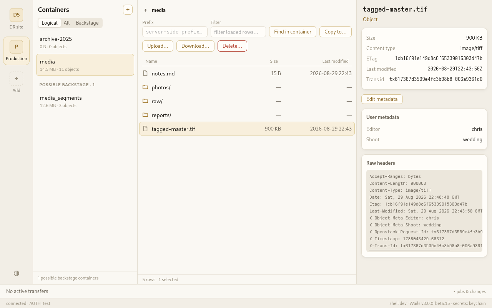
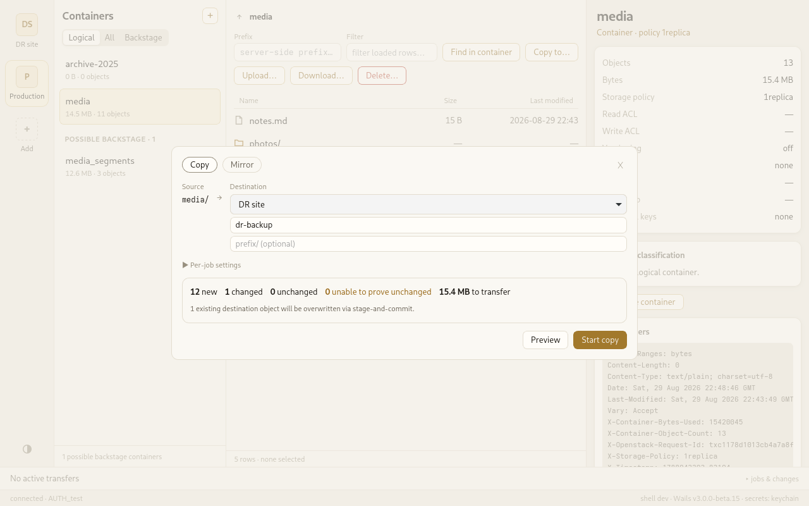
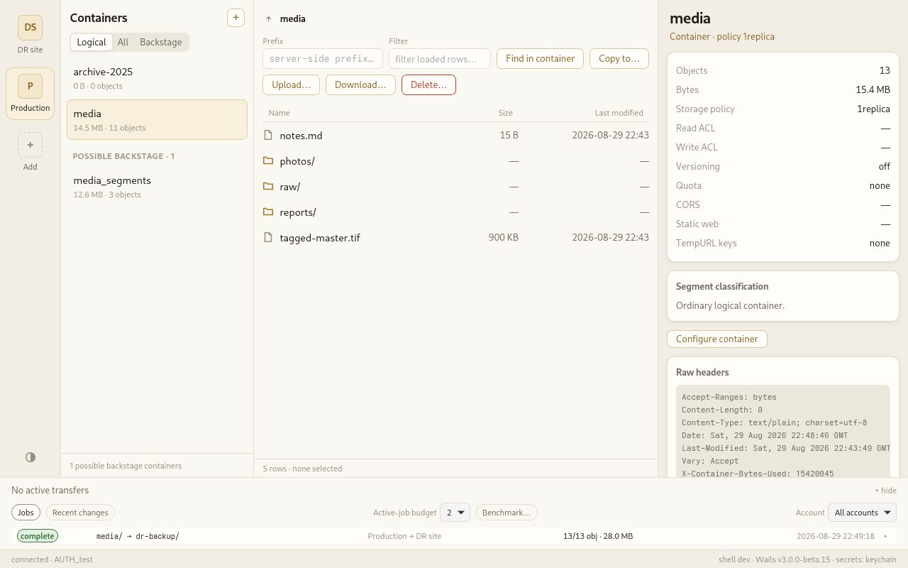
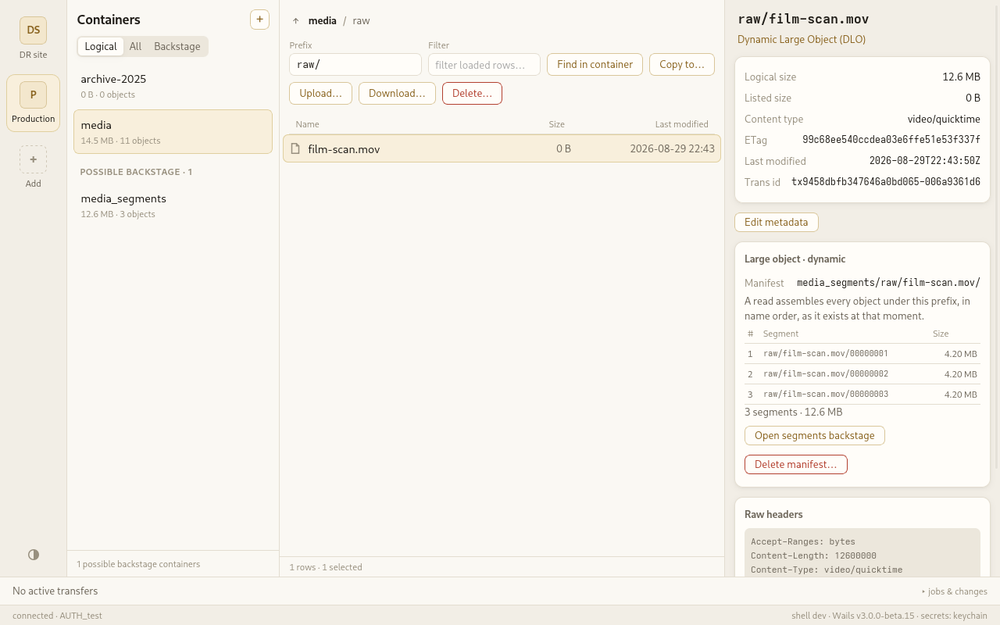

# Aeronautes — product and engineering design

**Status:** locked implementation design  
**Date:** 2026-08-28  
**Audience:** human maintainers + coding agents  
**Product:** Aeronautes (living swift genus; “air sailor”)  
**Binary / repo id:** `aeronautes`  
**App ID:** `io.csmart.aeronautes`  
**GitHub:** `csmart/aeronautes`  
**Primary target:** OpenStack Swift / SwiftStack operators  
**Primary platform:** Linux (reference/first-polish)  
**Required targets:** Linux, Windows, macOS — each on **x86_64 and aarch64** (six targets, all required; see §61.0)

> This document is the authoritative design for the project.
>
> If implementation experience requires a change to a locked decision, update this document (and, for architectural decisions, add an ADR) before changing the code.
>
> The images in `assets/` began as draft mockups (visual direction, not protocol specifications) and are now real captures of the built application. Where any image disagrees with this document, **this document wins**; §4.5 records the normative corrections the drafts needed. Do not copy labels, header names, field names, or default values from images without checking them against this document.

---

## 1. One-sentence product

**Aeronautes is a beautiful, performance-first desktop operator workbench for OpenStack Swift that makes Swift's control-plane semantics understandable and safe, while using rclone and native Swift features to execute bulk data operations as fast as the target cluster can safely handle.**

---

## 2. Product thesis

Generic transfer tools are already good at moving bytes.

What is missing is an operator UI that understands the things that make Swift operationally powerful, subtle, and occasionally dangerous:

- account, container, and object metadata;
- SwiftStack / TempAuth v1 authentication;
- container ACLs;
- storage policies;
- quotas;
- CORS;
- staticweb;
- TempURL keys;
- versioning;
- virtual folders as markers versus implied prefixes;
- DLO and SLO manifests;
- hidden/backstage segment storage;
- destructive namespace operations;
- cross-account and cross-cluster replication;
- the performance characteristics of very large Swift namespaces.

Aeronautes should not hide those semantics behind a generic file-manager metaphor.

It should **explain them, surface them, protect them, and make them pleasant to operate**.

### Product mantra

> **The inspector is the product. Transfers are a first-class superpower. Performance and beauty are features.**

---

## 3. Core product principles

### 3.1 Pretty is a feature

This is an operator tool people may stare at for hours.

It should feel crafted, calm, responsive, and desirable to use.

Do not accept generic admin-tool aesthetics merely because the software is technical.

### 3.2 Never hide Swift semantics

Aeronautes may translate raw headers into understandable concepts, but the underlying Swift model must remain visible.

An expert must always be able to answer:

- what Swift resource is this?
- which headers represent this state?
- is this a marker or only an implied prefix?
- is this a DLO or SLO?
- where are its segments?
- what exactly will be deleted?
- which engine will execute the operation?

### 3.3 Fastest safe path wins

The application owns:

- intent;
- semantic interpretation;
- safety;
- execution planning;
- verification;
- audit.

It does **not** require every operation to be executed by the same code path.

For a bulk operation, the planner may choose:

- native Swift API calls;
- Swift bulk-delete;
- Swift async/SLO-native operations;
- bounded parallel native requests;
- rclone copy — to planned-new or uniquely-staged destination names only (§28.6, §36);
- a future proven server-side fast path.

rclone never overwrites or deletes an existing object; every overwrite, deletion, and manifest
commit is Aeronautes-native (§28.6, §36).

Architectural purity must not force a materially slower implementation when an equally safe faster path exists.

### 3.4 Explain before deleting

Destructive actions should explain scope and consequences before execution.

For high-impact operations:

1. establish semantic scope;
2. classify risk;
3. preview or analyse where practical;
4. ask for appropriate confirmation;
5. execute using the fastest safe engine;
6. verify the resulting namespace;
7. report partial failures precisely.

### 3.5 Advanced, not intimidating

Aeronautes should work excellently on `Auto`.

Experts should also be able to tune:

- workers;
- checkers;
- transfer concurrency;
- API concurrency;
- listing page sizes;
- delete strategy;
- bulk-delete batching;
- buffers;
- memory budgets;
- rate limits;
- retries;
- large-object behaviour;
- compatibility workarounds.

Power belongs behind well-designed advanced controls, not behind an arbitrary free-form command-line textbox.

---

## 4. Visual direction



> Real capture of the built application against containerized Swift (draft mockups retired 2026-08-30; §4.5's corrections are now embodied in the product).

### 4.1 Visual system

The intended look is:

- warm cream / stone backgrounds;
- graphite / ink text;
- a restrained champagne / brass accent;
- subtle depth rather than heavy shadows;
- carefully rounded cards and controls;
- high-quality typography;
- dense information where operators need it;
- breathing room around major panes rather than excessive row height;
- extremely limited use of bright colour;
- colour reserved for state, danger, success, selection, and semantic badges;
- light and dark themes, both warm;
- animation around 120–160 ms for small transitions;
- no bounce or gimmicky motion.

Avoid:

- Horizon-style blue admin tables;
- Cyberduck utility chrome;
- Electron/VS Code visual language;
- generic purple gradients;
- stock shadcn appearance;
- cartoon mascots;
- excessive toolbar icons;
- giant whitespace that reduces scan speed.

### 4.2 Typography

Use:

- a highly legible modern UI face for dense object/container listings;
- a more characterful display treatment for headings and selected resource names;
- narrow mono for ETags, tokens, object paths, request IDs, and raw headers;
- tabular figures for sizes, rates, worker counts, timestamps, and progress.

Do **not** use a decorative display face for every row in a million-object browser.

### 4.3 Window/layout model

Wide layout:

```text
┌──────────┬────────────────┬──────────────────────────────┬─────────────────────┐
│ Bookmark │ Containers     │ Working list / prefixes      │ Inspector           │
│ rail     │                │                              │ always visible      │
│          │                │                              │                     │
├──────────┴────────────────┴──────────────────────────────┴─────────────────────┤
│ Transfer / jobs drawer                                                        │
└────────────────────────────────────────────────────────────────────────────────┘
```

Medium layout:

```text
rail | containers | working list | inspector ~320px
```

Narrow/laptop layout:

```text
rail | working list
              ↳ inspector slide-over
```

Panes should be resizable.

### 4.4 Keyboard model

Initial keyboard targets:

- `↑` / `↓` — move selection;
- `Enter` — open prefix/resource;
- `Backspace` or `Alt+↑` / `Cmd+↑` — parent prefix (offer the modifier form too; `Backspace` sitting next to a destructive `Delete` is a classic file-manager footgun);
- `/` — focus prefix field;
- `Cmd/Ctrl+K` — command palette;
- `Cmd/Ctrl+I` — focus/toggle inspector;
- `Delete` — open safe delete flow, never immediate deletion.

### 4.5 Mockup terminology corrections (normative)

This section originally corrected draft mockups whose pixels carried S3-flavoured errors. The
drafts are retired — `assets/screenshots/` holds real captures of the built application against
real Swift — but the corrections below remain normative as a record of the Swift-semantics
rules the UI embodies (several were the seeds of shipped behaviour).

| In the mockup | Correct for Aeronautes/Swift | Where |
|---|---|---|
| "Stacked Large Object", "STACKED OBJECT" | **Static Large Object (SLO)** | browser-inspector |
| `x-amz-meta-shoot`, `x-amz-meta-location`, `x-amz-meta-camera` | `X-Object-Meta-*` (Swift object metadata) | browser-inspector |
| Large-object `Redundancy EC:4+2` | Not a manifest field. Erasure coding is a **storage-policy** attribute shown on the container, not per object. Remove from the object inspector. | browser-inspector, transfer-planner |
| Large-object `Checksum CRC32C` | Swift segment integrity is the segment **ETag (MD5)**. There is no per-segment CRC32C. | browser-inspector, transfer-planner |
| `Multipart threshold`, `Upload/Download part size`, `Max in-flight parts` | A **single "large-object chunk size"** (rclone's `--swift-chunk-size` is both threshold and segment size — §25). Not two controls; Swift has segments, not "parts". | performance-settings |
| `Auto (64 MB)` large-object defaults | **5 GiB** default chunk size, capped at the cluster's `max_file_size` (§25). 64 MiB is explicitly forbidden as a production default (§64). | performance-settings |
| Clusters labelled "S3-compatible object stores" | Swift is **not** S3. Some clusters run an S3 middleware, but Aeronautes speaks the **native Swift API**; the S3 framing contradicts the product thesis. | architecture-overview |
| `Maximum active jobs 256` | The example ceiling is small (order of 4, §38.1). Do not imply hundreds of concurrent jobs. | performance-settings |

When these mockups are regenerated, use Swift-native vocabulary throughout: containers, objects, prefixes, segments, DLO/SLO manifests, storage policies, ACLs, `X-*-Meta-*` headers, ETags. Never `x-amz-*`, "multipart", "part", "bucket", or "S3-compatible".

---

## 5. Major screens

### 5.1 Browser + inspector

Primary shell:

- bookmark rail;
- container column;
- Logical / All / Backstage modes;
- breadcrumb;
- server prefix field;
- page-local filter;
- explicit **Find in container**;
- object/prefix working list;
- always-visible inspector;
- transfer/job drawer.

The inspector, not the file list, is the conceptual centre of the application.

### 5.2 Transfer planner



Cross-account/cross-cluster replication is a first-class workflow.

The transfer planner must make source, destination, mode, large-object policy, predicted impact, performance profile, and destructive consequences obvious.

### 5.3 Performance settings



Performance settings are a deliberate product surface, not a hidden debug panel.

Normal users should succeed with `Auto`.

Experienced operators must be able to control the machine and endpoint budgets precisely.

### 5.4 Architecture overview



This image is a visual summary only. The normative architecture is specified below.

---

## 6. Technology decision

### 6.1 Locked stack

| Layer | Choice | Notes |
|---|---|---|
| UI | Svelte 5 + TypeScript | Custom design system |
| Desktop shell | Wails v3 (beta) | Go-native desktop shell; GTK4/WebKitGTK 6 on Linux; chosen greenfield to avoid a later v2→v3 rewrite (§6.6) |
| App core | Go | Orchestration, jobs, scheduling, semantics, persistence |
| Swift wire foundation | `github.com/ncw/swift/v2` | Reuse mature Go Swift implementation |
| Swift semantic layer | Aeronautes-owned Go packages | The product's real domain logic |
| Bulk movement | pinned rclone subprocess | One process per logical transfer job initially |
| Local state | SQLite | Durable non-secret state |
| Secrets | OS keychain | Session-only fallback if keychain unavailable |
| Frontend/backend bridge | Wails bindings | Typed application services; no generic shell API |

### 6.2 Why Go

Go fits this project unusually well:

- Aeronautes is overwhelmingly network/I/O bound;
- goroutines/channels/context cancellation suit high-concurrency Swift operations;
- `ncw/swift/v2` already implements a large fraction of the required Swift wire behaviour;
- rclone is itself Go and uses the same Swift ecosystem;
- Wails preserves the desired Svelte/native-webview UI model;
- packaging remains a native desktop application rather than a Python runtime bundle.

### 6.3 Why not Python

Python remains an excellent reference implementation ecosystem because `python-swiftclient` is mature and canonical.

It should be used as:

- behavioural reference;
- fixture generator;
- integration-test oracle where useful.

It should **not** be the application runtime.

Reasons:

- poorer desktop packaging story for this architecture;
- runtime/dependency distribution overhead;
- unnecessary process boundary if combined with Svelte/Wails;
- PySide would compromise the chosen custom web-UI direction.

### 6.4 Do not port python-swiftclient

This is a hard rule.

Aeronautes is not a project to rewrite `python-swiftclient` in Go or Rust.

Do not seek:

- API compatibility;
- CLI compatibility;
- SwiftService parity;
- line-for-line porting;
- full test parity.

The normative hierarchy is:

1. OpenStack Swift protocol/API behaviour;
2. proven target-cluster behaviour;
3. `python-swiftclient` as behavioural reference;
4. `ncw/swift/v2` as low-level Go implementation;
5. Aeronautes' own semantic layer.

### 6.5 Do not fork `ncw/swift/v2` pre-emptively

Wrap it.

If a missing capability is needed:

1. use its lower-level request facility where appropriate;
2. add a narrow Aeronautes adapter;
3. consider an upstream contribution;
4. fork only if there is a concrete, sustained reason.

### 6.6 Webview reality (affects the "beautiful" pillar)

Wails renders in the host's **system webview**: WebKitGTK on Linux, WebView2 on Windows, WKWebView on macOS. The product's first pillar is *beauty*, and the Tier-1 platform is Linux, so the design depends on how WebKitGTK actually renders — where font rendering, compositing, and some CSS features diverge from a development Chromium, and where certain GPU/driver combinations have known glitches. This is a real risk to the core pillar, not a detail.

Mitigations:

- prove the design system under WebKitGTK early (Phase 0 gate, §60);
- keep the visual system within features that render consistently across all three webviews;
- choose fonts with robust fallbacks;
- avoid effects that only look right in Chromium.

**Shell version: Wails v3 (beta), chosen deliberately.** Because this is itself a greenfield beta app with a multi-month build horizon, we start on **Wails v3** rather than v2: it avoids a v2→v3 rewrite later, and on Linux it uses GTK4 / WebKitGTK 6 — a much better base for the Linux-first "beautiful" goal than v2's older WebKitGTK. The cost is that v3's API is still stabilising, so: pin a specific v3 version and upgrade deliberately; keep the Go↔frontend bridge decoupled (typed services, §55) so falling back to v2 stays cheap if v3 blocks. The Phase-0 spike (§60) *validates v3* on the named Tier-1 Linux baseline and is the trigger for the v2 fallback. Recorded in ADR `0010-webview-wails-v3`.

**Tier-1 Linux baseline (named — this resolves K-PLAT-002).** Aeronautes targets **modern distributions only**:

- **Fedora Workstation, current stable release** — first-class: the primary development and first-polish platform (at design lock: Fedora 44);
- **Ubuntu, current LTS** — native Tier-1 (at design lock: Ubuntu 26.04 LTS; Ubuntu 24.04 LTS, which also ships WebKitGTK 6.0, is a compatibility-test target);
- **EL9 and other GTK3-era distributions: no native support.** EL9 ships only the GTK3-era WebKit (the webkit2gtk-4.1 API), and Red Hat has deprecated WebKitGTK in RHEL 9, so Wails v3 cannot run there natively. The EL-family answer is **Flatpak** (the runtime bundles WebKitGTK 6.0), gated as before on proving keychain + rclone-sidecar + portal behaviour (§61.1). EL8 is unsupported.
- **"Static binary that runs on any Linux" was considered and rejected**: Wails renders in the system webview through CGO, and WebKitGTK cannot sensibly be statically linked or bundled outside a runtime, so a run-anywhere static binary would mean abandoning the chosen shell. Modern-distros-native plus Flatpak-for-the-rest is the policy.

---

## 7. Repository layout

Recommended monorepo:

```text
/
├── AGENTS.md
├── README.md
├── LICENSE
├── go.mod
├── main.go                     # the only file touching the webview/CGO layer
├── Taskfile.yml                # wails3 build orchestration (v3 has no wails.json)
│
├── build/                      # build *inputs*: config.yml, icons, per-OS packaging
│
├── frontend/
│   ├── src/
│   │   ├── components/
│   │   ├── features/
│   │   │   ├── bookmarks/
│   │   │   ├── browser/
│   │   │   ├── inspector/
│   │   │   ├── transfer/
│   │   │   ├── jobs/
│   │   │   ├── settings/
│   │   │   └── diagnostics/
│   │   ├── design/
│   │   │   ├── tokens.ts
│   │   │   ├── typography.css
│   │   │   └── motion.css
│   │   └── lib/
│   └── ...
│
├── internal/
│   ├── app/
│   ├── bookmarks/
│   ├── capabilities/
│   ├── swiftcontrol/
│   │   ├── listing/
│   │   ├── metadata/
│   │   ├── acl/
│   │   ├── versioning/
│   │   ├── largeobjects/
│   │   └── deletion/
│   ├── transfer/
│   │   ├── rclone/
│   │   ├── planner/
│   │   └── scheduler/
│   ├── jobs/
│   ├── performance/
│   ├── secrets/
│   ├── audit/
│   ├── db/
│   └── diagnostics/
│
├── docs/
│   ├── DESIGN.md               # this document (authoritative)
│   ├── REQUIREMENTS.md         # normative K-* IDs (phase gates)
│   ├── assets/
│   │   ├── screenshots/
│   │   └── draft/              # stale S3-flavoured mockups — do not copy
│   │       ├── browser-inspector.png
│   │       ├── transfer-planner.png
│   │       ├── performance-settings.png
│   │       └── architecture-overview.png
│   ├── swift-semantics.md
│   ├── performance.md
│   ├── rclone.md
│   ├── security.md
│   ├── ux.md
│   └── adr/
│       ├── 0001-go-wails.md
│       ├── 0002-swift-semantic-layer.md
│       ├── 0003-rclone-subprocess-boundary.md
│       ├── 0004-delete-strategy-engine.md
│       ├── 0005-large-object-safety.md
│       ├── 0006-secret-storage-linux.md
│       ├── 0007-rclone-flag-surface.md
│       ├── 0008-copy-data-path.md
│       ├── 0009-token-refresh.md
│       └── 0010-webview-wails-v3.md
│
├── test-fixtures/
└── scripts/
```

The tree above is the target shape. At design lock, `docs/swift-semantics.md`, `performance.md`,
`rclone.md`, `security.md`, and `ux.md` do **not** exist yet — each is created by the phase that
needs it (e.g. `rclone.md` before Phase 5, §44.1). ADRs `0001–0005` record decisions already made
in this document; `0006–0010` exist as **Proposed** stubs naming their open question and the phase
that must resolve it. A referenced-but-missing satellite document is not an error; this document is
authoritative until the satellite exists.

---

## 8. Architectural split

### 8.1 Governing rule

> **Aeronautes owns semantics, intent, safety, scheduling and verification.  
> Execution uses the fastest safe engine.**

```text
Svelte UI
   │
   │ typed Wails bindings
   ▼
Go application core
   │
   ├── swiftcontrol
   │     ├── listings
   │     ├── metadata / ACL / configuration
   │     ├── DLO / SLO interpretation
   │     ├── segment classification
   │     └── destructive operation planning
   │
   ├── jobs / scheduler
   │
   ├── transfer planner
   │     └── rclone subprocesses
   │
   ├── performance profiler
   │
   ├── SQLite
   └── SecretStore
```

### 8.2 Control plane versus execution

The old simplistic boundary:

> "rclone moves bytes; Swift code deletes"

is **not** the final design.

The final design is:

> **The control plane decides what may happen and verifies what happened.  
> The execution engine may be Swift-native or rclone.**

This allows Aeronautes to be both safe and extremely fast.

---

## 9. Swift protocol foundation

Use `github.com/ncw/swift/v2` underneath an Aeronautes-owned semantic layer.

The frontend must never call the low-level client directly.

**Shared wire library, duplicated behaviour — know which is which.** rclone's own Swift backend is also built on `github.com/ncw/swift/v2`. That is a deliberate advantage: object-name encoding, URL construction, and v1 auth are the *same implementation* on both the native path and the rclone path, so they are unlikely to disagree at the wire level. However, the layers **above** the wire library — listing strategy, pagination tuning, retry/backoff policy, adaptive concurrency, and provider-compatibility workarounds — are implemented and configured **twice** (once in Aeronautes' semantic layer, once inside rclone). Aeronautes can only influence rclone's copies of these through the curated flag surface it chooses to set at spawn time (§26, §44). Two consequences follow: (1) a provider quirk may need solving in both places; (2) Aeronautes' adaptive concurrency and endpoint budgets (§38, §41) apply directly to the native client but only *approximately* to a running rclone subprocess, which manages its own worker pools. Design the scheduler with this asymmetry explicit rather than pretending one controller governs both.

### 9.1 Aeronautes semantic service responsibilities

`internal/swiftcontrol` owns:

- auth/session abstraction;
- capability discovery;
- typed listings;
- header categorisation;
- resource snapshots;
- safe metadata mutation;
- ACL model;
- versioning model;
- storage-policy display/create semantics;
- DLO/SLO interpretation;
- segment evidence;
- destructive-operation planning;
- normalized errors;
- request IDs and diagnostics.

### 9.2 Initial auth

v1 first:

```http
GET {auth_url}
X-Auth-User: account:user
X-Auth-Key: secret
```

Use returned token + storage URL.

On 401:

1. invalidate session token;
2. authenticate once;
3. replay once;
4. then fail.

Keystone v2/v3 is not a v1 UI goal even if the underlying library supports it.

**Pin the auth target to a real cluster.** "SwiftStack" as a commercial product was discontinued after Nvidia's 2020 acquisition; "SwiftStack-compatible" here means the legacy/OpenStack Swift lineage those deployments run, and "SwiftStack v1 auth" is TempAuth-v1-style auth. Because there is no shipping SwiftStack release to certify against, the concrete auth flow, `/info` behaviour, and versioning model (§21) must be pinned to the **actual cluster the user operates**, and the "SwiftStack release gate" in §57.4 means "a representative instance of that real deployment", not a vendor product.

**Auth variants still live inside "v1".** Even TempAuth-v1 has sharp edges to handle explicitly: `account:user` identities (not email addresses), reseller/admin identities, a returned storage URL that differs from any `storage_url_override`, and http/https or hostname mismatches between the auth response and the configured endpoint (a classic SwiftStack footgun). Treat these as first-class bookmark/auth cases, not surprises.

---

## 10. Capability discovery

`GET /info` is foundational.

It is not an optional later enhancement.

A bookmark maintains:

```text
Capabilities
  source: Advertised | Unknown
  fetched_at

  bulk_delete
  slo
  tempurl
  staticweb
  versioned_writes
  container_quotas
  storage_policies[]
  ...
```

The UI must distinguish:

- **unsupported/absent**;
- **unknown because `/info` is disabled/unavailable**.

Capabilities should drive the inspector and available operations.

Examples:

- only show a storage policy chooser when multiple usable policies exist;
- gate bulk-delete strategies;
- gate TempURL features;
- gate SLO-native operations;
- expose capability status in Diagnostics.

**When `/info` is unavailable.** `GET /info` is served at the cluster root, not under `/v1/AUTH_account`, and **may be disabled, filtered, unavailable, or unreachable through provider-specific endpoint layouts**; a bookmark may only have a storage URL + token and no authorised path to `/info`. Aeronautes derives the info endpoint from the storage URL (strip the account path) as a best effort, and when it cannot read `/info` it enters an **Unknown-capabilities** mode: features are not hard-disabled purely because `/info` is missing, but are offered with a clearly labelled "capability unknown" state and validated by attempting the operation and handling the result, rather than pretending the feature is absent. The degraded experience with no `/info` must remain usable for the core browse/inspect/mutate flows; do not gate so much on `/info` that a tenant without it cannot operate.

Model capability provenance explicitly rather than a bare Advertised/Unknown split:

```text
CapabilityState   { Supported, Unsupported, Unknown }
CapabilitySource  { Advertised, Observed, SafelyProbed, OperatorDeclared }
```

`SafelyProbed` may only use **non-destructive** probes, or destructive-capability probes (e.g. bulk-delete) confined to an Aeronautes-owned test/benchmark container — never against real user data.

---

## 11. Bookmark model

```text
Bookmark
  id
  display_name

  protocol_profile
    SwiftStackV1

  auth_url
  username
  storage_url_override?

  secret_ref

  tls
    System
    CustomCa(ca_id)
    Insecure

  performance_profile
    Inherit
    Auto
    Balanced
    Aggressive
    Custom

  upload_policy
    segment_placement          # rclone honours container-vs-sidecar,
      RcloneDefault            # not an arbitrary per-upload prefix (§26.4)
      Sidecar                  # <container>_segments
      InContainer              # segments in-container under a prefix

    chunk_size
      Default                  # 5 GiB, capped at the cluster max_file_size (§25)
      Custom

  ui_preferences
```

Secret values never live in this structure.

---

## 12. Secrets and TLS

### 12.1 SecretStore abstraction

```go
type SecretStore interface {
    Get(...)
    Put(...)
    Delete(...)
}
```

Preferred implementation:

- the operating-system secret store, per OS: **Secret Service** (libsecret) on Linux, **Keychain** on macOS, **Credential Manager / DPAPI** on Windows. (Architecture makes no difference here; the OS does.)

If unavailable:

- offer **session-only** credentials;
- do not silently store plaintext in SQLite;
- offer an explicit, opt-in, passphrase-encrypted local vault (see below).

**Linux reality (the Tier-1 platform).** "OS keychain" on Linux means the Secret Service API (libsecret / gnome-keyring / kwallet) over D-Bus. On minimal window managers (e.g. sway), headless or SSH-only operator hosts, and inside a Flatpak sandbox, Secret Service is frequently absent or locked. Because Linux is the priority platform, the keychain-absent path is a **common** case, not an edge case, and "retype every credential on each launch" is an unacceptable default for a tool holding many bookmarks. Therefore v1 provides, in priority order:

1. OS Secret Service when present and unlocked;
2. an explicit, opt-in, **passphrase-encrypted local vault** built on an *established, reviewed* Go keyring / encrypted-file implementation or format — **do not invent an Aeronautes-specific crypto construction**. Required properties: authenticated encryption; a memory-hard password KDF; atomic writes; strict filesystem permissions; a versioned on-disk format; a password-change / migration path; no plaintext secrets in SQLite; no custom cryptographic primitives. Unlocked once per session; never silent; always clearly labelled; never the default when a real keychain exists. The implementation is chosen in ADR `0006-secret-storage-linux`;
3. session-only credentials as the last resort.

The earlier "no home-grown vault in v1" rule is replaced by "no *silent* or *ad-hoc* vault": the encrypted-vault option is a deliberate, documented, opt-in feature, not an invisible fallback. **This reverses a previously locked decision; it needs ADR `0006-secret-storage-linux`.**

### 12.2 Custom CA

Prefer importing/copying a selected CA into application-private storage and recording its fingerprint.

Do not rely indefinitely on a user's arbitrary filesystem path.

### 12.3 Insecure TLS

Must be:

- explicit;
- visually identified;
- bookmark-specific;
- never enabled by default.

When a Swift→Swift child holds two remotes, TLS policy MUST be applied **per-remote**, never as
a process-global flag — a global `--no-check-certificate` or `--ca-cert` would weaken or alter
trust for the *other* bookmark too. **Seam-spike verdict (rclone v1.74.3, self-signed TLS front
on containerized Swift, 2026-08-29):** `override.no_check_certificate` / `override.ca_cert` are
honoured **only in a config file** — the env-variable forms
(`RCLONE_CONFIG_<R>_OVERRIDE_*`) are silently ignored — and, worse, the override's trust
**leaks across remotes within one child**: with `override.ca_cert` on the source only, the
strict-TLS destination accepted the self-signed certificate too (order-dependent; the
no-override control failed as expected). So `override.*` is NOT per-remote isolation in
practice.

[ADR 0014](adr/0014-child-storage-gateway.md) replaces the child TLS configuration with a parent-owned transport per fixed upstream.
The child receives literal loopback HTTP endpoints and no TLS overrides; the parent applies the captured system/custom-CA/insecure policy to each remote.
Endpoints with **identical TLS trust** may share one child.
The existing rule for **different TLS trust** remains: use two single-remote children or reject the pairing until a separate reviewed compatibility change permits it.
Never broaden trust process-wide. (K-SEC-008.)

---

## 13. Resource model

```text
ResourceRef
  Account
  Container(name)
  Object(container, name)
  Prefix(container, prefix)
```

### 13.1 Resource snapshot

```text
ResourceSnapshot
  resource
  fetched_at

  last_modified?
  etag?

  derived
  editable_system
  user_meta
  raw_headers

  editable_fingerprint
```

Do not call ETag alone a concurrency token.

Aeronautes' stale-write protection is **best-effort conflict detection**, not a transactional guarantee.

---

## 14. Listing model

Delimiter listings are typed:

```go
type ListingEntry interface { ... }

type ObjectEntry struct { ... }
type PrefixEntry struct { ... }
```

Do not flatten both into a fake filesystem inode model.

### 14.1 Folder/prefix model

```text
PrefixId { container, prefix }
```

`prefix` includes trailing `/` while inside a virtual folder.

A prefix may be:

- marker-backed;
- implied by children only.

Marker convention created by Aeronautes:

```text
name: {prefix}{leaf}/
body: 0 bytes
Content-Type: application/directory
```

**What a delimiter listing can and cannot say (verified against real Swift, §57.3):** the server
folds *every* name below a child prefix into one subdir row — including an object named exactly at
the boundary, whether it is a marker or a real object wearing a folder suit. So a delimiter
listing alone cannot distinguish marker-backed from implied, and a folder-ish real object is
invisible at its own level. The answer is a **selection-triggered `PrefixDetail`** (one HEAD of the
exact prefix name, §14.2): it reports marker-backed vs implied and surfaces any real self-object.
Inside a slash-terminated virtual folder, the object at the folder's own name is not shown as a child row (it belongs to that folder's detail).
A plain object exactly matching an unslashed filter remains visible; Deep listings report every real object verbatim for jobs.

UI:

- distinguish marker-backed versus implied in the inspector (from `PrefixDetail`, not from
  listing rows, which cannot know);
- both remain valid navigable prefixes;
- when a prefix's self-object is a *real* object rather than a marker, say so explicitly — data
  is hiding behind a folder row.

### 14.2 Do not HEAD every row

Listing is cheap classification.

Selection triggers authoritative HEAD/inspection — `PrefixDetail` for prefixes, the object HEAD
for objects.

This is a hard performance rule.

### 14.3 Object-name encoding tests

Test names including:

```text
a b
a+b
a%b
a?b
a#b
日本語
foo//bar
/foo
foo/
foo%2Fbar
```

Never trust generic filesystem/path helpers to preserve Swift object identity automatically.

Run this encoding suite against **both** execution paths — Aeronautes' native client *and* the rclone transfer path. Careful encoding in Aeronautes' own client does not protect names that flow through rclone; a "logical" copy of a namespace containing `foo//bar`, a leading `/foo`, or an object literally named `foo/` must be shown to round-trip through the transfer engine, not only through native listing. Extend the set with a newline inside a name, `.` and `..` path segments, and names that are only spaces.

**This is a go/no-go gate with a required native fallback, not just an observation.** The seam
spike ran this suite through the pinned rclone (v1.74.3, Swift→Swift cross-account,
2026-08-29) and the measured classification is:

- **rclone-unsafe identities** (silently dropped by `copy` — "Entry doesn't belong in
  directory … ignoring"): a **leading `/`**, a **trailing `/`**, and a **repeated `//`**
  component (rclone [#5673](https://github.com/rclone/rclone/issues/5673)). These MUST route
  through the native byte-preserving path, as must dot-segment names (next bullet).
- **Un-listable identity**: a **newline** inside a name cannot be expressed in any rclone file
  list — `--files-from0` **does not exist** in 1.74.3; `--files-from-raw` is the unprocessed
  variant but is still newline-delimited. Newline-bearing names route native regardless of copy
  support.
- **Dot-segment identities are unsafe both ways** (measured again 2026-08-29 during executor
  integration, superseding this section's earlier "survived" note — that spike run measured the
  traversal path and mistook a renamed arrival for survival): a `.` or `..` **path segment**
  (`a/./b`, `a/../b`) is **silently skipped** by `--files-from-raw` (exit 0) and, on a
  traversal copy, **silently renamed** — rclone substitutes fullwidth dots (U+FF0E:
  `a/．/b`) — which is an identity mutation, not a round-trip. Both route native. Dots inside
  a segment (`a. b.`, `v1.2/x`) are safe.
- **rclone-safe on 1.74.3** (round-tripped byte-exact): spaces (leading, trailing,
  all-spaces — via `--files-from-raw`, which does not trim), `+`, `%`, `?`, `#`, `%2F`, and
  Unicode. This classification is pin-specific: re-run the suite on any rclone upgrade.
- **The worst finding**: rclone dropped the three unsafe identities and still **exited 0**.
  Exit codes are useless for completeness; per-object verification of the planned set against
  destination listings (§28.4) is mandatory, not prudent.

Any identity rclone cannot preserve is routed through the native path.
Aeronautes must **never silently skip or normalize** an object name.
K-TEST-001 requires the end-to-end native and forced-copy suite to pass with native fallback where needed.
Mirror currently has refusal coverage only; the same encoding suite must pass before P14 can re-enable execution.

---

## 15. Listing performance

High-volume namespace operations are streaming pipelines.

Never:

```text
list 10 million objects
store 10 million objects
then act
```

Prefer:

```text
LIST page
   │
   ├── render / inspect / enqueue
   ▼
LIST next page
```

### 15.1 Page size

Default mode: `Auto`.

For compatible Swift deployments, start by trying a high page size (up to 10,000) and adapt/fallback if provider behaviour requires it.

The complete native response and continuation contract is recorded in [ADR 0021](adr/0021-complete-listing-pages.md) for the P22 implementation.
A short nonempty page continues to another marker request; only a complete empty array establishes exhaustion under that provider-compatible contract.

This is intentionally independent of rclone's own listing implementation.

Aeronautes should outperform generic tooling where Swift-specific optimisation allows it.

### 15.2 Comparison at scale is a streaming merge-join

Swift listings are returned **sorted by object name** and paginated by `marker`. Comparing two
namespaces (Copy/Mirror preview and planning, §28.4) is therefore a **bounded-memory streaming
merge-join** of two paginated listing streams — never "load both sides into a map" (the first thing
a naive implementation reaches for, and a violation of K-PERF-001 at exactly the scale where
Mirror matters).

Rules:

- advance two paged iterators in lock-step, comparing on **raw name bytes** (Swift orders by name;
  never compare with locale-aware collation);
- emit New / Changed / Unchanged / Destination-only verdicts as the join advances, so preview
  counts and the forced transfer set stream out with bounded memory;
- neither side is a snapshot: both namespaces can mutate while the join runs (§15.3); the result
  is advisory, and execution-time behaviour must stay safe regardless (§28.6).

### 15.3 Consistency model

Swift is eventually consistent, and the design says so once rather than rediscovering it per
feature: **container listings can lag object PUT/DELETE** (container-DB updates are asynchronous
under load), while **HEAD/GET of a named object is authoritative**.

Consequences, wired through the rest of this document:

- listing-based verification (§32) uses **bounded retries** before concluding anything;
- stage-and-commit verification (§28.6 step 5) MUST confirm **segment-listing completeness**
  (expected segment count/bytes) before declaring success — a freshly-committed DLO read through a
  stale listing can assemble a **short object**;
- Copy/Mirror preflight comparisons (§15.2, §28.4) are advisory, not snapshots;
- crash reconciliation (§26.4) may not yet see just-written segments; treat "not listed" as "not
  proven absent";
- a DLO's reads depend on listing consistency **forever**, which is part of why the planner must
  disclose that a replicated SLO becomes a DLO at the destination (§28.6).

(K-CON-001.)

---

## 16. Filtering/search

Three distinct operations:

### Prefix

Server-side Swift `prefix=`.

Primary navigation/filtering mechanism.

### Page filter

Substring/client-side filter over currently loaded rows only.

Must be labelled clearly as local/current-page scope.

### Find in container

Explicit cancellable job:

- page through the namespace;
- stream matching results;
- do not run on every keystroke;
- bounded memory;
- expose scanned count and throughput.

---

## 17. Metadata mutation

Object metadata is one of Aeronautes' signature correctness features.

### 17.1 Object user metadata

Object POST semantics can replace the custom metadata set.

Therefore:

1. load snapshot;
2. user edits working copy;
3. preflight HEAD;
4. detect meaningful changes since original snapshot;
5. if changed, show conflict/reload flow;
6. assemble the **complete remaining object user-metadata set**;
7. replay the mandatory preserved-header set (enumerated below);
8. show diff;
9. POST;
10. HEAD again;
11. verify resulting state.

**Preserved-header replay set (normative).** Swift object POST leaves a header untouched when it is omitted, so the planner replays exactly:

| Header | Metadata-edit POST | Copy (§27.4) |
|---|---|---|
| `X-Object-Manifest` (DLO) | **always replay when present** (omitting it turns a DLO into a plain object) | destination keeps its **own** generated manifest, never the source's |
| `X-Symlink-Target` / `X-Symlink-Target-Account` | replay when present | carry when present |
| `X-Object-Meta-*` | full remaining user-meta set (replace-all) | carry the source set |
| `Content-Type` / `Content-Encoding` / `Content-Disposition` | **do not re-send** unless the user edited it (Swift leaves it untouched) | carry from source |
| `X-Delete-At` (absolute) / `X-Delete-After` (relative) | do not re-send unless edited; store/display as absolute | carry as absolute |

Object CORS headers do **not** exist — CORS is container-level, so never invent object CORS headers. Never replay read-only/system response headers, or (on Copy) the source's SLO/DLO control headers. Cover this exact matrix in the §57.2 mock-HTTP fixtures.

### 17.2 Container/account metadata

Use per-key set/remove semantics where Swift supports it.

### 17.3 DLO preservation

Metadata changes to a DLO must not accidentally destroy manifest semantics.

The mutation planner, not ad-hoc UI code, owns the required preserved-header set.

### 17.4 Diff UI

Significant mutations should show:

```text
Before                   After

X-Object-Meta-Owner      X-Object-Meta-Owner
alice                    bob

X-Object-Meta-Project    X-Object-Meta-Project
kept                     kept
```

Diff is semantic first; raw header view remains available.

---

## 18. Best-effort stale-write protection

Flow:

```text
Inspector HEAD
    ↓
user edits
    ↓
save requested
    ↓
preflight HEAD
    ↓
compare editable fields / Last-Modified / fingerprints
    ├── changed → conflict UI
    └── unchanged → POST
                      ↓
                   verify HEAD
```

Aeronautes must not imply this is an atomic compare-and-swap guarantee.

---

## 19. ACL model

v1 UI targets SwiftStack/Auth-v1 semantics first.

Use:

```text
AclDialect
  SwiftStackV1
  GenericRaw
```

Structured editor should understand useful SwiftStack-style principals and public read/listing semantics, while always showing the exact generated header value.

### 19.1 Presets

Useful presets may include:

- Private;
- Public read;
- Public list + read;
- explicit authenticated principal(s).

Dangerous public settings require clear confirmation.

### 19.2 Raw escape hatch

Always available to experts.

Structured mode and raw mode must round-trip without silently changing semantics.

---

## 20. Storage policies

Container storage policy is chosen at creation time and treated as read-only thereafter.

Container creation:

- one/default policy → don't clutter UI unnecessarily;
- multiple advertised policies → selector;
- unknown capabilities → use server default unless expert override is explicitly supported later.

Existing container inspector:

- display storage policy;
- no fake edit affordance.

---

## 21. Versioning

Initial UI supports the versioning model relevant to the target SwiftStack environment.

Represent it as a typed capability/profile, not as assumptions scattered through UI code.

UI should explain behaviour rather than simply exposing header names.

Potential options:

- Off;
- Versions Location;
- History Location.

Archive-container references must be validated as far as practical.

Large-object/versioning caveats should be shown when relevant.

**Pinned (owner decision, 2026-08-29).** The target environment is **upstream OpenStack Swift
master**, whose `/info` advertises `versioned_writes` (both `x-versions-location` and
`x-history-location` in `allowed_flags`) *and* the modern `object_versioning` middleware — no
proxy-node inspection needed; `/info` is authoritative and is what capability discovery (§10)
already fetches per bookmark. The owner confirmed the same middlewares on the production
cluster's `/info` (2026-08-29), so the pin matches the real deployment, not only the SAIO. The v1 pin:

- **Behavioural model: container-based `versioned_writes`** (`X-Versions-Location` /
  `X-History-Location`), resolved per bookmark from `/info` `allowed_flags` as a typed profile.
  This is what the container inspector already displays and what Phase 3's capability-gated
  container configuration edits.
- **`object_versioning` (`X-Versions-Enabled`) is detected and displayed** (its `/info` key and
  the container header) but its full UX — version listings, restore — is deferred until a real
  workflow requires it. Do not build it speculatively.

The older paragraph's warning stands: these are different models with different UX; add depth
only when a real cluster requires it.

---

## 22. TempURL

v1 priorities:

- show whether key slots are present;
- replace/rotate;
- clear;
- redact values;
- never log secret material.

Never expose existing secret values casually.

TempURL URL/signature generation may be a follow-up feature; key management belongs in the inspector.

---

## 23. Large-object model

**DLO** (Dynamic Large Object) and **SLO** (Static Large Object) are distinct domain objects.

Do not reduce both to a generic `SegmentHome`.

```go
type LargeObject interface { ... }

type DLOManifest struct {
    SegmentContainer string
    SegmentPrefix    string
}

type SLOManifest struct {
    // ONE ordered list preserves the original position of every entry,
    // including unknown/future entries interleaved between recognised ones.
    Entries []SLOEntry
}

// Tagged union. Each variant keeps RawFields so unknown fields on an
// otherwise-recognised entry survive an exact round-trip.
type SLOEntry interface{ isSLOEntry() }

type ObjectSegment struct {
    Path      ObjectRef
    ETag      *string
    Size      uint64
    Range     *ByteRange       // ranged entries contribute `etag:range;` to the ETag input
    NestedSLO bool
    RawFields map[string]any
}

type InlineDataSegment struct {
    Data      []byte           // decoded base64; contributes MD5(decoded bytes) to the ETag input
    RawFields map[string]any
}

type RawEntry struct {          // unrecognised/future entry, retained verbatim in place
    Fields map[string]any
}
```

### 23.1 DLO

DLO has a segment container + prefix.

Inspector shows:

- manifest header;
- logical object size where known;
- segment location;
- segment listing;
- backstage navigation.

### 23.2 SLO

SLO owns an authoritative exact manifest.

Inspector shows:

- exact segment paths;
- sizes;
- hashes;
- ranges;
- nested-SLO state where relevant;
- derived grouping by container/prefix only as presentation.

Never replace the exact segment list with a lossy grouping.

Inline `data` segments are part of the exact manifest: include them in display and in equality/ETag logic, and never drop one or invent a path for it. If the pinned target cluster cannot create inline segments, model that as a tested capability — but still parse and display an externally-encountered manifest that contains them. The SLO ETag input is **not** simply the MD5 of concatenated segment ETags: a ranged entry contributes `etag:range;` and an inline entry contributes the MD5 of its decoded bytes. Compute equality and ETag by Swift's documented rules, and preserve unknown entries in their **original order** (the single ordered `SLOManifest.Entries` above).

---

## 24. Segment evidence and backstage classification

```text
SegmentEvidence
  location

  confidence
    Confirmed
    Declared
    Suspected

  reason
    ObservedDLO
    ObservedSLO
    AppUpload
    UserPin
    NamingHeuristic

  source_object?
  first_seen
  last_seen
```

### 24.1 Confirmed

Examples:

- observed directly from a manifest;
- created by an Aeronautes-controlled upload with recorded ownership.

**`Confirmed` proves a segment is *referenced*, not that it is *unshared*.**
Automatic segment deletion needs the separate `ExclusiveOwnershipProof` defined in §28.6(b), including exclusion of other references and relevant concurrent writers through deletion.
A unique Aeronautes-recorded prefix proves creation only; neither that record nor `Confirmed` supplies this authority (ADR 0020).

### 24.2 Declared

Explicit operator pin/mark.

### 24.3 Suspected

Naming heuristics only:

- `*_segments`;
- `.segments`;
- `segments`;
- known in-container segment-looking prefixes.

### 24.4 Critical safety rule

> **A heuristic alone may never authorize a destructive segment operation.**

### 24.5 Logical view

Hide:

- Confirmed;
- Declared.

Do not truly hide Suspected.

Show them in a subdued section such as:

> Possible backstage · 2

with an operator action to classify them.

### 24.6 Backstage view

Backstage mode explicitly reveals:

- segment containers;
- in-container segment prefixes;
- raw marker/segment objects;
- more dangerous operations.

It should visually feel like entering an advanced operational context.

---

## 25. Large-object upload policy

Default production chunk size:

> **5 GiB** — matching Swift's canonical large-object segment size and rclone's own `--swift-chunk-size` default, capped at the cluster's advertised `max_file_size`.

Notes:

- **One control, not two.** rclone's Swift backend has a single `--swift-chunk-size` that governs *both* the threshold at which an object becomes segmented *and* the size of each uploaded segment. Until Aeronautes ships its own uploader, do not present independent "threshold" and "segment size" settings the engine cannot honour — expose a single "large-object chunk size".
- **5 GiB is safe against standard Swift.** Swift's default `max_file_size` is `5368709122` bytes — 2 bytes *above* 5 GiB — so a 5 GiB object/segment is under the limit and does **not** 413 (rclone ships the same 5 GiB default for exactly this reason). The rule is simply that the chunk size must not exceed the cluster's advertised `max_file_size`: read it from `/info` when available and lower the chunk size only if a particular cluster reports a smaller maximum.
- **Never tiny.** 64 MiB (or similar) remains forbidden as a production default (§64); small chunk sizes may be used intentionally for tests.
- **rclone uploads DLOs.** rclone's Swift backend creates **Dynamic** Large Objects (`X-Object-Manifest`) by default, not SLOs; SLO creation is a non-goal (§62). So the default large-object upload path is a DLO under an Aeronautes-tracked segment location; the inspector must still *read* both DLO and SLO because clusters contain both.

Default replication semantics are **logical**, not physical.

When copying:

```text
source logical object
      ↓
destination logical object
```

The destination may use:

- a different segment container;
- a different generated prefix;
- a different storage policy;
- a different provider configuration.

Do not attempt to reproduce source segment layout by default.

---

## 26. Transfer engine

rclone is bundled as a pinned external binary.

### 26.1 Initial process model

One subprocess per logical transfer job.

Advantages:

- no broad RC listener;
- no persistent RC credentials;
- simple cancellation;
- independent failure boundaries;
- explicit per-job tuning;
- easy version pinning.

Do not embed rclone's internal Go packages in v1.

Do not expose a generic shell interface to the frontend.

### 26.2 Credentials/config

Each `Runner.Copy` and `Runner.CopyTo` invocation uses a scoped storage gateway per remote; see [ADR 0014](adr/0014-child-storage-gateway.md).
Aeronautes captures the real upstream URL, token and TLS policy in the parent, while rclone receives a literal loopback URL and fresh random local bearer token.
The gateway performs one upstream round trip, refuses redirects and strips redirect/authentication response headers.
It permits source reads and destination writes only within this invocation's stage and matching generated segment scope.
The [request policy](rclone.md#gateway-request-policy) records the bounded bulk-cleanup and sidecar-policy exceptions.
The child environment remains readable by the same OS user; possession of a local token delegates the gateway's allowed requests for its bounded lifetime.
Neither real nor local tokens may enter argv, the job config, SQLite, the renderer or diagnostics.

Prefer ephemeral environment-based remote configuration.

Do not use a persistent `rclone.conf` as credential storage.

Only the invocation-local gateway tokens enter the child process environment.

Sanitized diagnostics must omit them.

**Hand rclone a local token.** Aeronautes authenticates with its own client and passes rclone the scoped gateway URLs and local tokens via **named-remote** environment config, never the upstream Swift token or long-lived `X-Auth-Key`.
This matches the "authenticate once" model, keeps the durable secret out of the subprocess, and bounds exposure if the child's environment is read — on Linux the child environment is readable at `/proc/<pid>/environ` by the same user (and root).
**Token expiry does not refresh inside a running rclone child**, so plan for it two ways.
*Preferred — bounded batches:* stock one-shot rclone has **no drain** (`--max-duration HARD` kills active transfers; `SOFT` only stops *starting* new transfers after the deadline, so an in-flight large object can still run past expiry; signalling the child is a cancel, not a drain).
So for long jobs Aeronautes splits work into bounded file batches and starts a **fresh child per batch** with a fresh token, and/or requires the remaining token lifetime to exceed the time to move the batch's largest object at a conservative throughput floor.
Token lifetime is established in priority order: **(1)** a server-provided expiry — stock TempAuth returns `X-Auth-Token-Expires` as delta-seconds remaining (observed against upstream SAIO 2.38; the adapter's own v1 authenticator captures it, tolerating absolute-epoch variants), but the target SwiftStack cluster's auth may not (confirming *that* remains seam-spike item 1, §60); **(2)** a conservative per-bookmark configured lifetime; **(3)** a bounded maximum child duration plus the failure-driven reauth→reconcile fallback below.
One consequence must be surfaced honestly: a **single object too large to move within the assumed lifetime at the floor rate** (multi-TiB over a slow link) is outside the supported envelope — the planner MUST fail such a job at preflight with a clear explanation (object size × measured link speed vs token lifetime), never mid-flight.
*Fallback — failure-driven:* if a token does expire in flight, the child's requests fail with an auth error and, after a **small** bounded retry budget (so control returns quickly rather than looping), the child exits; Aeronautes then re-authenticates with the durable key it still holds, reconciles partial destination state, and spawns a new rclone process.
On restart, Aeronautes rebuilds the work set from **unverified** objects only (§28.4): a *completed, verified* object is simply absent from the new set — Aeronautes does **not** rely on rclone's skip-identical, which is unsafe for `Unknown` objects and is bypassed by the `--ignore-times` selected-set contract.
A **partially-uploaded large object** has no destination manifest yet (only segments Aeronautes may not be able to name), so its resume behaviour is **unknown** until the Phase-0 spike (§60) settles it and must not be promised in the UI; its orphaned segments are handled by §26.4 reconciliation.
Keep the failure-driven reauth/reconcile path as a fallback, not a guaranteed happy path.
The durable key never enters the subprocess. (See ADR `0009-token-refresh`.)

**Two bookmarks need two named remotes, and the child must be isolated.** A Swift→Swift job configures two remotes in one process, which the backend-wide `RCLONE_SWIFT_*` defaults cannot express. Use fixed internal remote names via rclone's configless form — `RCLONE_CONFIG_AERONAUTES_SRC_TYPE=swift`, `RCLONE_CONFIG_AERONAUTES_SRC_STORAGE_URL`, `RCLONE_CONFIG_AERONAUTES_SRC_AUTH_TOKEN`, and the `AERONAUTES_DST_*` equivalents — addressing `aeronautes_src:`/`aeronautes_dst:`. Requirements: tokens go in the child **environment only, never in argv** (argv is readable by the same user at `/proc/<pid>/cmdline` and leaks through "Show sanitized command"); every spawn uses a job-scoped **empty** config (`--config` a temp file, or `RCLONE_CONFIG` pointing at a dummy) so the operator's own `rclone.conf` — a stray remote, extra flags, `leave_parts_on_error` — cannot silently change semantics; the inherited environment is whitelisted, not passed through; the sanitized command shows remote names and non-secret flags only. This is why §44.1's flag surface must **not** carry `--swift-storage-url`/`--swift-auth-token`: they would put the token in argv.

### 26.3 Initial pin

Pin an exact rclone release in the repository, including checksum.

The pin is upgraded only by an explicit compatibility change.

**Pinned (owner decision, 2026-08-29): rclone `v1.74.3`** — the current Fedora stable package,
so development and the seam spike run the same binary the primary platform ships. The §61.1
question (bundled checksum-verified binary per target vs a distro dependency on Fedora) is a
packaging decision finalised in Phase 5/7; the design default remains bundling. The owner also
wants a **compatibility matrix** eventually: the pinned version plus latest upstream, run through
the §14.3 encoding suite and the seam-spike checks, so a pin upgrade is a tested event rather
than a hope.

### 26.4 Cancellation, crash recovery, and orphaned segments

Cancelling a transfer — or the process dying — while a large object is uploading can leave **orphaned segments** at the destination: segment objects with no manifest, i.e. exactly the backstage mess the product exists to prevent. This is a first-class flow, not a setting. Graceful cancellation and hard interruption are **not** the same and must be handled differently.

**Graceful cancellation (preferred).** Cancel by signalling the child (context cancel / interrupt) so rclone can abort the upload and clean up its own uploaded segments — rclone does this by default unless told to leave parts on error, so Aeronautes must **not** set `--swift-leave-parts-on-error`. Then Aeronautes reconciles destination state and reports `Cancelled` / `Partial`. **Seam-spike measurement (v1.74.3): cleanup is best-effort, not perfect** — a SIGINT mid-segmentation cleaned the manifest and all but **one residual segment** (an in-flight PUT completing after cleanup), and a SIGKILL left nine orphaned segments and no manifest, exactly as this section predicts. Reconciliation therefore runs after *graceful* cancellation too, never only after hard interruption.

**Hard interruption (kill / crash / power loss) is not a safe boundary.**
rclone had no chance to clean up, so orphaned segments may exist.
For rclone-executed uploads, Aeronautes does not choose the segment prefix: rclone generates it under `<container>_segments` or `.file-segments/`.
The v1.74.3 seam experiment observed `<object>/<date>-<time>-<22-char-random>/<seq>` and captured the actual prefix from the child's JSON debug stream.
That evidence records creation provenance, not exclusive deletion authority.
[ADR 0020](adr/0020-recovery-containment.md) requires recovery and post-job reconciliation to retain uncertain staging objects, segments and records, including after graceful cancellation.
Neither a captured prefix nor an absent recorded live reference permits automatic reclamation.
The required containment path is:

```text
possible orphaned segments detected
        ↓
classify as suspected backstage / orphan
        ↓
record in segment_evidence / segment_ownership, surface to operator
        ↓
DO NOT auto-delete
```

Reconciliation performs no automatic deletion under ADR 0020.
It retains uncertain staging and segment data and all recovery records; explicit force cleanup remains a separate action with sharing risk disclosed.

**Learning the generated prefix is a Phase-0 investigation** (§60): determine whether the actual segment prefix is reliably obtainable from rclone structured/JSON output or another supported interface. Do not depend permanently on parsing unstable human-readable log strings unless that behaviour is explicitly tested and pinned. A future upstream rclone enhancement (caller-specified segment prefix, or machine-readable reporting of the generated namespace) would make this materially cleaner.

For a **future Aeronautes-native uploader** (out of v1, §62) Aeronautes would control the segment prefix directly and this ambiguity disappears; note also that rclone-executed large-object uploads are **DLOs** (§25), so an orphan is a DLO segment set.

---

## 27. Transfer modes

### 27.1 Copy — default

Semantics:

> Add missing objects and update changed objects.  
> Keep destination-only objects.

**Current availability:** Copy adds missing objects through conditional creation and refuses changed existing destinations before staging (ADR 0020).
The update semantics above remain a product requirement gated on P14's concurrency protocol.
An uncertain pair is checked: proven equality skips it, a missing destination permits conditional creation, and an unequal existing destination is refused.
Any job containing a refused overwrite finishes `partial`, even if nothing copied or a later error or cancellation occurs.
The job preserves actual copied totals, counts refused overwrites separately and excludes their exact execution-time identities from verification.
The preview identifies changed objects as refused and uncertain objects as awaiting a decision; listed comparison bytes are not a transfer estimate.
Versioning does not authorise an overwrite or change refusal behaviour.
Copy preserves destination-only objects; do not describe this limited containment as proof that the whole transfer workflow is non-destructive or release-ready.

Conceptually:

```text
SOURCE        DEST BEFORE       DEST AFTER

A             A                 A
B             B                 B
C                               C
              X                 X
              Y                 Y
```

### 27.2 Mirror — destructive

User-facing term: **Mirror**.

**Current availability:** comparison preview only.
Every Mirror start is refused before authentication, job creation, transfer or deletion because the external-writer guarantee is unsupported (ADR 0020).
The semantics below specify the eventual feature; P14 must establish and test the required concurrency boundary before execution is re-enabled.

Do not make Mirror a tiny checkbox.

Semantics:

> Make the destination's logical namespace match the source.  
> Delete destination-only objects.

```text
SOURCE        DEST BEFORE       DEST AFTER

A             A                 A
B             B                 B
C                               C
              X                 deleted
              Y                 deleted
```

If re-enabled after P14, Mirror must use an Aeronautes-planned copy — rclone `copy` of the forced selected set (§28.4) — plus Aeronautes-native destination-only deletion.
rclone `sync` is never permitted (§28.6a, §36).

### 27.3 Cross-account/cross-cluster

All saved bookmarks can be source or destination.

Examples:

```text
SwiftStack Prod → SwiftStack DR
Swift cluster A → Swift cluster B
Swift account A → Swift account B
local → Swift
Swift → local
```

Cross-account Copy is implemented.
Cross-account Mirror remains a v1 product requirement with execution refused pending P14.

### 27.4 Object metadata on copy

rclone's Swift backend does **not** carry arbitrary object metadata across a manual download/upload (its `Object` implements `MimeTyper`, not rclone's `Metadataer`; `Object.Update` sets a fresh mtime + content type and streams bytes). **Seam-spike confirmation (v1.74.3, cross-account):** a copied object arrived with only `Content-Type` and rclone's own `X-Object-Meta-Mtime` — custom `X-Object-Meta-*` was dropped, `-M`/`--metadata` changed nothing; and a copied DLO correctly received its **own** freshly generated destination manifest. So a cross-bookmark Copy that relied on rclone alone would silently drop `X-Object-Meta-*`, `Content-Encoding`, `Content-Disposition`, and expiry even when the bytes verify.

v1 Copy therefore **preserves object metadata explicitly**: after rclone moves the bytes, Aeronautes HEADs the source and applies a defined **writable** header set to the destination (a Swift POST, or the manifest PUT in the stage-and-commit path, §17.1's preserved-header table). The destination large object keeps its **own** generated `X-Object-Manifest`, never the source's; read-only/system headers and the source's DLO/SLO control headers are not copied. This is a per-object extra round-trip; the planner shows it. If a deployment intentionally chooses data-only copy, the planner MUST **preview every metadata category that will be dropped**. (K-XFER-010; plain/DLO/SLO cross-account fixtures for user metadata, content headers, expiry, and re-segmentation.)

### 27.5 Swift→local materialization

A Swift namespace does not map injectively onto a local filesystem, and this bites across the six targets: `file`/`FILE` collide on default Windows/macOS volumes; NFC/NFD-equivalent names collide on macOS; Windows rejects reserved device names, some characters, and trailing spaces/dots; an object `foo` conflicts with children under `foo/bar`; and rclone's own restricted-character encoding is non-injective when the substitute character already occurs. A byte-preserving fallback cannot invent a distinct local name where the filesystem has none.

So define a **per-target local materialization policy** before enabling download or local Mirror, and run a **complete collision preflight first** — never start writing and discover collisions incrementally. Acceptable policies: reject the whole operation after the preflight reports a collision; use a reversible escaped namespace plus a sidecar mapping manifest; or download an archive. Tests cover case, Unicode normalization, reserved names, full-width-substitute pairs, file-vs-prefix conflicts, and the §14.3 suite on representative filesystems for all three OS families. (K-XFER-011.)

---

## 28. Transfer planning

The transfer planner owns:

- source bookmark/path;
- destination bookmark/path;
- mode;
- destination large-object placement;
- performance profile;
- semantic risk classification;
- optional analysis/preflight;
- execution-engine selection;
- verification.

### 28.1 Copy preview

Where analysis is practical:

```text
New                 1,248     12.4 GiB
Changed               368      6.1 GiB
Unchanged            6,386    23.7 GiB
Destination-only     1,114     4.3 GiB  (kept)
```

### 28.2 Mirror preview

The current Mirror preview labels destination-only objects for comparison and offers no confirmation or execution control.
The following destructive preview requirements apply before any future re-enablement under P14.

Large/destructive jobs should support:

- review;
- counts;
- size estimates;
- search/filter of changed names where practical;
- typed confirmation above thresholds.

### 28.3 Smart preflight

A full dry-run on extremely large namespaces may nearly double scan work.

Default:

> **Smart**

Aeronautes may:

- fully analyse smaller jobs;
- sample/estimate or use single-pass execution for huge jobs;
- always preserve safety thresholds and clear destructive semantics.

Settings may offer:

- Smart;
- Always analyse;
- Single-pass/expert.

### 28.4 Large-object change detection

Copy/Mirror previews ("New / Changed / Unchanged / Destination-only") depend on deciding whether two objects are equal. For plain objects this is size + ETag (MD5). **For large objects it is not**:

- an **SLO** ETag is the MD5 of the concatenated segment ETags (an "ETag of ETags"), not the MD5 of the logical content;
- a **DLO** manifest object is zero bytes; its ETag does not describe the logical content at all.

Therefore a naive MD5 comparison — including whatever an execution engine does internally — can report a large object as "changed" when it is not, or miss a real change. Aeronautes owns the change-detection verdict for the preview and must not simply surface an engine's plain-hash comparison for DLO/SLO. Minimum v1 behaviour:

- compare logical size and, for SLOs, the manifest (segment set / sizes / ETags) rather than the top-level content hash;
- treat DLOs conservatively (size + manifest header + segment listing where cheap);
- where the verdict is uncertain, classify as **Changed/uncertain** rather than silently **Unchanged**, and say so in the preview;
- never let a Mirror **delete** a destination object on the basis of an ambiguous large-object equality result.

This section governs both the preview counts and any decision to delegate execution.
Mirror execution rules below are future re-enablement requirements; every current Mirror start refuses under ADR 0020.

**Comparison model.** Represent every object comparison as a typed result plus evidence, not a boolean:

```text
ComparisonResult
  EqualStrong     # proven equal
  Different       # proven different
  Unknown         # cannot prove either — treat conservatively

ComparisonEvidence
  PlainContentETag           # plain object MD5 match
  IdenticalSLOManifest       # identical segment set / sizes / ETags
  IdenticalDLOFingerprint    # same segment container+prefix, listing fingerprint
  AeronautesTransferRecord         # Aeronautes itself performed/verified this copy
  DestinationFingerprint     # Aeronautes-written destination metadata proves source identity
  SizeOnly
  Unknown
```

**Different manifests do not prove different content.** Because Aeronautes does *logical* replication, the destination is allowed to re-segment (a 2×5 GiB source may legitimately become 10×1 GiB at the destination). So an *identical* SLO manifest is strong proof of equality, but an *unequal* manifest is **not** proof of difference — it is `Unknown`, and Aeronautes falls back to size and, if it still cannot prove equality, transfers conservatively. Never map "manifest differs" to "delete/overwrite" on that basis alone.

**`AeronautesTransferRecord` is machine-local — persist equality on the destination too.** The
transfer-verification record lives in one workstation's SQLite, so on its own it makes
re-segmented large-object equality re-derivable only on that machine: lose the database, run from
a second workstation, or have a colleague run the same Mirror, and every such object compares
`Unknown` and re-copies conservatively — terabytes through the client hairpin (§28.5). Therefore,
by default (per-job opt-out), Aeronautes also records a **verification fingerprint on the
destination object itself**: an `X-Object-Meta-Aeronautes-*` header carrying the source logical
identity (logical size + source content fingerprint), written only where Aeronautes is already
writing destination metadata — the §27.4 metadata apply and the §28.6 manifest commit. It is never
a mutation of an object Aeronautes did not write. Any Aeronautes instance can then re-derive
`EqualStrong` from a destination HEAD plus current source state (evidence:
`DestinationFingerprint`). The exact header name/format is fixed at implementation and covered by
the §57.2 contract fixtures.

**Execution model: Aeronautes always plans; rclone never decides.** Earlier drafts allowed raw
`rclone sync` (delete phase disabled) to execute the copy half of a Mirror on a scan-proven
plain-only scope (`PlainOnlyProven`). That carve-out is **removed** (ADR 0004): Swift offers no
namespace snapshot or lock, so no point-in-time scan can make a later rclone `Update`/`Remove`
safe (§28.6a) — and the proof itself required HEAD-classifying every object in scope, an enormous
cost paid precisely at the scale where `sync` was supposed to help. Therefore, for every Copy and
Mirror:

- Aeronautes computes the transfer set itself (streaming merge-join, §15.2, with the comparison
  model above);
- the copy half is `rclone copy` of the forced selected set (below), writing only planned-new or
  uniquely-staged names (§28.6, §36); overwrites of changed objects — plain and large — commit
  natively via stage-and-commit;
- **destination-only deletion in a Mirror is always Aeronautes-native** (§28.6a) and manifest-only;
- `Unknown` equality → classify as Changed/uncertain and transfer; **never delete on `Unknown`**.

**A generated file list does not override rclone's own comparison.** `--files-from` only *filters the source namespace*; rclone still applies its destination equality test and will skip an object it considers identical — including one Aeronautes classified `Unknown` and needs transferred. So an Aeronautes-selected transfer set must be forced with a pinned, tested force-transfer mode (`--ignore-times`, or an equivalent per-object path), then the result **verified** before any Mirror deletion. Note the flag reality: rclone skips identical objects by default; `--ignore-existing` skips *changed* objects (wrong for Copy — never use it for the selected set). On restart, Aeronautes rebuilds the forced list from **unverified** objects only — subtract any destination object that already has a current Aeronautes verification record — so a verified object is never pointlessly re-staged and re-committed. rclone's default skip-identical is not sufficient for `Unknown` objects, so this subtraction is Aeronautes' job, not a flag. Every flag the planner depends on here goes into the Phase-0 seam experiment and the `docs/rclone.md` allowlist (§44.1).

The selected-file invocation also needs the traversal decision in [ADR 0022](adr/0022-complete-rclone-selection.md).
Pair `--files-from-raw` with `--no-traverse` and `--ignore-times` so the pinned engine addresses the selected names directly instead of rediscovering source membership through provider listings.
This applies to remote Copy and local upload/download; single-object `CopyTo` is unchanged.
Missing selected sources may still be omitted without an engine error, so stage checks and independent completion verification remain required.

The preview must be honest about the conservative set, e.g.:

```text
6,386  Unchanged
1,248  New
  368  Changed
   14  Large objects compared conservatively
    3  Unable to prove unchanged
```

### 28.5 Data path — where the bytes actually flow

A desktop-spawned rclone `copy`/`sync` between two *different* Swift bookmarks **streams every byte down to the workstation and back up again**; rclone only performs a server-side Swift COPY within the *same* remote configuration. So a cross-account or cross-cluster transfer is bounded by the operator's own link, not by cluster bandwidth — copying a 12 TB prefix "Prod → DR" through a laptop is an ISP/egress event, not a tuning parameter. This must be a visible, normative part of the planner, not an implicit assumption:

- **Client-side (default):** bytes transit Aeronautes. Label it, and show an estimated duration and egress based on the operator's measured link, not cluster throughput.
- **Server-side COPY:** capability-gated and only within a proven same-cluster/same-config path (§30); not a v1 requirement. Two Aeronautes bookmarks are two rclone remotes even when their storage URLs share a host, so the planner must **not** advertise "Server-side COPY" merely because source and destination look like the same cluster — prove it per §30 or label the job client-side.
- **Cluster-side rclone (jump host / sidecar):** out of scope for v1, but state it as the future answer for real bulk replication.

The transfer planner's Impact rail must show the **data path**, not only object counts. "Estimated data to transfer 18.5 GB" is misleading if those bytes hairpin through Wi-Fi; show the path and the real bottleneck. (See ADR `0008-copy-data-path`.)

### 28.6 rclone `Update` and `Remove` are segment-destructive

The pinned rclone Swift backend does **not** leave large-object segment cleanup to Aeronautes. When it *overwrites* an existing destination object that is a DLO/SLO, `Object.Update` snapshots the old manifest's segments, uploads the replacement, and then **bulk-deletes the old referenced segments** (unless container versioning is enabled). When it *removes* a large object, `Object.Remove` deletes the manifest and then **bulk-deletes its referenced segments**. (Verified in rclone v1.75.0's `backend/swift`.)

Swift explicitly allows a segment object to be referenced by more than one SLO manifest, and DLO prefixes may be shared (§35). So letting rclone overwrite or delete a destination large object can delete segments still used by **another** logical object — unrelated-data corruption, not orphan leakage. This is exactly where the "control plane owns safety, engine executes" boundary breaks if taken naïvely.

Two consequences, both locked for v1:

**(a) The rclone boundary is absolute: Aeronautes performs every overwrite, deletion, manifest commit, bulk deletion, segment reclamation, and container deletion natively.**
No raw `rclone sync` delete phase, `purge`, `delete` or rclone write to an existing live name is allowed, on any scope (§36).
No point-in-time scan can make a later rclone `Remove`/`Update` safe: a destination can become a shared-segment DLO/SLO after the scan, and rclone would then follow its current segments.
Copy and upload route engine writes through unique staging names and commit live names natively.
A native manifest-only DELETE does not follow segments, but it can still remove a replacement at that name or an object another manifest references.
Stage-and-commit alone does not preserve a writer arriving after the final HEAD.
Planned-new commits use the established conditional-create path and refuse a concurrently created destination; an unconditional fallback is forbidden.
P05 now refuses every Mirror start and every unsupported Copy overwrite before staging under ADR 0020.
All remaining live Copy commits use conditional creation, with no unconditional fallback; re-enablement requires an enforceable, tested concurrency protocol.

**HEAD-immediately-before-mutation is scoped to where identity matters, not a blanket rule.**
An authoritative HEAD is required where semantics depend on current identity: commit checks, segment operations, inspector destructive actions and evidence recording.
It is an observation, not an atomic compare-and-mutate boundary, and cannot make unsupported identity-sensitive work safe.
Do not add per-row HEADs to mass deletion and claim that the final-hop race is fixed.
The P05 Mirror refusal and P14/P15 concurrency gates in ADR 0020 apply independently of audit sampling and native manifest-only semantics.

**Seam-spike validation of the commit primitives (2026-08-29):** server-side `COPY` returns
201 and carries user metadata with it; a zero-byte `PUT` with `X-Object-Manifest` over an
existing plain object converts it to a DLO in one write (no delete-first window); and on a
`versioned_writes` destination each commit-overwrite archives the previous object — stage-and-
commit on versioned containers therefore *accumulates versions by design*, which the planner
must disclose.

**(b) Exclusive ownership is a distinct positive proof, not a confidence level.** `Confirmed` evidence (§24.1) proves a segment is *referenced*, not that it is *unshared* — §35 says exactly this for DLO prefixes. So define, separately:

> **ExclusiveOwnershipProof** — authority over the exact objects to be removed, including exclusion of other references and relevant concurrent writers through the destructive effect.

Generated-prefix records prove creation and `Confirmed` proves a reference; neither establishes this stronger authority.
The current workflow has no enforceable exclusivity proof, so automatic reclamation remains unavailable.
An account-wide scan is neither required nor a substitute for excluding a later reference; the performance rules still forbid adding one to ordinary transfers.
Explicit force cleanup remains a separate Backstage action with sharing risk disclosed, never automatic recovery or a promotion to exclusivity.
ADR 0020 supersedes the earlier generated-prefix definition and requires P04 to retain uncertain data and recovery records.

**Stage-and-commit protocol for overwriting a changed large object** (rclone moves the bytes; Aeronautes commits the tiny manifest — a DLO-header PUT, not an SLO composer, so it stays inside K-XFER-007):

This protocol describes the data path, not a completed concurrency guarantee.
Current Copy refuses these overwrites before staging; re-enabling them requires P14's reviewed final-effect boundary (ADR 0020).

1. HEAD/GET the live destination and persist the old manifest for reconciliation;
2. `rclone copy` the source to a **new** unique staging name under an Aeronautes staging prefix, so rclone's `Update` never runs against the live name;
3. verify the staged object (size / manifest / ETag per §28.4);
4. native PUT of the destination `X-Object-Manifest` (DLO header) onto the live name, pointing at the new unique prefix, plus the §27.4 metadata set and the destination verification fingerprint (§28.4) — the destination may become a DLO even if the source was an SLO (logical replication, §25);
5. verify the final logical object, including segment-listing completeness with bounded retries (§15.3);
6. native DELETE of the **staging manifest only** (never `rclone Remove`);
7. reclaim old destination segments only under `ExclusiveOwnershipProof` (normally never).

**Plain overwrites are also unavailable.**
The earlier stage-and-server-side-COPY implementation was removed because the final COPY could replace an external writer after the last HEAD.
Any future plain overwrite needs P14's final-effect boundary as well as staged verification and metadata preservation.
Current planned-new plain commits read the staged bytes and use a destination-conditioned PUT, while staged DLO commits use a conditioned manifest PUT.

The eventual durable states `before-stage → staged → committed → cleaned` must distinguish safe retry from a second overwrite and handle versioned destinations and external writers.
Earlier seam observations do not establish that restart or concurrency guarantee; P12/P14 still own those gates.

The planner MUST disclose in the plan/Impact rail when a destination object will be committed as a **DLO** (including SLO sources — logical replication, §25): a DLO's reads depend on container-listing consistency (§15.3), a real fidelity difference the operator must see before execution, not discover after.

This governs conditional Copy creation (§27.1), future Copy overwrites and Mirror deletion if re-enabled under P14 (§28.4), Empty Container / recursive delete (§33, §32), and SLO/DLO delete (§34, §35).

Acceptance fixtures: two DLOs sharing a prefix and two SLOs sharing a (direct and nested) segment — overwriting or deleting either manifest through any engine must leave the other fully downloadable and hash-correct; plus a **race** fixture that turns a plain destination object into a shared-prefix DLO after preflight but before deletion, proving the Aeronautes-native manifest-only delete path never bulk-deletes the shared segments. (Requirements K-XFER-008, K-XFER-014, K-SEG-004.)

---

## 29. Future clone-container workflow

Post-v1 candidate:

> **Clone Container**

This is not identical to copying objects.

Potential clone categories:

- objects;
- object metadata;
- container metadata;
- ACL;
- CORS;
- staticweb;
- versioning;
- quota;
- storage-policy mapping;
- TempURL key handling.

Rules:

- TempURL secrets are never silently copied;
- storage policy must map to a destination policy;
- versioning references must be reviewed;
- ACL identity semantics may differ between clusters;
- quotas should not blindly copy.

---

## 30. Same-cluster server-side copy

Potential optimisation, not a v1 requirement.

Cross-account Swift may sometimes support server-side copy paths.

This must not be enabled blindly.

Large-object semantics make naive server-side copying risky.

Before enabling:

- prove plain-object behaviour;
- prove DLO behaviour;
- prove SLO behaviour;
- verify permission requirements;
- benchmark against normal rclone transfer;
- gate behind capability/compatibility evidence.

The generic rclone `--server-side-across-configs` flag MUST NEVER be enabled for two independently-authenticated bookmarks: rclone's Swift `Fs.Copy` addresses the source path through the *destination* client and does not prove same-account/same-cluster, so it can read the wrong account or hit a same-named destination object. A future fast path is selected only from a typed §30 capability result, never from an expert toggle. (K-XFER-015.)

---

## 31. Destructive-operation architecture

### 31.1 Governing principle

The control plane owns deletion **planning and authorization**.

It does not necessarily issue each DELETE itself.

### 31.2 Strategy engine

Conceptual interface:

```go
type DeleteExecutor interface {
    Execute(ctx context.Context, plan DeletePlan) (*DeleteResult, error)
}
```

Possible executors:

```text
SingleSwiftDelete
SLODelete           # manifest-only default; +segments only by explicit force (§28.6, ADR 0020)
AsyncSLODelete
BulkDelete          # manifests only; never follows segments
ParallelSwiftDelete
ContainerDelete     # Delete Container: native empty (above), then native container DELETE (§33)
```

There are no rclone executors: the rclone boundary is absolute (§28.6a, §36).

Planner chooses based on:

- operation semantics;
- scope;
- large-object state;
- backstage classification;
- target capabilities;
- performance profile;
- benchmark/history;
- safety constraints.

---

## 32. Recursive prefix deletion

Pipeline:

```text
semantic scope
    ↓
risk/classification
    ↓
optional count/preview
    ↓
strategy selection
    ↓
stream listing / execute batches
    ↓
progress
    ↓
verify/re-list
```

Native implementation must be bounded/streaming:

```text
LIST page
   ↓
bounded queue
   ↓
N delete workers
```

or:

```text
LIST batch
   ↓
bulk delete
```

**Verification at scale is not free.** "Verify/re-list" after deleting millions of objects is itself a full namespace scan and can cost as much as the delete. Aeronautes must have an explicit, bounded verification policy rather than always re-listing everything: for large jobs, verify by sampling and by confirming the specific deleted keys/prefix are absent, escalating to a full re-list only when the sample or the operation's partial-failure record indicates a problem. State the chosen policy in the job's effective configuration so it is never a silent shortcut.

Verification should be **operation-specific**, not one generic re-list:

- recursive prefix delete → a low-cost postcondition such as `GET {container}?prefix={p}&limit=1` returning empty (after bounded retries) is strong evidence the prefix is gone without rescanning the container;
- Empty Container → the same `limit=1` listing check;
- single-object mutation → HEAD the exact object;
- SLO delete → HEAD the manifest, plus targeted segment-state checks as needed;
- large Copy/Mirror → execution-time verification plus targeted spot checks by default, with a full scan only on demand.

### 32.1 Cancellation

Cancellation should occur at safe boundaries.

Result states:

- Complete;
- Cancelled;
- Partial;
- Failed.

Partial failure must retain exact failed object names where practical.

---

## 33. Empty container versus delete container

These are different operations.

### Empty Container

Remove contents while preserving:

- container itself;
- metadata;
- ACL;
- policy;
- versioning configuration;
- quotas;
- other container configuration.

Execution may use:

- Aeronautes-native **bulk-delete** of the container's objects (default);
- bounded parallel Aeronautes-native DELETE.

Both are **manifest-only by construction** (§28.6a) and MUST NOT follow DLO/SLO segments into other containers.
Automatic segment reclamation is unavailable under ADR 0020; explicit force cleanup is a separate action.
rclone is not an Empty Container engine: `Purge` deletes the objects and container, losing its configuration and identity, while `Remove` follows referenced large-object segments (K-DEL-001, ADR 0004).
The acceptance test compares pre/post container HEAD configuration, not merely the existence of a same-named container.

Do **not** delete/recreate the container as an optimisation.

### Delete Container

Empty contents first if explicitly requested (same native engines as Empty Container), then issue a native Swift container DELETE.

`rclone purge` is not used here either (ADR 0004): purge's per-object `Remove` follows manifests and bulk-deletes referenced segments, and a manifest inside the doomed container can reference segments in **other** containers — a sidecar or shared store — that surviving manifests still use. Destroying the container does not make its manifests' segments fair game.

---

## 34. SLO deletion

**Manifest-only is the default.** Swift's native `?multipart-manifest=delete` deletes the manifest **and all referenced segments**, and Swift explicitly allows a segment to be referenced by more than one SLO manifest (nested SLOs enlarge the blast radius further). So "exact referenced segments" proves *which* objects would be deleted, not that *only this manifest* uses them — the same shared-segment hazard the DLO section already guards (§35), which the SLO path must match.

Offer:

- **Manifest only** — the normal, default action (delete just the manifest object);
- **Manifest + segments** — an explicit force action with sharing risk disclosed.
  Automatic segment deletion is unavailable because the current workflow cannot establish `ExclusiveOwnershipProof` through deletion (§28.6(b), ADR 0020).

**Implementation note (2026-08-30, review wave):** the shipped code does NOT send `?multipart-manifest=delete` — it would follow whatever manifest occupies the live name at execution time (a proof/delete TOCTOU), so segment deletion is manifest-only DELETE plus native deletion of exactly the proven identities, with a pre-delete manifest re-HEAD that refuses on identity change. The server-native fast path stays desirable once a live exclusivity binding exists (§65.10); until then correctness beats speed. (Requirement K-SEG-003; fixtures for direct, ranged, repeated, shared, and nested SLO segments.)

---

## 35. DLO deletion

DLO cleanup is intentionally conservative.

Normal option:

> **Delete manifest only**

Automatic manifest plus segment-prefix cleanup is unavailable under ADR 0020.
An app-created unique prefix and an ownership row do not exclude outside references or concurrent writers.
This applies to app-created and external DLOs alike.
Purging an exact prefix requires the separate explicit Backstage force action with sharing risk disclosed; its remaining P11/P15 gates are not waived.

A DLO prefix observed from one manifest does **not** prove that no other manifest references it.

---

## 36. The rclone boundary is absolute

rclone uploads and copies only to unique names under an Aeronautes staging prefix (§28.6).
This includes planned-new objects, whose live destination is committed natively with conditional creation.
Existing-destination replacement remains subject to ADR 0020's P05 refusal and later concurrency gate.

Plus reads: downloads, and the source half of every copy.

rclone is **never** used to overwrite a live name, delete an object, run a `sync` delete phase, `purge`, or delete a container. Earlier drafts allowed `rclone delete` (Empty Container) and `rclone purge` (Delete Container) on scan-proven plain-only scopes; ADR 0004 removed those carve-outs — the §28.6a race argument applies to them exactly as it applies to `sync`, and the §42 example numbers showed native bulk-delete outperforming purge anyway. The fastest safe path for destruction is the native one.

This makes "rclone moves bytes; Aeronautes destroys" literally true — which is also what keeps the UI's claims about any job honest (§44).

---

## 37. Performance is a hard product requirement

All high-volume operations must:

- use bounded concurrency;
- stream rather than accumulate whole namespaces;
- exploit server-side batch/async operations where faster;
- avoid unnecessary HEADs;
- use high, proven-safe listing page sizes;
- expose throughput and progress;
- respond to 429 / Retry-After;
- adapt to latency/failures;
- be benchmarked against representative SwiftStack infrastructure;
- prefer the fastest safe execution engine.

Performance work is not deferred until "after correctness".

Correctness and performance are designed together.

---

## 38. Scheduler and resource budgets

Settings have three layers:

```text
Application-wide budgets
        ↓
Bookmark / endpoint overrides
        ↓
Per-job requested overrides
```

The scheduler reconciles all three.

### 38.1 Global application budgets

Example settings:

```text
Maximum active jobs                 4
Total transfer workers             32
Total checker workers              64
Total native Swift API workers     64
Transfer memory budget             8 GiB
```

These are **whole-application ceilings**, not copied independently to every job.

### 38.2 Bookmark/endpoint budgets

Each Swift endpoint may override:

- API pressure;
- transfer/checker preference;
- delete concurrency;
- bulk-delete behaviour;
- listing compatibility;
- bandwidth/TPS limits.

Two jobs hitting the same endpoint compete inside the endpoint's budget.

A source→destination job consumes relevant budget at both endpoints.

### 38.3 Per-job overrides

Transfer/dialog:

```text
Performance      Auto

Advanced:
  Transfers      Auto (16)
  Checkers       Auto (32)
  API workers    Auto
```

Manual job settings request capacity but do not silently violate hard application/endpoint ceilings.

### 38.4 Borrow unused capacity

Default on.

If only one job is active, it may borrow unused worker budget instead of being artificially limited to an equal-share allocation intended for multiple jobs.

---

## 39. Worker terminology

Do not expose one vague setting called "workers".

### Transfer workers

Concurrent object/file transfers.

Maps approximately to rclone `--transfers`.

### Checkers

rclone backend/check parallelism.

Maps approximately to `--checkers`.

### Swift API workers

Aeronautes-native concurrent Swift requests.

### Delete workers

Parallel individual DELETE operations.

May be a specialized limit under native API workers.

### Bulk-delete batches

Entire bulk-delete requests in flight.

This number should normally be much smaller than individual DELETE worker concurrency.

---

## 40. Performance profiles

User-facing modes:

```text
Auto
Balanced
Aggressive
Custom
```

### Auto

Default.

Uses:

- known safe initial values;
- bookmark capability/profile;
- prior measurements;
- 429/backoff signals;
- latency trend;
- error rate;
- available memory;
- endpoint budgets.

### Balanced

Conservative general operation.

### Aggressive

Higher initial concurrency and faster ramp.

Still obeys correctness/safety and hard bounds.

### Custom

Exposes explicit values.

---

## 41. Adaptive concurrency

Auto may gradually raise native concurrency while:

- throughput improves;
- latency stays reasonable;
- errors remain low.

Back off on:

- HTTP 429;
- `Retry-After`;
- rising latency with no throughput gain;
- transport failures;
- timeout growth;
- memory pressure.

Do not treat adaptive tuning as an uncontrolled benchmark.

It should learn from normal operation.

---

## 42. Benchmarking

Settings → Diagnostics / Benchmark.

Benchmark can create a clearly named temporary Aeronautes-owned test container after explicit operator consent.

Measure:

- listing throughput;
- HEAD throughput;
- native DELETE throughput at multiple concurrency levels;
- bulk-delete throughput;
- upload/download throughput;
- Swift→Swift copy throughput;
- checker/transfer combinations;
- latency/error behaviour.

Persist recommendations per bookmark.

Example:

```text
Observed optimum

Listing           182,400 objects/s
HEAD               17,980 req/s
Bulk delete        21,440 objects/s

Recommended
API workers              48
Delete engine    bulk-delete
Checkers                 64
```

Always clean up the benchmark container and report cleanup failures.

A benchmark writes real objects, so it must not run casually against a production bookmark on the strength of a special container name alone: require either a dedicated benchmark bookmark or a typed confirmation of the cluster name before it runs.

---

## 43. Performance settings page

Required sections:

```text
General
Performance
Swift API
Transfers
Large Objects
Copy & Mirror
Safety
Network
Storage
Diagnostics
Experimental
```

### 43.1 Performance

- Profile;
- max active jobs;
- global transfer/checker/API budgets;
- memory budget;
- adaptive concurrency.

### 43.2 Swift API

- listing page size;
- HEAD concurrency;
- mutation concurrency;
- delete engine;
- individual delete workers;
- bulk-delete batch size;
- bulk batches in flight;
- retry policy;
- timeouts.

### 43.3 Transfers

- transfers;
- checkers;
- calculated connection limits;
- buffer memory;
- bandwidth limits;
- TPS limits;
- retry parameters;
- backlog;
- multi-stream settings where actually useful.

### 43.4 Large Objects

- large-object chunk size (one control, ≤ cluster `max_file_size`, default 5 GiB — §25);
- segment placement (sidecar vs in-container; Aeronautes does not choose the per-upload prefix — §26.4);
- `no-large-objects` is **not** a user/bookmark toggle and MUST NOT be exposed as "disable large-object detection": it makes rclone's hashes wrong, disables chunking, fails >5 GiB uploads, and lets `Remove` skip segment cleanup. It MUST NOT be an authorization or eligibility input for anything, and MUST be refused for any destructive scope. It may be used only as an internal checksum-path optimisation on a scope Aeronautes itself has currently classified fully plain (K-XFER-012);
- failed-upload/segment cleanup behaviour.

### 43.5 Swift compatibility

Expert controls for known non-standard pagination/provider behaviour.

These should be typed settings, not raw rclone flags.

P22's [ADR 0021](adr/0021-complete-listing-pages.md) makes safe short-page continuation part of the native listing contract rather than an opt-in compatibility setting.
It requires complete responses and strict marker progress; it does not silently sort, deduplicate or restart an invalid listing.

---

## 44. Do not expose arbitrary rclone arguments

No generic:

```text
Extra rclone args:
[................................]
```

in normal or expert UI.

Why:

- flags can silently alter semantics;
- UI could lie about what is being executed;
- dangerous options can bypass safety assumptions;
- diagnostics become ambiguous.

Expose supported settings explicitly.

A developer/debug build may have deeper tooling, but it is not a normal product feature.

### 44.1 Enumerate the depended-upon rclone flag surface

"No arbitrary args" only works if every behaviour Aeronautes needs is reachable through a specific, supported rclone flag.
Before Phase 5, produce and maintain (in `docs/rclone.md`) the **exact list of rclone flags Aeronautes sets**, mapped to the product setting that drives each one, covering at minimum: v1 auth via pre-authenticated **named-remote environment** config (`RCLONE_CONFIG_AERONAUTES_SRC_*` / `RCLONE_CONFIG_AERONAUTES_DST_*`; **never** `--swift-storage-url`/`--swift-auth-token`, which would put the token in argv — §26.2), the large-object chunk size (`--swift-chunk-size`), destination segment placement (segment container / in-container behaviour), storage policy, **per-remote** TLS in the parent gateway (no child TLS overrides; the same-trust pairing restriction remains — §12.3, ADR 0014), and concurrency/pacing (`--transfers`, `--checkers`, `--tpslimit`, `--bwlimit`).
If a required behaviour (e.g. a specific segment-placement mode) has **no** supported flag, that is a concrete gap to resolve deliberately — narrow adapter, upstream contribution, or an explicit compatibility decision — not a reason to open a free-form argument box.

A **narrow, typed, per-bookmark compatibility allowlist** for known provider quirks (pagination style, non-standard behaviours) is permitted where it is enumerated, documented, audited in the job's effective configuration, and shown in "Show sanitized command". The hard rule remains: no free-form arbitrary-argument textbox that can silently change semantics or invalidate the UI's claims. (Consider ADR `0007-rclone-flag-surface`.)

---

## 45. Effective configuration

Every job should be able to show its resolved settings:

```text
Application profile       Auto
Source bookmark           Production / Aggressive
Destination bookmark      DR / Auto
Job override              None

rclone:
  transfers               24
  checkers                64
  max connections         calculated
  buffer size (--buffer-size)  256 MiB   # per-transfer; NOT the app memory budget

Swift source:
  listing page size       10,000

Destination:
  chunk size              5 GiB
  segment placement       sidecar (resolved: <dest-container>_segments)
```

Add:

> **Show sanitized command**

No secrets.

This is important for diagnostics and reproducibility.

---

## 46. Job model

All long operations are first-class jobs.

Examples:

- find;
- copy;
- mirror;
- upload;
- download;
- recursive delete;
- empty container;
- benchmark;
- future orphan scan.

```text
Job
  id
  type
  state
  source?
  destination?
  created_at
  started_at?
  finished_at?

  execution_engine
  effective_configuration

  counters
  throughput
  errors

  cancellable
```

States:

```text
Queued
Planning
Analysing
Running
Verifying
Complete
Partial
Cancelled
Failed
```

---

## 47. Transfer/job drawer

Always available from the main shell.

For active jobs show:

- operation;
- source → destination;
- mode;
- percent where meaningful;
- transferred bytes;
- objects complete/total where known;
- current throughput;
- object rate;
- active transfer/checker/API workers;
- elapsed time;
- failure count;
- pause/cancel where supported;
- expandable diagnostics.

Do not show a spinner and hide the interesting data.

**Jobs are bookmark-scoped and the drawer filters on it (owner input, 2026-08-29).** A job records
the bookmark(s) it acts for — source and destination separately for cross-account work — and the
drawer offers an account/bookmark filter so an operator working to/from/with several clusters can
isolate one endpoint's in-flight activity. The §50 audit view carries the same filter. When Phase
5 materialises jobs, the `jobs` table gains explicit source/destination bookmark references to
make this queryable rather than parsed out of display strings. (Phase 3's mutations are
synchronous single requests — button-level progress plus an audit event; the drawer fills when
long-running jobs exist.)

---

## 48. Strategy selection

Conceptual decision table:

| Operation | Preferred planner behaviour |
|---|---|
| Browse/list | Aeronautes Swift client |
| Inspector HEAD | Aeronautes Swift client |
| Metadata/ACL/config | Aeronautes Swift client |
| Small marker PUT | Aeronautes Swift client |
| Upload/download | rclone |
| Swift→Swift Copy | rclone stages eligible new names; native conditional creation commits them. Changed existing destinations are refused before staging (§28.6, ADR 0020) |
| Ordinary Mirror | Start is refused; comparison preview remains available. Re-enablement requires P14, and the eventual native delete boundary remains §28.6a (ADR 0020) |
| Single object delete | Aeronautes-native, manifest-only; HEAD first (inspector-initiated, §28.6a) |
| SLO delete | manifest-only default; +segments by explicit force with sharing risk disclosed (§34, ADR 0020) |
| Recursive prefix delete | Aeronautes-native bulk/parallel delete; manifest-only (§28.6a) |
| Empty container | Aeronautes-native bulk/parallel delete only (§33) |
| Delete container | native empty, then native container DELETE; never `purge` (§33) |
| Segment cleanup | semantics-driven specialized path |

---

## 49. Errors and retries

### Read operations

May retry boundedly:

- network reset;
- timeout;
- 408;
- 429;
- selected 5xx.

Use exponential backoff + jitter.

Respect `Retry-After`.

### Mutations

Do not blindly retry an ambiguous POST/PUT/DELETE if the request may already have been applied.

Prefer reconciliation:

```text
ambiguous failure
     ↓
HEAD / list / inspect
     ↓
observe current state
     ↓
retry only if safe
```

Normalized error:

```go
type SwiftError struct {
    Kind            ErrorKind
    HTTPStatus      int
    Message         string
    TransID         string
    Retryable       bool
    ResponseExcerpt string
}
```

Use Swift transaction IDs throughout diagnostics.

---

## 50. Audit log

Audit events record:

- bookmark;
- operation;
- resource;
- semantic diff summary;
- timestamp;
- execution engine;
- result;
- request/transaction IDs.

Do not log:

- passwords;
- auth keys;
- auth tokens;
- TempURL secret values;
- rclone credential environment.

Sensitive fields should be typed/redacted at the domain layer, not cleaned up with fragile regex after logging.

---

## 51. SQLite

SQLite is required from day one.

Suggested tables:

```text
bookmarks
capability_snapshots
segment_evidence
segment_ownership
performance_profiles
jobs
audit_events
ui_preferences
schema_migrations
```

Never store secret credentials.

Use migrations immediately.

Enable WAL mode and serialise writes (single writer, many readers); Aeronautes is highly concurrent and the DB layer must be safe under many goroutines. Keep long-running scans/streams out of write transactions. Set a `busy_timeout` and funnel writes through a single writer goroutine (record both in the DB ADR). Give `segment_evidence` a retention/compaction policy so Backstage state does not grow into a second, unbounded object store inside SQLite. Give `audit_events` the same treatment: a size/age cap with compaction and an export path — the audit trail is a product feature, not an unbounded log, and an operator must be able to archive it before compaction discards anything.

Require `synchronous=FULL` and verify the effective WAL/FULL settings before each physical connection enters the pool, including before migrations.
Refuse a connection whose settings cannot meet that prerequisite; do not silently weaken the required journal settings.
The external credential ordering and the limits of this durability prerequisite are specified in [ADR 0015](adr/0015-credential-bindings.md).

Choose the SQLite driver with the six-target build matrix (§61.0) in mind: a pure-Go driver (e.g. `modernc.org/sqlite`) keeps the database CGO-free, so the arch dimension needs no extra C toolchain, whereas a CGO driver (`mattn/go-sqlite3`) needs a matching C compiler for every target. Wails already forces CGO for the webview, so builds run on per-OS runners regardless; the driver choice mainly decides how painful cross-*arch* builds are. Pin the choice in the DB ADR (pure-Go recommended).

---

## 52. UI detail: container modes

### Logical — default

Shows operator-facing logical storage.

Hide Confirmed/Declared segment stores.

Group Suspected stores separately.

### All

Show all containers without the extra Backstage affordances.

### Backstage

Purposefully expose segment storage and expert controls.

Footer examples:

```text
3 confirmed segment containers hidden
2 possible backstage containers
1 in-container segment prefix hidden
```

---

## 53. Inspector design

Inspector sections are capability/resource driven.

### Account

- containers;
- objects;
- bytes;
- policy totals where available;
- TempURL-key presence;
- account metadata;
- raw headers.

### Container

- object count;
- bytes;
- storage policy;
- read ACL;
- write ACL;
- metadata;
- versioning;
- quota;
- CORS;
- staticweb;
- TempURL keys;
- segment classification;
- raw headers.

### Object

- logical size;
- listing/stored size where meaningful;
- content type;
- ETag;
- Last-Modified;
- delete-at;
- user metadata;
- DLO/SLO state;
- manifest;
- segment table;
- raw headers.

### Prefix

- marker-backed or implied;
- current known/scanned count;
- transfer destination actions;
- recursive delete;
- marker create/remove.

---

## 54. Empty states teach Swift

Examples:

### No containers

> A container is a namespace with its own policy and access controls.

### Implied prefix

> This prefix exists because objects live beneath it; no explicit marker object is required.

### Segment store

> You are backstage. These objects may be parts of larger logical objects.

The product should teach the model without sounding patronising.

---

## 55. Frontend security boundary

The Svelte/webview layer is unprivileged presentation code.

It must not receive:

- password/key;
- auth token;
- raw keychain handles;
- rclone credential environment;
- unrestricted arbitrary process execution.

Expose specific typed services through Wails.

No remote JS/CDN dependency at runtime for core UI.

Use a restrictive application content policy appropriate to Wails/webview packaging.

Two release-hardening checks are explicit, not assumed (verified in the Phase-0 spike and again on the shipped binary in Phase 7):

- **DevTools/inspector disabled in release builds** — Wails gates this behind its production build configuration; set it explicitly and test the release binary rather than trusting the default;
- **the Go↔frontend bindings transport must not be a reachable localhost HTTP/WebSocket listener** in production (desktop webview shells have shipped this bug before); verify the transport is in-process/custom-scheme, or bound such that no other local process can drive it.

Define the typed Wails service surface (e.g. `BookmarkService`, `BrowseService`, `InspectorService`, `TransferService`, `JobService`) in an ADR so the bridge stays a small set of purpose-specific services rather than growing into a single god-object the frontend can drive arbitrarily. This decoupled boundary is also what keeps a Wails v2 fallback cheap (§6.6).

---

## 56. Telemetry/privacy

No telemetry on by default.

Performance profiling is local.

Audit history is local.

If telemetry is ever introduced:

- explicit opt-in;
- clearly documented payload;
- no secrets/object names by default.

---

## 57. Testing strategy

Aeronautes moves and deletes people's data, so the test suite is a first-class, non-negotiable deliverable: untested destructive, classification, or encoding code does not ship, and CI (`.github/workflows/ci.yml`) must be green.

Four required layers.

### 57.1 Pure unit tests

Cover:

- URL/path encoding;
- header categorisation;
- metadata assembly;
- case-insensitive metadata handling;
- ACL parsing/serialisation;
- listing parser;
- pagination;
- DLO parser;
- SLO parser;
- capability parser;
- segment evidence;
- mutation planner;
- delete planner;
- settings inheritance;
- scheduler allocation;
- redaction.

### 57.2 Mock HTTP contract tests

Exact Swift HTTP exchanges.

Especially:

- object metadata replacement;
- DLO-preserving POST;
- stale-write preflight;
- bulk-delete partial failures;
- SLO deletion;
- 401 reauth;
- 429/Retry-After.

### 57.3 Local real Swift

SAIO/containerized Swift where practical.

Exercise:

- auth;
- container CRUD;
- object CRUD;
- delimiter listings;
- metadata;
- ACLs where configured;
- bulk delete;
- DLO;
- SLO;
- versioning/middleware where configured.

Use tiny large-object thresholds in tests.

A containerized-Swift (SAIO-style) integration job is added to `.github/workflows/ci.yml` when Phase 1 starts, so this layer runs in CI and not only on developer machines.

### 57.4 Real SwiftStack release gate

Because the product claims SwiftStack/Auth-v1-first support, a release smoke test should hit a representative SwiftStack-compatible environment.

Local Swift proves Swift semantics.

It does not fully prove the target deployment.

---

## 58. Canonical fixture namespace

Create fixtures including:

```text
normal/
  hello.txt

empty-object

folder-marker/

implied/
  child.txt

unicode/
  日本語.txt

weird/
  a+b.txt
  percent%name
  repeated//slash

external-dlo
external-dlo-segments/...

external-slo
slo-parts/...

photos_segments
  # intentionally a LEGITIMATE normal container for heuristic tests

confirmed_segments

.file-segments/...
```

This fixture is required because many of Aeronautes' most dangerous bugs are classification bugs.

---

## 59. Performance test suite

Performance is a release concern.

Representative fixtures:

```text
100,000 × 1 KiB objects
100,000 × 1 MiB objects
10,000  × 100 MiB objects
DLO/SLO populations
deep prefixes
flat prefixes
```

Measure:

| Operation | Metric |
|---|---|
| Browse first page | time to first results |
| Scan 1M objects | objects/sec |
| Find over 1M | objects/sec |
| Delete 100k | objects/sec |
| Empty large container | objects/sec |
| Swift→Swift Copy | GiB/s + objects/sec |
| Mirror no changes (execution unavailable pending P14) | future gate: objects/sec checked |
| Mirror changed population (execution unavailable pending P14) | future gate: GiB/s + objects/sec |
| Cancel large job | cancellation latency |

Compare where relevant:

- Aeronautes native implementation;
- rclone strategy;
- python-swiftclient CLI/reference tools.

If rclone wins materially and can be delegated safely, use rclone.

If Aeronautes/native Swift wins, use native.

---

## 60. Delivery plan

Do not skip semantic foundations in order to make a flashy file list functional first.

Static UI work may proceed in parallel against fixtures.

Accessibility, keyboard model, and large-list virtualisation are hardened in Phase 7, but because UX is a core pillar they are **constraints from Phase 0**, not retrofits: build the design system with focus states, keyboard operability, and a virtualised list primitive from the start, so Phase 7 is verification and polish rather than rework.

Each phase **Gate** below verifies, in addition to its prose criteria, the requirement IDs mapped to that phase in the `REQUIREMENTS.md` phase-gate table (that table is the authoritative first-gate assignment; it is not duplicated here).

Every phase is implemented as a sequence of **small single-feature commits** — one component or behaviour per commit, each building green with its tests. §65 defines the concrete sequence for Phase 0–1 and the pattern every later phase follows: expand the phase's deliverable list into a commit sequence before starting it. A phase is a gate, not a commit.

### Phase 0 — architecture, shell, semantics

Deliver:

- Go module;
- Wails v3 + Svelte 5 shell;
- design tokens;
- four-pane static UI;
- Settings shell;
- SQLite migrations;
- SecretStore abstraction;
- `ncw/swift/v2` adapter;
- domain types;
- ADRs;
- test fixture framework;
- a **Wails v3** rendering/packaging spike of the design system on the named Tier-1 Linux baseline (§6.6), with v2 identified as the fallback (`scripts/webview-spike.sh` builds the production binary and verifies the §55 runtime properties; the design-system rendering half completes with the tokens/static-UI commits);
- a disposable **rclone-seam spike** (see below).

Gate:

The design system renders and packages acceptably on Wails v3 on the named Linux baseline (not only a development browser); the v3-with-v2-fallback decision is recorded in ADR `0010`; and the rclone-seam spike's observations have updated §26 as needed.

A contributor can explain:

- who owns semantics;
- what rclone is allowed to execute;
- why DLO and SLO differ;
- why object metadata POST is special;
- how secrets are kept out of the frontend/database.

**Phase-0 rclone-seam experiment (disposable).** Before the real transfer subsystem exists, run a throwaway experiment whose only goal is to replace assumptions with observations. With the exact pinned rclone and a tiny chunk size *in the test environment only*:

1. confirm how token lifetime is learned: does the auth response carry `X-Auth-Token-Expires`? Observe the real TTL and 401 behaviour (drives §26.2's priority order);
2. give rclone only `storage_url` + `token` (never the key) and upload an object above the large-object threshold;
3. record the **actual generated segment names/prefix** and capture rclone's structured/JSON output;
4. gracefully cancel mid-segmentation; inspect what rclone cleaned up;
5. hard-kill mid-segmentation; inspect what remains;
6. use an expired/invalid token; observe retry/failure timing and how control returns to Aeronautes;
7. restart with a fresh token and confirm a Copy resumes from the **unverified** set only, never re-staging a verified object (§28.4);
8. round-trip strange names (`foo//bar`, `foo/`, `foo%2Fbar`, a newline, `.`/`..` prefixes, all-spaces, Unicode) through a Swift→Swift copy and verify exact destination names;
9. run the **stage-and-commit** protocol (§28.6) end to end — both the large-object manifest commit and the plain-object server-side-COPY commit — and crash-test it at every durable boundary (`before-stage`, `staged`, `committed`, `cleaned`) on versioned and unversioned destinations;
10. prove the **race**: turn a plain destination object into a shared-prefix DLO between preflight and deletion; confirm the Aeronautes-native manifest-only delete path never touches the shared segments;
11. confirm remote-scoped **`override.*` TLS** overrides (`override.no_check_certificate`, `override.ca_cert`; strict source + insecure destination, and the reverse) work with the env-configured configless remotes and affect only the intended endpoint; if not honoured, validate the two-child fallback (§12.3);
12. measure whether cross-bookmark Copy preserves object metadata, and confirm the destination keeps its own `X-Object-Manifest` (§27.4);
13. drive a throttled object whose transfer spans token expiry; prove forward progress via bounded batches without leaking or heuristically deleting segments;
14. run the Swift→local collision matrix (§27.5) on a representative Windows, macOS, and Linux filesystem.

**Sequencing:** the webview/packaging spike gates Phase 1; this rclone-seam list does **not**. Items 1–13 run in parallel during Phases 1–4 (start with 1 and 11 — they are the cheapest assumptions to falsify) and must be complete before the Phase-5 transfer abstraction freezes; item 14 may trail until §27.5 work starts.

**Status (2026-08-29, rclone v1.74.3 against upstream containerized Swift):** items **1–12
answered**; findings recorded in §14.3 (encoding classification: leading/trailing/`//` slashes
and newline route native; silent-skip-with-exit-0 makes listing-diff verification mandatory),
§12.3 (`override.*` is config-file-only and leaks trust across remotes in one child → two-child
rule for mixed trust), §26.2/§26.4 (token expiry header, retry timing ~2.6s default / 50ms
tuned, segment prefix `<object>/<ts>-<random>/<seq>` capturable from `-vv` JSON, cancel
best-effort with residual-segment evidence, kill orphans reproduced), §27.4 (metadata not
carried; destination DLO gets own manifest), §28.6 (COPY-commit preserves metadata,
manifest-swap over a plain object works, versioned destinations archive a version per commit).
Item **13** is covered by design (bounded batches) plus item 6's failure-timing measurement —
a short-TTL live run remains nice-to-have; item **14** trails until §27.5. ADR 0007 is resolved
from this evidence.

Feed the results back into §25, §26.2, §26.4, §27.4, §27.5, and §28.4/§28.6 before the production transfer abstraction is finalised. This is the highest-value pre-implementation experiment.

### Phase 1 — auth + browse

Deliver:

- SwiftStack v1 auth;
- `/info`;
- account HEAD;
- container listing;
- object listing;
- typed prefix/object entries;
- prefix + delimiter;
- pagination;
- bookmark save/session credentials;
- basic account portrait.

Gate:

Real target cluster can be browsed without rclone.

### Phase 2 — read-only inspector

Deliver:

- account/container/object HEAD;
- derived/system/user/raw header views;
- storage policy;
- ACL display;
- versioning display;
- CORS/staticweb/quota/tempurl presence as capabilities permit;
- DLO detection;
- SLO detection + manifest;
- segment evidence;
- Logical / All / Backstage.

Gate:

Fixture namespace is classified correctly, including a legitimate `photos_segments` container that must not be hidden/destructively classified from name alone.

### Phase 3 — safe mutation

Deliver:

- metadata working copy;
- preflight conflict detection;
- semantic diff;
- DLO-preserving metadata update;
- post-write verification;
- structured SwiftStack ACL editor + raw mode;
- create container;
- storage-policy picker;
- marker create/delete;
- capability-gated container configuration;
- audit events.

Gate:

Editing one object metadata key cannot silently erase another.

DLO remains a DLO after metadata edit.

### Phase 4 — large-object read semantics

Deliver (read, inspect, classify — **not** the hardest destructive cleanup, which moves to Phase 6 so the rclone seam is exercised first):

- rich DLO inspector;
- rich SLO inspector;
- exact SLO segments;
- segment ownership model and evidence;
- Backstage navigation and guards;
- SLO manifest-only delete and DLO manifest-only delete (low-risk: they remove only the manifest object).

Defer to Phase 6: SLO manifest+segments delete, and owned-prefix DLO segment cleanup — these depend on the transfer-seam and reconciliation experience gained in Phase 5.

Gate:

Unknown/shared DLO prefix cannot be automatically purged.

Heuristic segment classification cannot authorize destruction.

### Phase 5 — transfers + cross-account Copy

Deliver:

- pinned rclone process manager;
- local→Swift upload;
- Swift→local download;
- multi-file/directory upload;
- Swift bookmark→Swift bookmark Copy (conditional creation of new names; changed existing destinations refused before staging, §28.6);
- comparison model + streaming merge-join preview (§15.2, §28.4);
- Smart preflight;
- staging, verification, post-job reconciliation;
- **Mirror preview (read-only)** — comparison counts and an explicit unavailable notice; execution remains refused pending P14;
- progress;
- cancellation;
- per-job settings;
- scheduler budgets;
- 5 GiB production large-object default;
- destination segment placement.

Mirror execution is currently refused under ADR 0020.
The original Phase 6 implementation did not establish an enforceable external-writer boundary; P14 is required before re-enablement.

Gate:

Cross-account Copy must create eligible new objects conditionally and preserve refused existing destinations on real test accounts, with accurate partial outcomes and separate refused counts.
Mirror preview must show the comparison and execution-unavailable notice without offering a destructive start.

No persistent rclone credential file.

No credentials in logs.

The first rclone-integrated release contains zero destruction paths.

### Phase 6 — destructive jobs + performance system

Deliver:

- Find in container;
- delete strategy engine (all-native, §31–§36);
- bulk-delete path;
- bounded native DELETE path;
- **Mirror execution remains gated** (currently refused under ADR 0020; P14 must establish its concurrency boundary before the native destination-only deletion can be re-enabled);
- Empty Container;
- Delete Container (native empty + native container DELETE, §33);
- recursive prefix delete;
- SLO manifest+segments delete and owned-prefix DLO segment cleanup (deferred from Phase 4, now that the transfer seam and reconciliation exist);
- performance profiles;
- application/bookmark/job budgets;
- benchmark page;
- effective-config diagnostics;
- throughput display.

Gate:

Large synthetic destructive jobs are bounded, cancellable, observable, and recoverable after partial failure.

Mirror refusal must have no effects across the selected namespace and shared backing objects.
Before P14 re-enables execution, it must pass the shared-segment and external-writer race fixtures (§28.6, §58).

### Phase 7 — release hardening

Deliver:

- keyboard navigation;
- accessibility;
- responsive layouts;
- large-list virtualisation;
- database migration tests;
- crash/error recovery;
- audit viewer;
- CSP/webview hardening;
- package/signing pipeline (all six OS×arch targets, §61.0);
- licences/About;
- documentation;
- release smoke tests.

---

## 61. Packaging

### 61.0 Supported targets (all required)

Aeronautes must build and run on **three operating systems × two CPU architectures — six targets**:

| OS | x86_64 | aarch64 |
|---|---|---|
| Linux | required | required |
| Windows | required | required |
| macOS | required (Intel) | required (Apple Silicon) |

All six are release targets, not aspirations. The tiers below are **polish/priority ordering** (which target gets first release-quality attention), not the support scope.

Build strategy: because Wails links the OS-native webview via CGO, builds happen **on a matched runner per OS** (a CI matrix: Linux / Windows / macOS), with the arch dimension handled by native-arch runners or a matched cross-toolchain per OS. Verify each target's webview + Wails v3 support in the Phase-0 spike — WebView2 on Windows ARM64, WebKitGTK on Linux arm64, WKWebView on Apple Silicon. Keep `GOOS`/`GOARCH`-specific assumptions out of the codebase except in the `secrets` and packaging layers.

### Tier 1 — Linux

Release quality first.

Initial packaging candidates:

- native packaged executable/bundle;
- AppImage if appropriate;
- Flatpak once keychain/sidecar behaviour is proven.

### Tier 2 — macOS

Continuously build from early development.

Notarize when release/signing infrastructure is ready.

### Tier 2 — Windows

Continuously build from early development.

Sign release artifacts when ready.

Do not let signing/notarisation block proving the product on Linux.

### 61.1 Bundling the pinned rclone binary

The pinned rclone (§26.3) is a per-**target** native binary — one for each of the six OS×arch combinations (rclone publishes all six: linux/windows/darwin × amd64/arm64). Each must ship with the matching build and be integrity-checked. Decide and document, per target:

- how the binary is obtained and where it lives in the bundle;
- that the bundled binary's OS and arch match the app build (never ship an amd64 rclone in an arm64 bundle);
- checksum verification at build time and again at runtime before first spawn (refuse to run an unexpected binary);
- the hardest case is **Flatpak**: a bundled subprocess plus Secret Service access plus filesystem portals interact awkwardly — this is why Flatpak is gated on "keychain/sidecar behaviour proven" above. The Flatpak manifest must account for the rclone sidecar, the encrypted-vault fallback (§12.1), and portal-mediated local filesystem access for upload/download.

---

## 62. Non-goals for v1

Not v1 (or not ever):

- Keystone UI;
- S3 inspector;
- S3-first browser;
- mount/FUSE;
- raw `rclone sync`/`purge`/`delete` as execution engines (ADR 0004);
- embedding rclone libraries;
- native Go replacement for rclone transfer engine;
- SLO creation/uploader;
- arbitrary external DLO auto-cleanup;
- global orphan scanner;
- raw physical segment replication;
- scheduled replication;
- automatic cross-config server-side copy optimisation;
- full object version-history browser;
- crate/library publication project;
- plugin framework;
- telemetry by default.

Potential v1.x/v2 features:

- Clone Container;
- scheduled Copy/Mirror;
- server-side same-cluster copy fast path;
- TempURL generator;
- orphan analysis;
- Keystone;
- deeper version-history UX.

---

## 63. Definition of done — v1

> This is the **north-star** v1 — the complete product, not a sprint board. The first shippable slice is §65 (treat it as **v0.1**): auth, browse, and a live inspector HEAD, before any rclone in the app. Ship §65 before Mirror, the benchmark system, or the delete strategy engine. Do not read this section as the initial backlog.

### Browse

An operator can:

1. save multiple SwiftStack v1 bookmarks;
2. browse containers without loading the whole account namespace;
3. browse very large containers page by page;
4. navigate marker-backed and implied prefixes;
5. switch between Logical / All / Backstage.

### Inspect

The operator can:

1. inspect account/container/object headers;
2. understand derived, system and user metadata separately;
3. inspect ACLs/configuration;
4. identify DLOs and SLOs;
5. see exact SLO segments;
6. jump from a logical object to confirmed backstage storage;
7. distinguish confirmed/declared/suspected segment stores.

### Mutate

The operator can:

1. edit object metadata without dropping unrelated keys;
2. edit DLO metadata without breaking its manifest;
3. edit container/account metadata as supported;
4. edit container ACLs;
5. create containers with the correct policy selection;
6. configure supported container features;
7. see meaningful diffs and conflicts.

### Transfer

The operator can:

1. upload;
2. download;
3. upload directories/multiple files;
4. Copy Swift→Swift across bookmarks;
5. Mirror Swift→Swift;
6. see progress, throughput and worker allocation;
7. cancel;
8. understand destination large-object placement.

### Delete

The operator can:

1. delete ordinary objects;
2. remove markers;
3. recursively delete normal prefixes;
4. empty containers;
5. delete SLO manifests;
6. delete SLOs with exact segments;
7. delete DLO manifests;
8. clean known-owned DLO segments;
9. deliberately perform Backstage cleanup when required.

### Performance

The application:

1. has global resource budgets;
2. has bookmark overrides;
3. has per-job overrides;
4. exposes Auto/Balanced/Aggressive/Custom;
5. can benchmark a bookmark;
6. reports throughput and effective configuration;
7. chooses among native Swift and rclone execution strategies.

### Safety

Normal UI must not allow:

- heuristic-only segment classification to authorize destructive cleanup;
- accidental recursive purge of a confirmed segment store;
- rclone overwriting or deleting any existing object (§28.6, §36);
- silent loss of object metadata;
- silent DLO-manifest breakage during metadata edits;
- TempURL/auth credentials in logs or SQLite;
- raw rclone options that invalidate UI semantics;
- destructive Mirror semantics disguised as an innocuous checkbox.

If any of the safety or semantic requirements above are missing, it is not v1.

---

## 64. Instructions for coding agents

### Always

- treat this document as authoritative;
- update this document before changing a locked decision;
- add ADRs for major architectural changes;
- preserve the Svelte visual direction;
- keep Swift semantics in Go domain packages, not UI components;
- keep secrets out of the frontend;
- test object-name encoding;
- stream large namespaces;
- benchmark performance-sensitive paths;
- surface transaction IDs;
- make destructive plans explicit;
- prefer the fastest **safe** engine.

### Never

- port python-swiftclient wholesale;
- write a second generic Swift SDK without a proven need;
- list the primary UI through rclone;
- make rclone the source of Swift semantics;
- HEAD every row in a listing;
- classify a segment store as destructive-safe from its name alone;
- default large-object chunking to tiny values such as 64 MiB;
- silently store credentials in SQLite;
- expose arbitrary rclone command-line arguments as a normal feature;
- use rclone `sync`, `purge`, or `delete` at all (§36, ADR 0004);
- call best-effort stale-write detection atomic concurrency;
- generate a generic VS Code/Electron-looking UI.

---

## 65. First implementation milestone — the commit sequence

This milestone covers **Phase 0 plus the browse portion of Phase 1** (§60); follow the phase gates
for acceptance. The unit of work is the **commit**: one component or behaviour each, building
green with its tests, small enough for a human to review in one sitting. Do not batch "Phase 0"
into one commit; do not split one component across many.

The first milestone deliberately avoids transfer complexity: **no Keystone, S3, rclone,
large-object uploading, or destructive jobs here.**

Ordered commit sequence (deviate only where a real dependency forces it):

1. **Go module + repo scaffold** — `go.mod`, directory skeleton, README status update.
2. **SQLite layer** — pure-Go driver, migration runner, schema v1 (§51 tables), WAL /
   busy-timeout / single-writer. Tests: migrate-from-empty, idempotent re-run, and a static
   check that the schema has no secret-shaped columns (K-SEC-003).
3. **SecretStore** — interface + session-only store; tests. (The OS Secret Service backend and
   the opt-in vault are separate later commits; the vault needs ADR 0006 resolved first.)
4. **Swift adapter: session + v1 auth + errors** — wrap `ncw/swift/v2`; normalized `SwiftError`
   with transaction IDs; authenticate-once / replay-once-on-401; mock-HTTP contract tests (§57.2).
5. **Capability discovery** — `/info` fetch/parse, Unknown-capabilities mode, provenance types
   (§10). Tests: advertised / disabled / unreachable.
6. **Account portrait** — account HEAD, header categorisation (derived/system/user/raw),
   editable fingerprint (§13.1). Tests include case-insensitive metadata handling.
7. **Container listing** — typed, paginated, streaming (§14, §15). Tests: pagination markers,
   bounded memory.
8. **Object listing** — delimiter/prefix listing, typed Object/Prefix entries, marker-backed vs
   implied prefixes; the §14.3 encoding suite through the native path. Tests.
9. **Wails v3 + Svelte 5 shell** — hello-window app, typed service bindings skeleton (§55); CI
   gains the GTK4/WebKitGTK system dependencies. This commit is the webview-spike vehicle (§6.6).
10. **Design tokens + typography/motion** — the §4 visual system as tokens; both warm themes.
11. **Static browser/inspector** — four-pane layout against the §58 fixtures; the virtualised
    list primitive from the start (§60).
12. **Bookmarks** — model + SQLite persistence + SecretStore wiring + session credentials; tests.
13. **Live wiring: browse a real cluster** — bookmark → auth → containers → objects → inspector
    HEAD in the polished UI. This is the v0.1 vertical proof.

Commits 2–8 are pure Go and independent of the GUI toolchain; 9–11 need the Wails/webview stack.
Within each group the order is a dependency chain; the two groups may interleave.

Later phases follow the same pattern: before starting a phase, expand its §60 deliverable list
into a commit sequence like this one (each commit with its tests named), and update this document
in the same commit whenever implementation experience changes a design decision.

The first real vertical proof is:

> Launch Aeronautes on Linux → choose a saved SwiftStack v1 bookmark → authenticate → browse containers and prefixes in the intended UI → select an object → inspect a real HEAD response.

Once that is stable, proceed phase-by-phase.

### 65.1 Second milestone — Phase 1 gate + Phase 2 (read-only inspector)

Same rules: one component per commit, each with its tests named, deviating only where a real
dependency forces it.

1. **SAIO integration suite + CI job** — env-gated integration tests
   (`AERONAUTES_SAIO_AUTH_URL`) that load the §58 canonical fixtures into a real containerized
   Swift and drive the adapter end to end: auth + 401 replay, account portrait, both listing
   levels with pagination, the §14.3 encoding suite against real Swift, object HEAD, DLO logical
   size, marker-at-subdir paging. `ci.yml` gains the containerized-Swift job (§57.3). This is the
   Phase 1 gate artifact ("real cluster browsed without rclone"); §57.4 still applies to the real
   SwiftStack target.
2. **Container HEAD detail** — adapter: storage policy, read/write ACLs, container-versioning
   headers surfaced as a typed *display* profile (Off / Versions-Location / History-Location —
   the §21 behavioural pin remains an owner decision and is not built here), quota, CORS and
   staticweb presence, TempURL key slots, categorised metadata, redacted raw view, editable
   fingerprint (§13.1). Tests include case-insensitive categorisation and TempURL redaction.
3. **OS Secret Service backend** — the §12.1 keychain-primary SecretStore on Linux (DBus Secret
   Service), with explicit fallback to the session store when no keychain is reachable. Tests run
   against a private bus + keyring daemon where available and are skipped, not faked, elsewhere.
4. **SLO manifest fetch** — `?multipart-manifest=get` parsed into the §23 exact model: one
   ordered entry list; ranged, inline-data, and unknown entries preserved verbatim. Tests pin
   round-trip fidelity and ordering.
5. **Segment evidence engine** — §24: inspection-observed DLO/SLO references recorded as
   Confirmed evidence in `segment_evidence`; naming heuristics as Suspected; operator pins as
   Declared (UI later). Classification queries feed the container modes. Tests include the
   `photos_segments` trap: never hidden, never destructively classified from name alone.
6. **Live inspector + container modes over evidence** — services and UI: §53 container section
   (policy, ACLs, versioning display, quota, classification), the §13.1 four header views in the
   inspector, SLO segment table, and Logical/All/Backstage driven by the evidence engine instead
   of the name heuristic. Gate: the §58 fixture namespace classifies correctly end to end.

### 65.2 Third milestone — Phase 3 (safe mutation)

The first writes to real data. Same rules; every mutating commit carries mock contract tests
*and* an integration assertion against real containerized Swift, because the §60 gate lines —
"editing one metadata key cannot silently erase another" and "a DLO remains a DLO after a
metadata edit" — are exactly the kind of claim only a real server settles.

1. **Audit store** — `internal/audit` over the existing `audit_events` table (§50): append one
   event per mutation (bookmark scope, action, target, non-secret parameters, transaction id,
   outcome), list recent, and the §51 retention cap so the trail never becomes an unbounded log.
   Tests: append/list, cap compaction, no secret-shaped values accepted.
2. **Mock cluster writes** — `internal/swifttest` learns PUT/POST/DELETE for objects and
   containers (create with policy, metadata/ACL/versioning POST semantics including the
   replace-all metadata rule) so mutation services get honest contract tests. Tests via the
   adapter round-trip.
3. **Object metadata update (adapter)** — the §13.1 working copy: HEAD-based snapshot, edited
   set, preflight fingerprint comparison (best-effort conflict *detection*, §18), a full
   replace-all POST that re-sends everything the edit must not destroy (user meta, Content-Type,
   `X-Delete-At`, and the DLO `X-Object-Manifest`), and post-write verification by re-HEAD.
   Integration: the two gate lines, against real Swift.
4. **Container mutation (adapter)** — create with storage-policy (picker data from §10
   capabilities), metadata/quota POST, ACL set, versioning configuration per the §21 pin
   (`X-Versions-Location`/`X-History-Location`, gated by `/info` `allowed_flags`), and marker
   create/delete (a marker is a plain zero-byte object — creating and deleting *only it* is
   Phase-3-safe). Integration coverage for each.
5. **MutateService + audit wiring** — the bridge surface for all of the above (ADR 0011 updated
   in the same commit): every method runs preflight → execute → verify → audit, returns typed
   outcomes (applied / conflict / verify-mismatch), and never accepts a raw header grab-bag from
   the frontend. Service tests over the writable mock.
6. **Metadata editor UI** — inspector edit mode: working copy, semantic diff (added / changed /
   removed keys), conflict surfacing with re-fetch, save + verify status. The §4.5 vocabulary
   rules apply to every label. Verified live headless.
7. **Container & ACL editor UI** — create-container dialog with policy picker, capability-gated
   configuration (quotas, versioning per pin), the structured SwiftStack ACL editor with raw
   mode, marker create/delete on prefixes, and a minimal audit-trail view (§50) so mutations are
   visibly accounted for.

Gate (§60): the two metadata gate lines hold against real Swift, every mutation lands an audit
event, and no mutating path exists outside MutateService.

### 65.3 Fourth milestone — Phase 4 (large-object read semantics)

Read, inspect, classify — the hardest destructive cleanup stays in Phase 6 (§60). Much of Phase
2 already reached here (exact SLO manifests, DLO/SLO detection, observed evidence); this
milestone finishes the read story and adds the two *low-risk* deletes.

1. **Segment ownership store** — the §28.6(b) `ExclusiveOwnershipProof` model over the existing
   `segment_ownership` table: record a job-scoped unique prefix, query exclusivity. Tests pin the
   §24.1 safety asymmetry: `Confirmed` evidence never promotes to ownership, an unrecorded prefix
   is never exclusive, and ownership is bookmark- and prefix-exact. (Writers arrive with Phase 5
   transfers; the model and queries land now so Phase 6 deletion planning has a settled seam.)
2. **DLO segment preview (adapter + service)** — a bounded first page of the manifest prefix's
   segments (name, size, etag) plus a has-more marker, reusing the streaming listing (§15 —
   never "all segments"); InspectorService serves it for the §23.1 inspector.
3. **Manifest-only delete (adapter)** — `DeleteManifestObject`: preflight HEAD must classify DLO
   or SLO (a plain object refuses — this path deletes only manifests), plain DELETE (for an SLO
   this removes the manifest alone; `?multipart-manifest=delete` is exactly what this path must
   never send), verify-gone re-read. Integration proves on real Swift that the segments survive
   both variants.
4. **Manifest delete service + UI** — MutateService.DeleteManifest with audit; the inspector's
   large-object card gains the danger flow with §30-grade honesty: the dialog states that
   segments remain and become orphans unless referenced elsewhere, and links where they live.
5. **Rich large-object inspectors + backstage navigation** — the DLO card grows the segment
   preview table and totals; the SLO card gains manifest totals (declared bytes/segments vs HEAD
   length); both gain "open segments backstage": a jump to the segment container/prefix with a
   persistent backstage banner in the working list (§52, §54) carrying the guard context.

Gate (§60): an unknown/shared DLO prefix cannot be automatically purged — in this phase no
segment-touching delete path exists at all, and the manifest-only path refuses anything that is
not a manifest; heuristic classification authorizes nothing (existing §24 tests plus the delete
guard's refusal-by-classification tests).

### 65.4 Fifth milestone — Phase 5 (transfers + cross-account Copy)

Sequenced on the seam-spike findings (§60 status block; `docs/rclone.md`); every mutating commit
carries mock contract tests and an integration run against real containerized Swift, and the
phase-long invariant is the §60 gate: **zero destruction paths** — nothing in this milestone
deletes user data (staging artifacts Aeronautes itself created under unique names are cleaned;
that is litter control, not destruction).

1. **Jobs store** — `internal/jobs` over the `jobs` table plus migration 0002 adding
   source/destination bookmark references (§47 owner input: the drawer filters by account). The
   §46 state machine (Queued → Planning → Running → Verifying → Complete/Partial/Cancelled/
   Failed) with legal-transition enforcement, counters as JSON, and list/filter queries. Tests.
2. **rclone runner** — `internal/transfer/rclone`: resolve and verify the pinned binary, spawn
   with the exact `docs/rclone.md` surface (env remotes, job-scoped config, token env-only),
   stream `--use-json-log -vv` (progress stats, errors, and generated segment-prefix capture
   feeding ownership evidence §26.4), graceful cancel (SIGINT, escalating), bounded retries.
   Unit tests against a stub rclone executable (canned JSON, signal behaviour); integration
   against SAIO with the real pin.
3. **Copy planner** — `internal/transfer/plan`: the §15.2 streaming merge-join over
   name-sorted deep listings → New / Changed / Same / Unknown (§28.4 semantics: Same only for
   plain objects with matching size+ETag; large objects without comparable ETags are copied),
   §14.3 routing (rclone-safe vs native-only names, newline names always native), and the
   preflight summary (counts, bytes, overwrites, routed-native count, versioned-destination
   disclosure §28.6). Pure logic tests plus SAIO.
4. **Copy executor** — `internal/transfer/copy`: planned-new via rclone batches
   (`--files-from-raw` + `--ignore-times`) with the native byte-preserving path for unsafe
   names; **stage-and-commit overwrites** (§28.6(a)): plain objects staged under a unique
   Aeronautes name then committed by server-side COPY, large objects staged then committed by
   manifest-swap PUT at the target referencing the captured staged prefix, staged manifests
   cleaned after commit; §27.4 metadata re-application from the source HEAD; verification by
   listing-diff plus per-object HEAD (never rclone exit codes) with the §28.4 destination
   fingerprint; post-job reconciliation sweeping staged names and captured prefixes on
   cancel/failure. Integration: the full §58 namespace — hostile names included — copies
   cross-account byte-exact (K-TEST-001's copy half), overwrites commit atomically, cancel
   leaves no unswept staging.
5. **Multi-bookmark connections + TransferService/JobService** — Connections grows per-bookmark
   sessions (Copy needs two); the bridge gains PlanCopy (preview), StartCopy, job list/status/
   cancel, all audited; ADR 0011 updated.
6. **Job drawer live + Mirror preview** — the §47 drawer shows running jobs (progress, rates,
   counts, cancel) with the bookmark filter, audit history behind a tab; Mirror preview
   (read-only) renders the full §27.2 destructive plan — copy set plus would-delete set with
   counts and warnings — with execution structurally absent until Phase 6.
7. **Local→Swift upload and Swift→local download** — runner-driven, multi-file upload, the
   §27.5 collision preflight in its minimal v1 policy (reject the operation on any collision,
   reported completely before any write), large-object defaults per §25.
8. **Per-job settings + scheduler budgets** — per-job overrides of chunk size/concurrency
   within §44.1's typed surface; the §38 job scheduler with a small bounded active-job budget
   and queueing.

Gate (§60): cross-account Copy on real test accounts including stage-and-commit overwrites;
Mirror preview correct and inert; no persistent rclone credential file (config files carry no
secrets — tokens are env-only, verified in the spike); no credentials in logs; zero destruction
paths.

**Status: complete (2026-08-29).** All eight commits landed; the gate held: the executor's SAIO
suite performs cross-account copies of the full hostile-name namespace byte-exact with
stage-and-commit overwrites (plain via server-side COPY, large via manifest-swap) and
cancel-reconciliation to zero staging litter; the Mirror preview renders the §27.2 plan with
execution structurally absent; runner tests assert tokens never reach argv or config files; the
only deletes in the phase are job-created staging names and captured-orphan segment sweeps.
One §14.3 correction came out of the build (dot-segment names are rclone-unsafe both ways) and
is recorded in that section and docs/rclone.md.

### 65.5 Sixth milestone — Phase 6 (destructive jobs + performance system)

Everything here deletes only what a typed, previewed plan named, through Aeronautes-native
engines — the rclone boundary stays absolute (§36) — and every destructive test runs against
the SAIO or the mock, never a real endpoint. Deletion is manifest-only by construction except
under `ExclusiveOwnershipProof` (§28.6(b)); the §28.6 acceptance fixtures (shared segments,
plan-to-delete race) gate the phase.

1. **Delete strategy engine** — `internal/deletion`: DeletePlan/DeleteResult and the §31.2
   executors — SingleDelete, BoundedParallelDelete (LIST page → bounded queue → N workers),
   BulkDelete (`POST ?bulk-delete`, capability-gated via §10, text/plain body, per-item error
   parsing) — all manifest-only; strategy selection by scope/capability/profile; the §32
   operation-specific verification policy (prefix `limit=1` postcondition with bounded retries,
   sampling, stated in effective config). swiftcontrol grows the bulk-delete wire op; the mock
   grows the endpoint. Contract tests: shared-segment and race fixtures prove manifests-only.
2. **Recursive prefix delete, Empty Container, Delete Container** — the §32 pipeline as §46
   jobs behind TransferService-style bridge methods (preview count/bytes → typed confirmation
   scope → stream execute → verify → audit): recursive delete scoped to container+prefix;
   Empty Container preserving every piece of container config (§33 acceptance: pre/post HEAD
   compare); Delete Container = explicit empty + native container DELETE. Drawer rows,
   cancellation mid-stream, SAIO integration on synthetic namespaces (thousands of objects,
   hostile names, manifests with shared segments left intact).
3. **SLO manifest+segments delete and DLO owned-prefix cleanup** (deferred from Phase 4) —
   §34/§35 over the Phase-3 evidence store: manifest-only stays the inspector default;
   manifest+segments requires `ExclusiveOwnershipProof` for every referenced segment (then
   Swift-native `?multipart-manifest=delete`); externally-created manifests get the deliberate
   Backstage flow with the "sharing cannot be disproved" warning; DLO prefix purge only under
   recorded ownership. Fixtures: direct/ranged/nested/shared SLO segments — the sibling
   manifest stays fully downloadable, hash-correct.
4. **Executable Mirror** — the §27.2 delete half on top of the Phase-5 copy executor: after
   the copy half verifies, destination-only deletion (Aeronautes-native, manifest-only, never
   on `Unknown` equality, §28.4); typed confirmation above thresholds (§28.2); the §28.6
   acceptance fixtures run on the SAIO — shared-prefix DLO overwrite and the plain→DLO race —
   proving the native path never bulk-deletes shared segments.
5. **Find in container** — the §16 explicit cancellable job: server-side paging, streamed
   matches, scanned count and throughput, never per-keystroke; results panel wired to the
   existing button.
6. **Performance profiles, budgets, throughput** — §40 Auto/Balanced/Aggressive/Custom
   resolving into the typed §44.1 settings (per-job overrides win, §38 layering; Auto consumes
   the §42 recommendation when one is recorded); the application budget surface (persisted
   active-job ceiling + default profile — bookmark-level budgets are deferred to the full §44
   settings screen, stated here rather than silently missing); throughput and ETA in the
   drawer from counter deltas; the §45 effective-configuration view on a job (settings,
   engines, verification policy).
7. **Benchmark page** — §42: consent-gated benchmark job against a clearly-named temporary
   Aeronautes-owned container (dedicated bookmark or typed cluster-name confirmation), fixed
   spread of listing/HEAD/DELETE/bulk-delete/upload throughput at a few concurrency levels,
   per-bookmark persisted recommendations feeding Auto.

Gate: large synthetic destructive jobs are bounded, cancellable, observable, and recoverable
after partial failure; Mirror executes correctly against the shared-segment and race fixtures;
Empty Container provably preserves container configuration.

**Status: complete (2026-08-30).** All seven commits landed and the gate held on real Swift:
the deletion engine's SAIO suite bulk-deletes synthetic namespaces (hostile names included)
with cancellation mid-stream and honest Remaining accounting; the §28.6 acceptance run
executes a full Mirror — real rclone copy half, native delete half — with the shared-segment
and plan-to-delete-race fixtures both proving manifest-only deletion; Empty Container's
pre/post HEAD compare shows configuration untouched; and the benchmark job measures a real
cluster and feeds its recommendation into Auto. Bookmark-level budgets remain deferred to the
§44 settings screen as stated in item 6.

### 65.6 Seventh milestone — Phase 7 (release hardening)

Owner inputs (2026-08-29): test TLS against the SAIO with self-signed certificates; the
signing/notarisation half of the pipeline is explicitly skipped for now and said so out loud —
packaging must not misrepresent artifacts as signed.

1. **Custom-CA trust + TLS proven against real HTTPS Swift** — the bookmark CA store the
   Phase-2 editor stubbed: per-bookmark PEM bundles persisted (never per-process trust), wired
   through Connect (§12.3), the browse/mutate surfaces, AND the transfer engine (the runner
   already carries override.ca_cert; the service materialises the bookmark's bundle as a
   job-scoped file). Insecure mode stays per-bookmark and loud. Integration: a TLS terminator
   with a self-signed CA in front of the SAIO; connect, browse, and a cross-account copy
   through HTTPS under custom-CA and insecure modes, plus the refusal when trust is absent.
2. **Migration tests + crash recovery** — the migration suite (fresh create, stepwise upgrade
   from every prior schema, re-open idempotency); startup job recovery: rows left non-terminal
   by a crash are failed loudly at open ("interrupted by shutdown") so the drawer never shows
   phantom running jobs; staged-litter note in the failure text points at reconciliation.
3. **Audit viewer** — the §50 trail beyond the drawer's recent slice: filterable (operation
   prefix, result, bookmark) and paginated reads on AuditService, and the drawer tab grows the
   filter row and a load-more.
4. **Keyboard navigation + accessibility + virtualisation audit** — §4.4 completion: roving
   selection in the working list (arrows/Enter/Escape), dialog focus traps, aria labelling
   pass, and confirmation that every unbounded list rides the virtual list.
5. **CSP/webview hardening** — a strict CSP on the shell page (self-only, no remote origins —
   the webview talks only to the Wails bridge), plus the §55 statement of what the webview can
   reach.
6. **Packaging pipeline (unsigned)** — the §61.0 six-target matrix as CI: native Linux builds
   wired for real (rpm/tarball via the existing Makefile), macOS/Windows matrix jobs building
   unsigned bundles, arch dimension per runner; signing/notarisation steps stubbed with an
   explicit "unsigned pre-release" marker per owner decision, never a fake signature.
7. **Licences/About + documentation** — an About surface (version, Wails, pinned rclone,
   dependency licences) and the operator-facing docs refresh (README quickstart, TLS setup,
   the §57.4 real-endpoint smoke checklist that remains the owner's to run).
8. **Release smoke script** — the scripted end-to-end pass against the mock cluster (launch,
   connect, browse, copy, mirror preview, destructive preview) as `scripts/smoke.sh`, runnable
   headless; §57.4 against real SwiftStack stays a manual owner step, stated in the docs.

Gate: TLS works against real Swift under both trust modes with per-bookmark scoping; a fresh
clone builds unsigned artifacts for the six targets in CI configuration; migrations upgrade
every historical schema; the smoke script passes headless.

**Status: complete (2026-08-30).** All eight commits landed and the gate held: the TLS suite
runs against real Swift behind a self-signed HTTPS terminator under system trust (refused),
custom CA (native client and real rclone child), and per-bookmark insecure; the six-target
unsigned CI matrix is in place with the local Linux rpm path verified; the stepwise migration
suite upgrades every historical schema; and `scripts/smoke.sh` passes headless — the real
binary against the in-repo mock cluster, ending with a real engine copy proven landed
server-side. Signing remains skipped and labelled per the owner decision. The §57.4 smoke
against real SwiftStack infrastructure remains the owner's manual step.

### 65.7 Eighth milestone — post-release engineering

The phases are done; this milestone is the follow-through the release exposed, in priority
order: a CI regression fixed at its root, the unbuilt half of §61.1, and the owner-signaled
multi-rclone verification (2026-08-29: "we prob need to test against multiple rclones though,
including latest upstream at some point").

1. **Headless app package restored + CI repair** — Phase 7's file dialogs made internal/app
   import the Wails application package, breaking ADR 0011's stated "plain Go — no
   webview/CGO imports" property and with it the CI saio job (it compiles the integration
   tests, which import internal/app, without webview headers). Fix at the root: dialogs move
   behind a small injected FilePicker seam that main.go implements with Wails; internal/…
   compiles with CGO_ENABLED=0 again and a test pins that property. The release workflow's
   broken macOS PATH expression is corrected in the same commit.
2. **Bundled pinned rclone (§61.1)** — the runner grows integrity verification: an embedded
   per-target manifest (sha256 of the pinned official build for each of the six OS×arch
   targets), resolution order bundled-sidecar-next-to-the-executable first then PATH, and a
   refusal to spawn a sidecar whose checksum does not match — verified at runtime before
   first spawn, not just at build time. Packaging: macOS/Windows CI jobs download the
   official pinned build for their target, verify against the manifest, and place it in the
   bundle; Linux packages depend on the distribution's rclone instead (the pin tracks
   Fedora's), stated in RELEASING.md. Flatpak remains gated as §61.1 says.
3. **rclone compatibility matrix** — a harness (make rclone-matrix) that fetches an
   enumerated set of official rclone builds (the pin plus latest stable), runs the §14.3
   encoding suite and the runner contract against each on the SAIO, and writes a per-version
   findings table into docs/rclone.md; the pin-upgrade rule becomes concrete: a version may
   only join the runtime allowlist with a recorded matrix run.

Gate: CI green including the saio job with no webview dependencies added to it; a bundle
carrying a wrong or tampered rclone refuses to spawn it with a clear error; the matrix run
records at least the pin and one newer upstream version with any behavioural differences
written down.

**Status: complete (2026-08-30).** The picker seam restored the plain-Go app package with a
CGO_ENABLED=0 CI step pinning it (the saio job compiles again with no webview deps); the
sidecar manifest covers all six targets with the tampered-refusal proven against the real
official binary, Linux packages depend on distro rclone, and the release jobs bundle the
verified official build; the recorded matrix run (docs/rclone.md) covers v1.74.3 and v1.75.0 —
behaviourally identical on every measured hazard, with v1.75.0's new --files-from0 noted as
the future path for newline-bearing names.

### 65.8 Ninth milestone — data-safety hardening

The post-release review (owner: "anything else missing or sub-par… a rock solid, beautiful
app that manages people's data?") produced this list, ordered by data-safety weight:

1. **Token freshness for long transfers** — the engine child holds a fixed token in its
   environment and cannot re-authenticate; a job outliving the token dies mid-transfer
   (ADR 0009 designed the priority order; §26.2). Sessions learn to refresh a stale token
   before it expires (known expiry: refresh inside a safety margin; unknown expiry: refresh
   past a conservative age), the engine binding turns dynamic — every child spawn pulls fresh
   tokens from the sessions instead of capturing them once — and engine batches gain a byte
   cap alongside the name cap so no single child outlives a token on sheer transfer size.
   Proven end to end against real Swift through an auth proxy that shortens the advertised
   token lifetime to seconds: a multi-batch copy must re-authenticate mid-job and finish.
2. **Crash-safe staging cleanup** — a crashed process currently strands its staging objects
   and any captured-but-uncommitted segment prefixes with no record to sweep from. Jobs
   persist their staging prefix and captured segment prefixes as they run; the startup
   crash-recovery sweep grows a reconciliation pass that deletes stranded staging names and
   sweeps captured prefixes under the same live-manifest guard the in-job reconciler uses.
3. **Retention** — jobs and audit grow without bound (§51 called compaction a product
   feature). A retention pass at startup keeps terminal jobs and audit events for a
   configurable window (defaults: 90 days audit, 30 days terminal jobs), never touching
   non-terminal rows, with the §45/§50 caveat stated: the audit trail is a local record, not
   an immutable ledger.
4. **Re-run surfacing** — re-running a copy is already cheap-idempotent (fingerprints and
   Same verdicts skip verified work); the drawer says so with a re-run control on terminal
   copy/mirror jobs instead of leaving the operator to rediscover it.
5. **Live byte progress for local transfers** — upload/download jobs report bytes as they
   move (per-object completion today), matching the copy jobs' live rate and ETA.
6. **Smoke in CI** — scripts/smoke.sh runs headless in the pipeline (Xvfb on the runner) so
   a UI-breaking change cannot reach master green; the transfer half already degrades
   honestly when the pinned engine is absent, and CI fetches the pin anyway.
7. **Polish pass as feasible** — responsive behaviour below ~1100px and any quick wins the
   pass exposes; the mirror delete-set memory cap and macOS/Windows first real builds stay
   tracked but are not gated here.

Gate: a copy spanning multiple engine spawns completes across a forced token expiry on real
Swift; a killed process's staging litter is provably swept at next startup; CI runs the
headless smoke; retention prunes exactly what its policy says.

**Status: complete (2026-08-30).** All gate items held: the 65-second-expiry auth proxy run
re-authenticates once per spawn and the copy completes (with the wire library's own
60-second refusal floor documented where the test found it); the crash sweep replays the
in-job reconciliation rules from persisted records — the committed prefix's live manifest
survives, the orphans and stranded staging go, records clear; retention's boundary-set test
prunes exactly the old terminal job and old audit event while recovery-held, running, and
fresh rows survive; and the smoke runs in CI (WebKit's sandbox disabled for that one step —
the runner container denies its user namespaces; the shipped app keeps it). Re-run and live
local byte progress shipped alongside; the narrow-width pass landed two breakpoints. Still
tracked, not gated here: the mirror delete-set memory cap and first real macOS/Windows
builds.

Follow-up (2026-08-30): the mirror delete-set cap is gone — dest-only names spill to a
JSON-lines temp file during the single plan walk and stream back into the delete half in
bounded chunks, so Mirror holds O(chunk) names in memory at any scale and hostile names
(newlines included) round-trip through the spill encoding. First real macOS/Windows builds
remain tracked: the release matrix exists and its test-gate ordering was fixed after the
first dispatch failed on the unbuilt go:embed frontend.

Follow-up (2026-08-30, review wave): two independent adversarial audits (grok, codex —
reports live outside the repo) reviewed master at c7f87fe. Their combined verified
findings drive §65.9; their shared root-cause diagnosis is recorded there.

Follow-up (2026-08-30, later): the smoke job was promoted to the fourth required status
check on master after seven consecutive green runs. The first full release-matrix dispatch
proved both Linux targets and exposed that the darwin/windows Taskfile includes (§61.0's
"land with the per-OS builds" note) were still missing: both landed, curated from the Wails
v3 template — darwin builds CGO-native and packages an unsigned .app bundle from
build/darwin/Info.plist; windows builds pure-Go (WebView2 over COM) with -H windowsgui and
a generated .syso carrying icon and version resources. Icon generation is the shared
common task (wails3 always emits both platforms' icons; outputs are gitignored build
products). The windows chain is validated by cross-build from Linux; the matrix (now
fail-fast: false so sibling targets report independently) proves the native runners.


### 65.9 Tenth milestone — adversarial-review fixes

Two independent adversarial audits reviewed master at c7f87fe and converged on one
root cause: **identities are inferred from mutable observations instead of carried
explicitly** — the planned-new destination, the selected row, the live manifest, the
TLS trust pair, prefix ownership, and recovery state. This milestone makes those
identities explicit and locks each fix with a test that fails when the invariant
breaks. Findings are cited as G# (grok) / C-##,H-##,M-## (codex).

Commit sequence (one tested commit per component; every fix lands with its
regression test in the same commit):

1. **TLS trust identity** (G1/C-07) — normalize each remote's trust to an identity
   (system / insecure / CA-bundle fingerprint); one child only when identities are
   EQUAL; buildEngine refuses non-identical pairs before preview with a clear error
   (no silent splitter exists and none is faked). TestTLSConfigFile inverted: the
   custom-CA + insecure pairing must refuse; identical-CA pairing must pass.
2. **Runner argv/boundary hygiene** (G6-part/H-09/M-11) — `--` before every
   positional; refuse empty name sets; refuse remote paths starting with `-`;
   storage URLs are rejected if they carry control characters before they can reach
   the INI; `rclone version` probe runs with a timeout and minimal env; a stderr
   scanner failure is surfaced, not swallowed.
3. **Engine exit status honored** (H-02) — nonzero ExitCode, Cancelled, or child
   error count becomes a typed engine failure for the batch (diagnostics and
   captured prefixes retained). Auth-classified failures refresh both sessions and
   retry the unfinished names once in a fresh child (K-XFER-001's lifecycle,
   bounded).
4. **rclone never receives a live destination name** (G2/C-02/K-XFER-014) — every
   engine write stages: batches copy into the job staging prefix, then each name
   commits natively (plain: server-side COPY + staged delete; large: manifest PUT
   at the live name over the staged segments). The residual commit race is native
   Swift last-write-wins on a manifest-only operation — never rclone Update's
   segment bulk-delete. A hygiene test asserts no rclone argv ever contains the
   live destination prefix.
5. **Durable commit protocol + sweep rewrite** (G3/C-01/H-03/H-17-part/G23) —
   migration 0008 adds `committing` recovery records carrying the LIVE identity
   {container, name, staged prefix} persisted BEFORE the live manifest PUT; a
   failed recovery write fails the job closed before the boundary. Segment-prefix
   capture becomes durable at observation time (runner streams prefix events; the
   recorder is synchronous). The startup sweep only ever deletes a captured prefix
   whose recovery records prove job creation AND whose recorded live name's current
   manifest does not reference it; on any doubt it keeps the data and surfaces a
   suspected-orphan note, and records are cleared only after a zero-note sweep.
   A single-instance flock guards the state directory; Linux children get
   Setpgid + Pdeathsig (Windows/macOS containment tracked in §65.10).
6. **Ownership promoted only from job-captured prefixes; nested/inline/unknown SLO
   entries fail the proof** (H-01, G4/C-05) — markCommitted requires the prefix to
   be one of this job's captured prefixes; an unobserved destination manifest is
   never promoted. sloSegmentRefs refuses NestedSLO/inline/unknown entries, making
   the code match its own comment.
7. **SLO segment deletion without TOCTOU** (C-06) — the `?multipart-manifest=delete`
   fast path is removed. Proven deletion is manifest-only DELETE followed by native
   deletion of the exact proven segment identities, with partial results persisted.
8. **Session-owned raw client** (G5/H-08) — bulk delete and manifest operations ride
   the bookmark's transport with a no-cross-origin redirect policy, timeout,
   response cap, and one 401 re-auth replay. http.DefaultClient leaves swiftcontrol.
9. **Copy/Mirror scope overlap refused** (C-03) — same resolved endpoint + container
   with equal-or-nested prefixes is rejected at validation (both directions tested:
   the deterministic self-delete nesting and the recursive-ingestion nesting).
10. **Mirror deletes only fresh members** (H-06) — each delete chunk re-checks
    source absence immediately before deletion; any successful delete followed by
    failure/cancel yields Partial with exact accounting.
11. **Exact destructive accounting** (G15/H-07) — per-name failure records spill to
    disk with no cap (the DTO carries a bounded view plus the spill reference);
    bulk results are reconciled against request cardinality; progress snapshots are
    serialized; the delete-service counter race gets its mutex; DLO/SLO cleanup
    with any failure or remainder reports Partial and keeps its retry surface.
12. **Immutable mutation identities in the UI** (G20/C-04) — dialogs capture
    {container, name} at open and submit exactly that; state-layer mutations take
    identity arguments instead of re-reading the selected index; filtering
    preserves selection by identity or clears dependent state; Escape closes the
    nested manifest dialog (minimal modal-stack fix).
13. **Local transfer hardening, wave 1** (G6/H-10/H-18) — upload/download paths
    come only from picker-issued handles resolved in Go; preflight rejects `..`
    and `\` components on every platform, directories at file targets, case-fold
    twins, and `//`-collapse collisions; downloads write a temp file and rename
    without replace; byte counts are compared to preflight. The full six-platform
    materialization contract is §65.10 scope.
14. **Wiring methods off the bridge** (G19) — SetEngineFactory / SetEvidenceStore /
    SetFilePicker / SetScale / RunRetention / SweepCrashLitter become unexported;
    same-package tests keep their access.
15. **Bookmark lifecycle** (H-09/H-12/M-01) — auth/override URLs are parsed and
    canonicalized (no control chars, userinfo, or fragments; https required with an
    explicit loopback/lab plaintext opt-in); Save/Delete invalidate cached sessions
    and capabilities atomically; deletion is refused while jobs reference the
    bookmark; the rail gains edit/delete and a persistent insecure-TLS badge.
16. **Verification strength recorded** (H-04/K-CON-001) — before a staged large
    object commits, its segment listing is enumerated with bounded retries and
    compared (count + logical bytes) against the source; fingerprints record their
    strength and manifest-class fingerprints are no longer sufficient to skip.
17. **Symlink fidelity** (H-05-part) — X-Symlink-Target/-Account are modeled via
    non-dereferencing HEAD and replayed on copy metadata.
18. **Honesty batch** (G7/G8/G12/M-01/M-10/M-12/M-15 + comment-vs-code list) — the
    preview names its data path (workstation hairpin) and overwrite bytes; chunk
    size is parsed and capped against destination /info at preview and start;
    X-Versions-Enabled is modeled and displayed; "parts" wording becomes segments;
    the manifest dialog discloses inline-SLO data loss; comments that promise more
    than the code does are corrected everywhere both reviews listed one; AGENTS.md
    and README claims align with reality; nfpm license metadata says Apache-2.0 and
    a NOTICE ships with bundled-rclone artifacts; jobs drawer uses
    operation-specific counters and honest re-run wording.
19. **CI honesty** (M-12/codex test-gap notes) — actions pinned by digest, SAIO
    image pinned, a real frontend lint script, all-source frontend coverage
    accounting.

Deferred to §65.10 (the test war room) with owner visibility, not silently:
adaptive concurrency (K-PERF-003), server-issued plan tokens (H-14), the full
six-platform local materialization + cancellation matrix (H-10/H-17), metadata-only
change replication (H-05), audit outbox/export (H-13/M-10), Backstage as a server
capability (H-15), vault (ADR 0006, owner), directory upload, benchmark realism
(M-09), provider short-page seam tests (M-13), the a11y/contrast/responsive program
(M-06/07/08), and SLO DTO raw-field fidelity (M-04).

Gate: every P0 from both reviews fixed with a regression test that fails on the
old code; the staged-write hygiene test proves rclone argv never carries a live
destination; the crash matrix covers process death on both sides of the commit
boundary; the TLS pairing matrix refuses every non-identical combination; the full
suite (unit + SAIO + smoke) green on the branch.

**Status: complete (2026-08-30), on branch review-fixes awaiting re-review.** All
nineteen planned commits landed plus the job-ceiling count fix and a tracked-file
cleanup. Every P0 (G1-G6 / C-01..C-07) is fixed with its regression; the SLO
integration test now proves the manifest-only + proven-set path on real Swift; the
symlink work was measured on SAIO first (the middleware ignores a leading-slash
target — the mock mimics the real contract and the first implementation's bug was
caught by it). Deferred items are exactly the §65.10 list above, unchanged.

**Follow-up wave (2026-08-30, after grok's re-review).** The re-review found the
first wave's C-01 fix incomplete — durable committing/committed rows were written
in rclone's unslashed header form while captured rows carried the slashed
log-derived form, so a restart's lookup missed and the C01-slash sequence stayed
reachable — plus local transfers still handing rclone live destinations, folder
markers escaping ahead of the namespace checks, and a Save-invalidate patch that
had silently no-oped. All fixed: prefixes have ONE canonical (slash-terminated)
form across capture, records, loads, and sweep comparisons; local uploads stage
and commit natively with full recovery records while downloads stage-and-place
no-replace, and the RUNNER now refuses any remote destination outside an
.aeronautes staging namespace (the K-XFER-014 boundary is mechanized below every
caller); preflight policy checks precede directory markers and file-vs-prefix
uses real ancestor lookups; bookmark edits invalidate the cached session AND the
active pointer, with a regression this time; the bookmark transport strips
Location off every 3xx so no client above it (the wire library's included) can
resend credentials to a redirect target; and the P1 list landed — recursive-
multipart wire lock, argv verb/flag locks, DataPath assertion, empty-chunk cap,
canonical endpoint identity for the overlap gate (dual-bookmark tested),
SetRecommendationSource unexported, honest object_versioning display, and every
design-section reference swept from operator-facing copy (owner request). Still
deferred with the §65.10 list: the second exclusivity clause ("no other recorded
manifest references this prefix"), Backstage as a capability, plan tokens,
HasCredential live probing, and the platform matrix.

**Third wave (2026-08-30, after codex's follow-up and grok's second follow-up).** The two
follow-up reviews (both pinned to moving snapshots) found new mutation-boundary races and
one release blocker: Windows had a no-op instance lock. All addressed. Windows has a real
exclusive-handle lock; Mirror binds deletions to the planned destination ETag and fails
closed on an empty identity; ownership evidence canonicalizes at record AND query; planned-
new commits are conditional (If-None-Match:*) on every PUT-committed shape — measured on
SAIO, where server-side COPY answers 304 to the same header and DELETE ignores If-Match, so
the plain-commit and manifest-delete residuals are ONE re-HEAD-to-write hop, pinned by
barrier tests that plant the racer at the exact protocol point rather than implied closed;
an auth-shaped retry force-invalidates the token so it cannot replay; the auth response
refuses an https→http storage-URL downgrade and private-network plaintext requires the
insecure opt-in; symlink metadata edits refuse (Swift POSTs the link then 307s — measured);
local placement lands via os.Link (true no-replace) and HEAD-resolves zero-byte trailing-
slash rows before treating them as folder markers; the delete state machine reaches Partial
from Running; the failure spill reports its own write errors; the recovery goroutine is
genuinely supervised (a testable step run for the process lifetime, backing off when quiet,
never retiring on an empty pending set — the earlier claim shipped ahead of the code and
grok follow-up 3 caught it); the bindings-drift CI gate, whole-source coverage, two-account SAIO requirement,
and full-text NOTICE landed. Still deferred to §65.10 by name: the second exclusivity clause
(live no-other-references scan) with auto-segment-delete gated on it, Backstage as a server
capability, server-issued plan tokens, the six-platform local materialization/namespace
matrix (reserved names, NFC/NFD, long paths), ordered-inventory large-object verification,
HasCredential live probing, the modern-versioning edit path, and the whole-account snapshot
system suite itself.

**Fourth wave (2026-08-30, codex re-review — a NO-GO with four P0s).** Codex held a
higher bar than grok and was right to: it caught a regression the recovery-loop fix
introduced (RecoverySweepStep exported on a bound service → into the bindings; now
unbound, and the bridge test is a verb-prefix guard that catches maintenance methods by
SHAPE, not a denylist) and it rejected the plain-COPY "pinned residual" grok had accepted.
Contained/fixed with tests: R-01 planned-new plain commits now use a CONDITIONAL live PUT
(the racer survives — the test is inverted to prove it); R-02 segment deletion is
FORCE-ONLY until a live reverse-reference scan exists (evidence is advisory, never
auto-authorizes destruction); R-04 overlap identity is the account segment (AUTH_xxx)
compared fail-closed so host aliases can't bypass it; R-06 credentials are read from a
snapshot published in v1Auth.Response for the primary read path — PARTIAL: codex's
war-room W-05 later reproduced, under -race, that ForceReauth can retain a rejected
future-expiry snapshot and skip reauth, and that raw helpers (BulkDelete and peers) still
read mutable swift.Connection fields; the single atomic {url,token,expiry,generation}
tuple is the deferred fix, NOT yet done — do not call this race-free; R-07 the returned
storage URL gets scheme/host validation and HTTPS→HTTP downgrade rejection but NOT yet the
full public/private plaintext endpoint policy (codex W-06); R-08
symlink edits refuse any link form (cross-account included); R-09 partial (absolute paths
no longer cross the bridge, native upload verifies its landing); R-12 partial (the
public-ACL ack is honestly documented as an accident control, not a hostile-webview one).

Codex's remaining items are genuine ARCHITECTURE, not patches, and it sequences them
AFTER containment: R-05 ordered-inventory large-object verification, R-10 an identity-keyed
exact-outcome ledger, R-11 a durable intent/outbox with fail-closed persistence, R-12 full
server-issued one-shot capabilities, R-09 the six-platform local materialization matrix,
R-15 metadata-only replication, R-16 provider short-page handling, and the modern-versioning
edit path. These are the §65.10 war room and a one-typed-mutation-protocol refactor. The
branch is honestly NOT a valuable-data safety-claim release until they land — recorded here
rather than implied done. Both reviewers agree the system suite is the backbone and must
gate release. NOTE: the war room's own critical paths (codex W-01 stale-preview plan tokens,
W-02 mirror last-hop delete race, W-03 overwrite last-hop race, W-04 recovery-sweep
exclusivity) are NOT yet contained — the product code is unchanged and they remain open P0
architecture. Do not read "war room landed" as "P0s contained".

### 65.10 Eleventh milestone — the test war room (planned)

Owner directive (2026-08-30): "a full set of integration/system tests that
exercises every possible action supported by the app and checks the result …
that the right data is copied, that no data is accidentally deleted, that it's
updated when it's meant to" — with reportable coverage, as a dedicated branch
cut from the accepted review-fixes tip. Both external reviewers endorsed the
shape and hardened it; their refinements are folded in below. The full
commit-sequence plan is written when the milestone starts.

**What "full coverage" means here (and what it does not).** Never the cartesian
product of every setting — that never finishes and still misses bugs. The
reportable definition:

- 100% supported-ACTION coverage: every bridge method is a matrix row with a
  happy path and its refusal twin;
- 100% of destructive/mutating actions ALSO carry conflict, cancellation,
  partial-failure, and retry cases;
- 100% K-* requirement mapping and 100% known-bug regression mapping (the
  review-wave scenarios become named system tests);
- line coverage stays a SECONDARY signal — 100% lines proves nothing about
  data safety.

**Load-bearing design rules:**

1. **Auto-inventoried matrix.** The bridge surface is enumerated by the build
   (reflection over bound services); CI FAILS when a method or UI action has no
   matrix entry. The coverage report is a generated artifact, never a claim.
2. **Independent read-only oracle.** Snapshots are taken by a separate raw-HTTP
   Swift reader in the test harness — NEVER through Aeronautes' own parsers, or
   a parsing bug validates itself. Snapshots cover content digests and logical
   GET bytes, all metadata/content headers, DLO manifest values plus complete
   segment inventories, raw SLO manifests (ranges, nesting, digests), symlink
   headers, container configuration/ACLs/quotas/versioning and archived
   versions, BOTH accounts, local filesystem output, job state, recovery
   records, and audit events.
3. **Whole-account snapshot/diff after every action**, scoped to throwaway
   per-test containers for cost: the expected delta is explicit and "nothing
   else changed" is asserted globally — the assertion that catches accidental
   deletion anywhere.
4. **This suite drives the Go service layer** (the same entry points the UI
   calls) and never re-implements operations in test code. UI truthfulness
   (filter retargeting, dialog identity) is a SEPARATE harness: UI→bridge
   contract tests plus destructive-dialog component/a11y coverage — kept apart
   so neither stalls the other.
5. **Adversarial interleavings are first-class matrix rows**, made
   deterministic with barriers/failpoints, never sleeps: concurrent writers
   between plan/commit/delete, process death at every durable/remote boundary
   (a real subprocess killed around a real rclone child, then a second process
   sweeping — in-process failure is not that), SQLite failures at safety
   writes, token expiry mid-job, 401/429/5xx, redirects, malformed bulk
   responses, truncated listings.
6. **State matrix**: plain/DLO/SLO/nested/shared-segment/symlink ×
   new/same/changed/unknown × versioned/unversioned destinations ×
   same/cross-account × hostile names × system/custom-CA/insecure TLS.
7. **Two SAIO accounts are MANDATORY** for the suite — skip-if-absent is how
   cross-account tests silently disappear. Whole-account snapshot tests run
   serially in isolated namespaces so parallel residue cannot hide or
   fabricate changes.
8. **Platform suites** for local materialization and child lifecycle run on
   real Linux/macOS/Windows runners; SAIO-on-Linux cannot prove Windows path or
   cancellation behavior.

**Build order** (roughly codex's sequence): inventory + generated coverage
report → independent snapshot oracle → browse/inspect/metadata/container
matrix → copy/upload/download matrix → mirror + deletion variants →
cancellation/crash/fault-injection matrix → UI-to-bridge and dialog coverage →
macOS/Windows platform matrix → hard CI gates with report artifacts.

**Standing rule (phased, per review consensus):** until the harness lands, the
existing discipline holds — no merge without a regression test (unit/SAIO).
Once the harness exists, every behavior-changing feature adds a matrix row and
system test, every bug fix carries the system-level reproduction that failed
before it, and build/CI-only bugs get the equivalent pipeline regression. No
system test, no merge.

Also riding this milestone: the §65.9 deferred list (adaptive concurrency,
plan tokens, six-platform materialization/cancellation, metadata-only
replication, audit outbox/export, Backstage capability, benchmark realism,
short-page seam tests, a11y/contrast/responsive program, SLO DTO raw fields),
and the frontend whole-source floor turned from honest-red to green.

#### 65.10.1 Executable commit sequence (started 2026-08-30)

The foundation lands before any matrix, one tested commit per component:

1. **Independent oracle** (`internal/systemtest/oracle`) — a raw-HTTP Swift
   reader that NEVER imports swiftcontrol. It snapshots an account: every
   container's config (ACLs, quota, versioning, meta) and every object's
   identity (SHA-256 of the logical GET bytes, size, content-type/encoding/
   disposition, delete-at, all user metadata, class, DLO manifest value + the
   full segment inventory with per-segment digests, raw SLO manifest, symlink
   target/account). `Diff(before, after)` yields added/removed/changed
   containers and objects so a test asserts the expected delta AND that nothing
   else moved. Proven against SAIO by seeding known state and asserting the
   snapshot matches byte-for-byte.
2. **System harness** (`internal/systemtest`) — connects two SAIO accounts
   through the real `internal/app` services (the same entry points the UI
   calls), gives each test throwaway prefixed containers, and provides
   snapshot-before / act / snapshot-after / assert-delta helpers. Gated on
   `AERONAUTES_SAIO_AUTH_URL`; a second account is MANDATORY under
   `AERONAUTES_REQUIRE_TWO_ACCOUNTS`.
3. **Action inventory + guard** — a machine-readable `inventory.go` listing
   every bound bridge method with its required scenarios (happy + refusal, plus
   conflict/cancel/partial/retry for destructive ones); a test enumerates the
   bound services by reflection and FAILS on any exported method absent from the
   inventory, so a new action cannot ship without a matrix row.
4. **Behavioral matrices**, each snapshot-diff asserted: browse/inspect/
   container+metadata → copy/upload/download → mirror + deletion variants →
   cancellation/crash/fault-injection (reusing the swifttest barrier hooks and a
   real killed-subprocess crash) → coverage report artifact + CI gate.

Deferred-architecture items from §65.9 (ordered-inventory verification, exact
outcome ledger, durable outbox, capability tokens, six-platform local matrix,
metadata-only replication, short-page handling, modern-versioning edit) are
pulled in where a matrix exercises them; each lands with the system test that
would fail without it.

**Foundation landed (2026-08-30).** The cornerstone is in and proven against
containerized Swift: the independent raw-HTTP oracle (never imports
swiftcontrol; witnesses plain/DLO/SLO/symlink identity with content digests and
full segment inventories; Diff catches a same-size swap with zero phantom
changes), the two-account system harness driving the REAL services with
snapshot/AssertNoCollateral, the auto-inventory gate (47 bound actions; a
reflection guard fails CI on an un-inventoried method; pure reflection so it
runs without SAIO), and five flagship behavioral matrices — object metadata
edit (surgical), cross-account copy (logical-content identity, source
untouched, no staging leak), prefix delete (spares the adversarial near-miss),
mirror (converges + deletes only dest-only), and the destructive refusal twins
(refusals have zero effect). The suite auto-runs in the SAIO CI job (two
accounts required).

**Foundation hardened (2026-08-30, post-review).** The first adversarial
war-room review (grok) found real helper holes that could bless a lie; all are
closed with catching tests: AssertNoCollateral now walks container-config
changes (an ACL/quota/versioning flip that adds no object is caught), and its
pure core is unit-tested without SAIO (a bare container name no longer
blanket-allows object changes inside it). The oracle escapes control bytes
correctly (`%09`, not the illegal `%9`) and follows Swift marker pagination on
every listing, so a tab/newline object name and a container past the 10k page
are both witnessed — proven by an offline httptest. The copy matrix now seeds a
real SLO and asserts negative space over the WHOLE destination namespace (a
sidecar/segment container the engine might create is no longer invisible); the
refusal matrix snapshots after the DLO setup and asserts nothing moved anywhere,
including the segment container. Seed PUTs fail closed on non-2xx; a missing
second account skips locally but still fails CI. The inventory now distinguishes
synchronous Destructive ops from asynchronous Jobs, whose required scenarios
include the full DESIGN lifecycle (conflict, cancel, partial, retry) — so those
appear as honest gaps rather than being silently dropped. The bound-service list
is derived from a single source of truth in the app package, and an AST test
proves main.go binds exactly those. Reportable coverage today: 7/99 required
scenarios (the honest denominator, up from 7/75 once job lifecycles are
counted), the rest enumerated as gaps by the report artifact. The suite is
race-clean under `-race` against SAIO. Remaining matrix rows (read/session happy
paths, conflict/cancel/partial cases, upload/download, fault-injection/crash
with real killed subprocesses, UI→bridge, platform) build on this foundation
next.

**Two adversarial war-room reviews actioned (2026-08-30).** Grok ("real
foundation, not comment theatre") and Codex both reviewed the branch. Codex's
verdict is **NO-GO for release against valuable data** — correctly so: its P0/P1
findings (W-01 stale-preview→different-op plan tokens, W-02 mirror last-hop
HEAD→DELETE race, W-03 overwrite last-hop race, W-04 recovery-sweep exclusivity,
W-05 credential atomic tuple, W-06 endpoint policy on returned URL, W-07
ordered-manifest verification, W-08 identity-keyed outcome ledger, W-09 durable
outbox/panic boundary, W-10 capability-bound force, W-11 local transfer, W-12
metadata-only/symlink fidelity, W-13 short-page iteration, W-14 versioning, W-15
session-generation, W-16 release attestation, W-17 native capability tokens) are
the SAME deferred architecture already named as R-01–R-18 — the redesign the war
room exists to eventually gate. That these are unchanged in this branch is a
SCOPE statement, not a disposition: they are existing product defects present in
the branch; it is merely reasonable to merge isolated TEST infrastructure before
fixing them. A NO-GO on releasing the PRODUCT does not block merging TEST
infrastructure once that infrastructure's oracle cannot bless false state.

Codex's FIRST followup found the first round of suite fixes still had three
correctness defects; its SECOND followup blocked the test-infra merge until they
were fixed. They are now fixed with catching tests: (F-01) the negative-space
delta is a TYPED record — identity is matched as an exact (container, object)
tuple, never parsed from a formatted string, so an object literally named
"approved: smuggled" can no longer masquerade as an allowed "approved"; (F-02)
the oracle propagates BOTH listing-page read errors (a valid empty "[]" plus a
truncated read is now refused, not accepted as complete-empty), requires strictly
increasing listing names, and REFUSES a malformed or unmodeled SLO entry instead
of silently omitting it — with offline custom-transport regressions for each;
(F-03) DeleteManifestWithSegments keeps partial/retry/cancel through an explicit
per-action contract (a synchronous return shape does not erase those semantics
its implementation has), and the update mutates carry conflict. Earlier accepted
fixes stand: Diff enumerates an added/removed container's objects (H-05); segment/
SLO/object reads fail closed and clients refuse redirects (H-06); the report
rejects bogus coverage entries (H-02); reclassification and the wired per-action
Scenarios override (H-03); the changed-object mirror fixture and optimistic-
conflict metadata case (H-07).

Coverage is EVIDENCE-BASED, reconciled OUT OF PROCESS, and honest about being a
cooperating-author progress signal rather than authenticated proof — the full threat
model, mechanism, invariants, and review history are ADR 0013. In brief: the
denominator is one trusted non-test source (`internal/scenariocontract`, imported by
both the tests and `cmd/scenariocov`, never read from the stream); a single-use Receipt
emits a claim as a `go test -json` line only from a top-level test; and
`cmd/scenariocov` credits a cell only when that top-level test ran, was running (not
paused) when the claim line completed, terminally passed exactly once, its package is
expected, and that package started and passed. Claims are top-level only (a slash-bearing
claimant is ambiguous and rejected at both the harness and the reconciler). The reconciler
is a phase automaton (`idle → running ⇄ paused → terminal`) over the authentic records the
CI producer profile emits (Go 1.27 test2json: start/run/pause/cont/attr/output/terminals,
no `-bench`): illegal transitions (duplicate run, cont-before-pause, terminal-without-run,
post-terminal output), a package that passes with a failed test or leaves a test
unfinished, an empty or misshapen record, a non-JSON line, benchmark activity, and a
reserved marker in a non-output event, in package output, or from a subtest — including a
marker split across fragments — are rejected or invalidate the stream; a marker from a
paused test is parsed but earns no credit. It is not a hostile-input validator for a
non-gating counter and does not exhaustively reject every out-of-profile shape. All output
is reassembled linearly with per-line, aggregate, and active-buffer bounds checked before
each completed line, and retained state is bounded for the trusted CI artifact at
configured limits.

CI is fail-closed. `go list` fixes the expected package set (validated non-empty, unique,
and exact); the raw stream is tee'd to an artifact and both the `go test` and `tee` exit
codes are checked; and `cmd/scenariocov` is handed go test's real exit code
(`${PIPESTATUS[0]}`) and that set. `valid` is the conjunction of process-succeeded,
stream-complete, and contract-valid, and deliberately does NOT imply coverage-complete;
an expected package must PASS (or be a genuine no-test skip), and the safety inputs are
mandatory for `valid:true` so the local stdin mode is visibly incomplete. `saioConfigured`
names only that the env var was set. On a protocol PARSE error the tool writes a
structured `valid:false` report before exiting; the raw stream is uploaded regardless
(`if: always()`), though a `go list`, event-open, report-write, or `tee` failure fails the
step without producing a report.

Standing invariants hold: the contract is validated well-formed (a bad kind, an unknown
or duplicate scenario, or a missing happy baseline fails `scenariocontract.Validate`,
with negative unit tests over synthetic contracts); the kind
defaults are a conservative FLOOR below DESIGN's literal ≈162 baseline, not a
completeness claim; passing tests leave Swift exactly as they found it (raw-listing
checked cleanup + residue sweep, ten repetitions clean); every raw test client refuses
redirects. It is 8/102 today and visibly incomplete scaffolding — NOT a hard no-gap gate,
and no policy yet prevents a credited cell from disappearing (a regression gate is later
work, per ADR 0013). Deferred, as the tranche
the war room grows into: per-cell variant/oracle provenance beyond the test list, an
explicit per-action required/N/A contract reconciled with the 162 baseline and a
joined UI matrix (F-04), a semantic oracle over complete account + local + durable
state (Codex R-05), a deterministic barrier/fault layer, the two-direction Swift
matrix, and hard CI gates (R-06).

**Grok's fourth war-room review (2026-08-31) exercised the harness and found NEW
PRODUCT P1s — dual-path regressions where copy's safety net was never carried onto the
sibling paths.** These are product-code hardening for the redesign
tranche (the war room's job is to LOCK them with tests, not this branch): (P1-2)
StartUpload runs RecoveryClear after a note-free best-effort staging sweep, so a
"complete" upload can leave staging litter with no recovery rows — copy's gate is not
on the upload path; (P1-3) local DLO commit skips the staged-segment completeness
gate copy has; (P1-4) Force DLO segment sweep does not slash-terminate the manifest
prefix, so an external unslashed manifest can expand into a sibling's segments;
(P1-5) the pre-delete DLO recheck is ETag-only, and an empty-DLO swap shares the
empty-body ETag; (P1-6) Mirror dest-only can delete another job's `.aeronautes/stage/`
objects; (P1-7) the rclone child still follows storage 302s with the env auth token
(native Location strip does not cover the byte path); (P1-8) Windows reserved
download names (CON/PRN/…, trailing dot, `<>:"|?*`) are not refused. None has a
catching test yet. Grok also confirms: do NOT restore auto-delete under
ExclusiveOwnershipProof to "match" DESIGN §34 — the code is correctly stricter
(Force-always); §34's body is the stale side and should be rewritten.


**Full project audit (2026-09-05):** the [recorded assessment](audits/2026-09-05/README.md) revalidates the open safety work and adds executable data, credential, local-filesystem, UI and oracle findings against `cc6465ac69ec00756d9976bbf6cf7531b07da66d`.
Its [proposed remediation sequence](audits/2026-09-05/remediation-plan.md) includes the minimum deterministic fault/barrier harness, early containment, and subsequent safety, product and release work.
The audit records evidence and a plan; it does not implement fixes or supersede locked decisions.
Conflicting ownership/concurrency/durability contracts must be resolved in this design and an ADR before dependent implementation.

### 65.11. Audit remediation

The owner authorised implementation of the [5 September audit plan](https://github.com/csmart/aeronautes/blob/c3da04c45fd214ed166118c0debc12d3a9996763/docs/audits/2026-09-05/remediation-plan.md).
Implement each logical fix with a failing-before/passing-after regression and independent local review before pushing.
Keep the valuable-data release hold until the plan's safety and release gates have evidence.
On 8 September the owner reaffirmed safe operation on valuable data as the first milestone.
The [current execution order and finding dispositions](audits/2026-09-05/remediation-plan.md#execution-order-for-valuable-data-safety) reconcile delivered slices and prioritise P12/P13 recovery and exact outcomes, with bounded P21 callers and authority, verification, containment and native-lifetime prerequisites at each dependent effect.
The plan retains every finding, the ADR 0020 refusals, accepted v1 scope and all six platform gates; the following dated implementation sequences remain historical context.
Earlier §65 implementation logs are historical evidence, not authority to resume unsafe cleanup.
Earlier logs of executable Mirror also describe historical code; current availability is the refusal rule in §27.2 and K-MIRROR-001.
In particular, the generated-prefix sweep rules in §65.8 item 2 and §65.9 item 5, and §65.10's scan-based re-enablement suggestions, are superseded by the P01/P04 contract in ADR 0020.

The first commit sequence follows the plan's security-first order:

1. P09: apply the saved-endpoint policy to returned storage URLs and every reauthentication; keep the no-HTTPS-downgrade rule.
2. P09: close the real rclone redirect path, recording any required transport/engine decision before changing that boundary.
3. P10: bind saved credentials to their endpoint, account and trust identity, then address session acquisition and credential-store failure as separate fixes.
4. P02/P03: correct snapshot encoding and add the minimum deterministic HTTP barriers needed by the first containment regressions.
5. P01/P04/P05: record the concurrency, ownership and durability contract, then retain uncertain recovery residue and contain unsupported destructive races.

P09's endpoint oracle is the existing bookmark policy: HTTPS is accepted; loopback HTTP is accepted; literal private-address HTTP needs explicit insecure mode; public HTTP is refused even in insecure mode.
The effective storage endpoint, including an override, must also preserve HTTPS when authentication uses HTTPS.
A lab using private-IP HTTP authentication that advertises a hostname-based HTTP storage endpoint must use HTTPS or configure a literal private-IP storage override with insecure mode.
DNS resolution is not a lasting authority to send credentials in cleartext.
An accepted override takes precedence even when the advertised endpoint is missing or forbidden, including on reauthentication.
Subsequent work follows the full plan's dependencies; a completed security slice does not imply the harness, destructive paths or release are complete.

The P09 child-transport implementation follows [ADR 0014](adr/0014-child-storage-gateway.md).
The real Swift token-redirect reproduction also fails on the verified 1.75.1 candidate, so this uses a scoped invocation-local gateway while retaining the 1.74.3 pin.
Permanent tests exercise all forty real-child redirect cases, upstream TLS, method/path/header scope, whole-body bulk validation, streaming, setup failure and listener teardown.
Cancellation retains the existing ten-second SIGINT cleanup grace; gateways close on child exit or at that deadline independently of reaping.
The repeated Swift trace preserves segmented transfer and failed-upload cleanup; measured streaming costs and remaining platform evidence are [recorded separately](experiments/2026-09-06-child-gateway.md).
This closes the tested child redirect path, while the wider safety and platform release hold remains.

The first P10 prerequisites make forced invalidation override advertised token expiry and retain it after failed authentication.
The Go-only `Session.Credentials` operation now refreshes and returns a coherent URL/token/expiry tuple with copied trust from the session's construction config.
Both engine builders and the raw native bulk-delete and symlink-read paths consume that tuple; an authentication error returns no credentials.
Those raw requests refresh the complete tuple after a 401 and retain invalidation if authentication fails or the retry is rejected.
Container/object metadata POST and SLO-manifest reads now use snapshot URLs, including after library reauthentication, removing direct reads of mutable connection fields.
Their `swift.Connection.Call` token selection remains library-managed and can race with an independently refreshed URL generation, as can the library's own operation wrappers; closing that library request-pairing gap remains P10 work.
CA files remain published by content identity; each gateway reads the captured bytes once for its trust configuration and identity check.
This does not yet revoke held sessions after a bookmark edit or bind stored keys to a configuration generation; those P10 lifecycle and secret-store fixes remain open.

The next P10 design slice is [ADR 0015](adr/0015-credential-bindings.md), accepted after independent local design review under the authorised remediation plan.
It chooses credential reentry for an origin/account/trust change and defines immutable references, durable external-store work, recoverable deletion and generation-bound session/job admission.
The commit sequence is durable SQLite settings, bound credential publication and snapshots, recoverable logical deletion and status, coordinated cache/session/job lifetime and the remaining request-pairing fix, then physical cleanup with verified native authority.
The next bounded lifetime slice tags cached sessions with their captured generation and checks that generation after blocking authentication/capability discovery and when publishing or reading the cache.
Its oracle is that an authentication begun before edit/delete cannot republish an obsolete cached session after the change; already-held sessions and request/job admission remain separate required work.
It uses the bookmark coordinator before the cache lock and releases both before external I/O.
Every existing path must use that single nesting; specifically, remove `Connections.Session`'s current cache-lock-to-`Store.Available` nesting before adding the reverse path.
The final generation recheck and cache installation must happen together under both locks, so a bookmark change cannot publish and invalidate between them.
Cleanup remains disabled until both verified original-backend selection and the full acquisition/job/cancellation-cleanup reference set are coordinated, as ADR 0015 already requires.
Investigating native selection can proceed independently; this order changes no backend, vault choice, erasure proof or final P10 guarantee.
The first implementation requires effective WAL/FULL settings on every physical connection and refuses an ineffective setting before use.
The [validation record](experiments/2026-09-06-sqlite-durability.md) includes the failing-before regressions, connection and migration checks, measured commit cost and proof limits.
The subsequent binding guard refuses a blank-key edit that changes the complete auth URL, username, storage override or TLS trust, checking the current row inside the update transaction.
Identical CA bytes and cosmetic changes retain the saved key; caller-supplied credential presence cannot grant retention.
The editor explains key reentry, and refused edits retain the existing bookmark and live connection.
Imported CA rows publish in the same transaction as the bookmark; service tests prove both retarget refusal with zero receiver requests and CA rollback on an injected SQL failure.
The publication slice now records a fresh replacement reference before external Put, compares the captured generation and row revision, and publishes configuration, key reference and CA together.
Connection acquisition uses a single SQL snapshot and holds a lease through the external key read, refusing a changed binding before authentication.
Ambiguous commit responses are re-read before declaring success or failure; an unavailable read-back pauses new acquisition and retains evidence.
Logical deletion keeps its selected reference in an independent journal row, and no physical cleanup runs in this slice.
It distinguishes a session-store lifetime from an unverified native-keychain adapter lifetime, as specified in ADR 0015.
It retains unused references and journal records until cleanup can prove both the original backend and the absence of live users; a fallback or a negative lookup through a changed OS default is not deletion evidence.
The [validation record](experiments/2026-09-06-credential-publication.md) records the failure/concurrency oracles and the limited database/adapter reopen proof.
The editor and README disclose retained keys; native cleanup and the wider P12/P13 recovery contract remain open.
Removal from the current session store is deferred along with persistent key cleanup.
The status bar now exposes recorded credential cleanup work, including references belonging to deleted bookmarks and unfinished saves.
The journal-only read distinguishes active saves under the publication coordinator, never changes cleanup evidence and exposes only counts through the bridge.
Status refreshes after every save/delete attempt and on opening its view, rejects stale responses and reports unavailable reads as unknown.
The [status validation record](experiments/2026-09-06-credential-status.md) describes the recovery, concurrency, service and frontend proof.
Verified persistent-backend selection and bounded recovery remain prerequisites for completing P10; a status count does not establish safe cleanup or native erasure.
Cached sessions now carry the generation captured with their credential configuration, and authentication or capability discovery that spans a binding replacement or deletion cannot install an obsolete entry.
Final validation and cache installation share bookmark coordination; cache readers release their mutex before acquiring that coordinator and verify the same cached identity before returning it.
Unreadable generations refuse access, while cosmetic edits retain the generation and allow authentication to finish.
The [cache validation record](experiments/2026-09-06-cache-generations.md) includes acknowledged HTTP and database barriers, the original failing service regressions and negative controls for lock inversion and uncoordinated cache use.
Cache containment alone does not revoke pointers already held by a caller; request admission is enforced by the subsequent step below.
All six job entry points now acquire generation pins before preflight and durable creation, refusing binding changes, key-only rotation and deletion until the final pin is released.
Cosmetic edits retain the binding, and a second publication check protects jobs admitted while an external key save is waiting.
Failed starts release all acquired pins; queued cancellation and running jobs retain theirs through the entire job body and cancellation cleanup.
The [job lifetime validation record](experiments/2026-09-06-job-generations.md) covers the original queued replacement failures, both ends of cross-bookmark jobs, failed creation and cleanup barriers, with safeguard-removal negative controls.
Historical recovery identity and verified native cleanup remain required work; these process-local pins do not complete P10.
Each bookmark session now carries its captured generation into native transport admission, so replacement, deletion or an unavailable generation refuses new authentication and storage requests from held sessions.
Credential snapshots also validate before handing authority to an engine; the parent gateway validates at creation and before every upstream request, including policy HEADs and dispatch after body reads.
Publication coordination covers admission but is released before external I/O, preserving concurrent transfers and allowing operations admitted before a change to finish.
The [request-admission validation record](experiments/2026-09-06-request-admission.md) covers all 42 initial obsolete/unavailable cases, later retries/pages/reopens, delayed gateway requests and five negative controls.
Native cleanup authority and historical recovery identity stay open, and P10 remains incomplete.

The pairing correction follows the accepted [ADR 0016](adr/0016-native-request-credentials.md).
A deterministic reproduction of the library's split URL/token reads fails when authentication changes the host or account path, while an unchanged-endpoint control passes.
The narrow local dependency patch selects the URL callback and token under one authentication lock on every attempt, preserving concurrent storage I/O and existing retry semantics.
The required Go job verifies the recorded upstream archive plus patch against the exact imported source and explicitly tests the nested upstream root package against its mock.
The [pairing validation record](experiments/2026-09-06-native-pairing.md) covers deterministic regressions, concurrent native and direct calls, prepared requests, retries, body replay, lazy pages and stream reopen.
Native cleanup, historical recovery, throughput measurement and the broader P10 work remain open.

The next native-store prerequisite follows [ADR 0017](adr/0017-keychain-write-verification.md).
A private D-Bus probe shows that the pinned keyring library can report success after dismissed write and delete prompts.
Before publishing an immutable replacement, the keychain adapter now reads the supplied encoded value back exactly; a missing, unreadable or different value preserves the old bookmark and leaves the candidate tracked.
Native write and verification errors return fixed messages that cannot echo the supplied reference or key.
The startup probe also verifies its synthetic value and observes absence after deletion before accepting the backend as healthy.
After design approval, implement the isolated fixture, required Linux lane and decode-error redaction as one reviewed commit, then write/startup verification and its publication regressions as a second reviewed commit.
These observations do not establish original-store authority, bounded native prompts or completed cleanup; retain the existing conservative journal policy and valuable-data hold.
The [keychain validation record](experiments/2026-09-06-keychain-writes.md) separates protocol fault injection, publication/barrier regressions, cross-compilation and the remaining native platform proof.

The next harness prerequisite is P02 / TEST-01, following [ADR 0018](adr/0018-snapshot-representations.md).
The archived gzip/plain probe still fails after the keychain slice because the independent oracle implicitly decodes and loses the stored encoding header.
After local design approval, preserve content-coded bytes and encoding evidence as one reviewed fix, then reject incomplete snapshot responses as a second reviewed fix.
The first fix now uses an owned transport without automatic decompression and records ordered encoding headers for objects and backing segments.
Its [validation record](experiments/2026-09-06-snapshot-representations.md) includes the original failing probe, same-decoded-content and header-only controls, real-Swift gzip evidence and safeguards deliberately removed.
The second fix now requires complete HTTP 200 responses without Content-Range for object, segment, manifest and JSON listing reads, preserving empty-array pages and missing-container observations.
An acknowledged header/body barrier verifies refusal before a partial response's body finishes, and the final tests reject partial, truncated and unsupported structured evidence across every affected read path.
This follows the existing P02/P03 and P01/P04/P05 containment sequence while leaving native P10 authority, bounded prompts and physical cleanup explicitly open.
The oracle's representation and refusal tests must pass before its expanded snapshots are used to certify recovery safety.

The minimum P03 HTTP fault slice follows the independently reviewed [ADR 0019](adr/0019-http-response-barriers.md).
Add an acknowledged response-ready barrier around the existing test handlers, with exact method, escaped path, raw query and arrival occurrence selection scoped to a fixture operation.
The selected response stays buffered until explicit release; a lost-response mode aborts the exchange after the backend effect without inventing an HTTP result or retrying.
Bound arrival, response holding, response size and cleanup, and test cancellation and failure paths.
Its first callers are the existing planned-new final-HEAD race and a landed-but-lost PUT acknowledgement, witnessed through ADR 0018's reader outside the fault endpoint.
Require mock and owned real-Swift evidence, negative controls and local review before protected delivery.
The implementation now includes the bounded handler wrapper, the converted conditional-copy race and raw PUT controls through both the mock and the owned real-Swift proxy.
The [validation record](experiments/2026-09-06-http-response-barriers.md) records 465 passing top-level race tests with no skips, thirteen safeguard-removal controls and the unsupported Expect/100-Continue boundary.
This is the first P03 seam; the wider fault matrix and P01/P04/P05 recovery and destructive-race containment remain open.

The P01/P04 containment contract is the independently reviewed [ADR 0020](adr/0020-recovery-containment.md).
It replaces generated-prefix exclusivity with authority that excludes other references and relevant concurrent writers through deletion.
Because the current workflow has no such proof, suspend automatic historical and post-job recovery deletion, including local upload's final staging-prefix sweep, retain all recovery rows across Copy, Mirror and upload, and remove the background remote sweep.
Expose retained-record counts through local read-only job status, including a summary independent of the recent-job limit; unavailable reads remain unknown.
Completed jobs may retain records for unverified residue without changing the transfer result or claiming confirmed orphans.
Verify outside DLO/SLO aliases, staging aliases, malformed and missing history, changed bookmark bindings, database failures and a separate process reopening the state database.
Normal transfer-time cleanup remains P12/P15/P21 work.
The separate P05 implementation must refuse unsupported overwrites and Mirror starts before their irreversible work, preserving conditional planned-new Copy.

Review each logical implementation and require catching system evidence, all five PR checks and green master before delivery.
The first backend slice now removes recovery deletion, automatic authentication, record clearing and the background sweep, while preserving interrupted-job classification and reporting retention in its error text.
The [validation record](experiments/2026-09-06-recovery-retention.md) includes unchanged audit probes, independent mock and real-Swift aliases, service-level upload and bookmark-change checks, a separate process reopening SQLite and deliberately restored unsafe behaviour.
The status slice now replaces the unused startup hooks with local-only `JobService.RecoveryStatus` counts across all terminal jobs and a per-job count in Get/List.
The jobs drawer shows both counts, preserves the transfer result, labels remote residue unverified and displays unavailable reads as unknown.
The summary is independent of the account filter and recent-job window, and older frontend responses cannot replace newer results.
The validation record includes two service scenarios, drawer tests and deliberately broken status variants.
P04 passed independent local review, all five [PR34 checks](https://github.com/csmart/aeronautes/actions/runs/34038987138) and all five [master checks](https://github.com/csmart/aeronautes/actions/runs/34039597466) after its protected merge.

P05 follows ADR 0020 in two implementation commits, each with its own local review:

1. Refuse every Mirror start before authentication, engine construction or job creation, and remove the now-unreachable Mirror execution and delete-spill machinery.
   Keep the bridge method and request shape so existing callers receive an explicit unavailable error.
   A refused start creates no job, pins, recovery records or audit event; it is not an applied transfer.
   Keep the read-only comparison preview, remove the misleading confirmation and enabled start flow, and explain that Mirror cannot protect concurrent changes.
   Reconcile §27.2, §48's Mirror strategy row, §59's Mirror performance rows, the Phase 6 deliverable and gate, K-MIRROR-001, K-TEST-001 and the REQUIREMENTS phase map with this refusal; retain eventual execution only as a gated specification pending P14.
   Replace tests of disabled execution with whole-operation refusal tests covering source, destination, backing objects, job records, credential pins and engine admission.
   Preserve the Mirror happy-path matrix gap until a supported concurrency protocol re-enables it; refusal does not earn success credit.
2. Refuse changed Copy items before staging on both engine and native routes, including unknown pairs that resolve to unequal existing destinations.
   Remove unconditional overwrite branches from native, staged and symlink commits so the remaining live writes always use conditional creation.
   Preserve known-equal skips, new-name Copy and the existing local-upload preflight refusal and conditional-create paths.
   Update the preview to describe refused changes and uncertain comparison counts, and preserve partial results when eligible new names were copied alongside refusals.
   Reconcile §27.1, §28.6, §48's Copy strategy row, the Phase 5 gate, K-XFER-008 and the applicable agent instructions so none advertises implemented overwrite availability.
   Cover plain, DLO, SLO and symlink destinations, native names, mixed plans and local-upload admission with independent storage observations and competing-writer controls.

Any Copy job that refuses an overwrite terminates as `partial`, including a job with no copied objects or one later cancelled or stopped by another error.
Its error text states the refused count and reason and retains any later cancellation or failure detail.
Add an `overwritesRefused` counter that counts each refused plan item once, independently of the bounded failure examples and of verification results; do not also insert a refusal as an execution failure.
`objectsCopied` and `bytesCopied` retain the executor's actual completed-copy totals, and `overwrites` stays zero under containment.
Exclude the exact refused names from post-job verification and its verified/failed counters and examples.
Remember that execution decision with bounded memory; do not reclassify a fresh listing as a substitute for the original refusal set.
An unavailable, incomplete or corrupt refusal record fails verification closed and remains visible in the partial error; it must not silently hide any copied object's mismatch.
Test more refusals than the existing 200-example cap together with a real copied-object mismatch so refusal volume cannot mask that mismatch.
The terminal audit operation is `transfer.copy.partial` with the existing `verify_mismatch` result and detail identifying the job and refused count.
Document that this coarse result also covers an incomplete transfer with refused items and does not prove that any write succeeded; a more precise audit vocabulary remains P13 work.
Do not create a separate applied event for a refused item or imply that the existing job/audit append gap is now durable; P12/P13 still own that wider contract.
The job drawer must display refused overwrites separately and retain the partial result.
Regenerate bindings for changed bridge models and verify the drift gate before review.

Record the original DS-02/03 failures before changing their execution paths.
Their archived probes require reaching the unsafe final HEAD, so early refusal makes that mechanism unreachable rather than turning those unchanged probes into passing regressions.
Maintained regressions must instead fail on the prior implementation, verify explicit refusal and preserved storage afterwards, and reject deliberately restored admission or missing conditional-create headers.
Use the acknowledged HTTP barrier where a still-supported conditional creation reaches its final request boundary, with an independent backend witness.
Each implementation commit must build and pass its relevant tests; replacing a disabled feature's tests must not weaken coverage of the remaining transfer, queue, credential or recovery paths.
Deliver both commits through all five PR checks on the current head and master, then verify the resulting master run.
These refusals contain the audited paths; P11 through P16 and the wider valuable-data release hold remain open.

The first P05 implementation now refuses every Mirror start before any service or storage work and removes its unreachable execution machinery.
The comparison dialog exposes no Mirror execution path, and current availability is reconciled with the future P14 gate.
The [validation record](experiments/2026-09-06-mirror-refusal.md) covers independent mock and real-Swift snapshots, unchanged records and audit history, frontend refusal, and deliberately restored unsafe behaviour.
The second P05 implementation now refuses changed Copy items on all routes and removes unconditional overwrite commits.
Jobs with refused items retain a partial result and separate refused count, including after cancellation or another error.
A bounded-memory record preserves exact execution-time refusal identities for verification and refuses incomplete or corrupt evidence.
The [Copy validation record](experiments/2026-09-06-copy-refusal.md) covers the prior failure, mixed real-Swift plans, refusal volume, conditional-write races, local-upload preservation and deliberately removed safeguards.

P06 binds frontend preview completion to the current intent under UI-01 and the audit plan.
The original mounted Copy and Delete probes still fail after P05: a late response can arm an operation whose destination or destructive mode changed while the preview was pending.
The oracle is that only a successful preview for the exact current request, UI scope revision and dialog lifetime can enable submission.
Submitting must consume that preview and send its captured request; it must not rebuild a different request from the current controls.
Delete confirmation is entered after preview and must match the captured container, while every scope or mode change clears that confirmation.

Implement P06 as two separately reviewed logical fixes:

1. Bind Copy/Mirror comparison and destructive-job previews to immutable request snapshots and a monotonically advancing dialog intent generation.
   Invalidate on destination account, container, prefix, mode, profile and every per-job input event, including changes made before blur and changes subsequently reversed.
   Add a small UI scope revision that advances synchronously when the connected bookmark, open container or prefix changes and when a reconnect attempt starts, including reconnecting to the same bookmark.
   A preview must match both the captured scope revision and current request before publishing a result or enabling Start.
   Clear prior previews before every new request; stale success, error and finalisation callbacks must not alter a newer request's result, error or busy state.
   Closing or unmounting ends the dialog lifetime immediately and invalidates pending work.
   Check the same conditions in the Start handler, consume its snapshot synchronously before awaiting the bridge, and prevent duplicate submission even if a disabled button receives a synthetic event.
   Preserve Mirror's unavailable state through every mode transition; returning from Mirror to Copy requires a new Copy preview.
2. Apply the same intent and lifetime contract to local upload/download picking and preflight.
   Capture the remote scope before opening the picker, then bind the returned opaque token and the complete typed upload/download request to that attempt.
   A scope or mode change during either picker or preflight invalidates the attempt, and a late picker result must not launch a preflight for a different scope.
   Pass the captured request through BrowserState to both preflight and Start instead of reconstructing it from the live browser scope.
   Only a current successful report without rejection may enable submission, and a new selection, cancelled picker, failed preflight or consumed submission requires a fresh preflight.

Use the existing production components and BrowserState with a recording Api boundary and deterministic deferred replies for the separate UI-to-bridge harness required by §65.10 rule 4.
Record the affected UI scenarios and their test names in a small matrix with each implementation; these tests do not earn Go service-scenario credit.
Cover the original two audit reproductions, source and destination changes, all relevant settings and modes, change-and-revert, same-bookmark reconnect, close/reopen, late success and failure, overlapping requests, confirmation invalidation and duplicate Start.
For local transfers, hold both picker and preflight separately, prove the exact preview/start arguments including tokens and settings, and retain the rejection and cancellation controls.
Positive controls must show that an unchanged current request still starts exactly once and that only the current request owns result, error and busy state.
Run the maintained reproductions against the previous implementation, then prove that deliberately removed generation, scope, lifetime or submission safeguards are caught.
Keep the two archived UI-01 probes as additional before/after evidence; adapting their obsolete Copy summary label must be disclosed separately from the unchanged safety assertions.
Run the frontend check, build and full suite for each implementation, and require the normal five PR checks and subsequent master checks before delivery.

This is frontend intent binding, not a server-issued plan capability or proof that remote objects stayed unchanged after preview.
P11 still owns backend replay, expiry, authority and current-binding validation; P14 still owns external-writer protection.
P07 owns bookmark invalidation and general asynchronous mutation completion, including inspector/manifest deletion identity; P08 owns paging and Find lifetimes.
P23 owns destination-name byte preservation, so this slice does not silently expand into changing the existing input normalisation policy.
P18–P21 and P30 retain local filesystem, materialisation and native-picker obligations.
No native accessibility, platform picker or valuable-data release guarantee follows from these frontend tests.

The first P06 implementation now binds Copy/Mirror comparison and container/prefix Delete previews to captured requests, dialog generations and a synchronous UI scope revision.
It ignores obsolete results and errors, consumes the preview before Start, and invalidates on close, reconnect, scope changes and every relevant input event.
The [preview validation record](experiments/2026-09-06-preview-binding.md) contains the separate UI scenario matrix, maintained before/after cases, explicitly adapted archived reproductions and removed-safeguard controls.
The second P06 implementation now captures local transfer scope before the picker and admits its token and preflight result only for that current intent.
It forwards the complete captured request through BrowserState to preflight and Start, and a separate local-dialog revision catches mode changes and close/reopen before rerender.
The validation record includes local UI scenarios, the paired baseline and independent removed-safeguard controls.
This completes the defined frontend P06 binding work; backend plan authority, native picker obligations and the wider release hold remain open.
Independent local review and all five current-head/current-master checks remain required before delivery.

P07 binds inspector results and mutation dialogs to the UI identity that requested them, and makes bookmark invalidation leave a truthful disconnected state.
The archived UI-02 and UI-05 probes both still fail on the P06 tree: a late object save replaces another selection's detail, and deleting the active bookmark retains its account portrait.
The oracle is UI-02/05, the selection contract in §§14.2 and 17–18, and K-UI-005.
An operation already submitted may complete, but its response must not replace a newer view, close a newer editor or initiate follow-up work for a different scope.

Implement P07 as three separately reviewed logical fixes:

1. Bind object, prefix and container detail reads and mutation results to the captured UI scope revision, exact resource identity and relevant detail request generation.
   Selection changes, navigation and reconnect attempts invalidate pending results, including a change followed by a return to the same names.
   A newer read or mutation for the same resource supersedes earlier result publication; stale success, error and finalisation callbacks own no current detail state.
   Apply this to object metadata save, container save/refresh/open and marker creation, including subordinate SLO/DLO detail reads.
   Keep returning the original mutation outcome to its caller and recording completion through the existing audit path even when the inspector has moved.
   Reject an inconsistent working copy before mutation admission; never combine one resource's fingerprint with another resource's name.
2. Bind inspector edit sessions, marker actions, manifest deletion and container creation dialogs to their captured target and lifetime.
   Close or unmount retires callbacks immediately; selection or scope changes cannot let an old success close a newer editor or let an old error/busy callback alter it.
   Recheck the captured target and connection at submission, including forced retries and synthetic duplicate events.
   Manifest ownership results and confirmation must describe the captured bookmark/container/object; pass that captured bookmark through operations that already accept it.
   Mutation-triggered list refreshes and navigation must remain in the original current scope, with a recheck after every awaited follow-up.
   Preserve explicit force confirmation and retained-segment policies; this is not a new ownership proof or server-side mutation capability.
3. Use one complete UI connection reset for active-bookmark save/delete invalidation and reconnect admission.
   Clear account, capabilities, container/list/selection/detail state and scope-bound dialogs, retire pending scope reads and stop old Find work.
   Treat an active-bookmark change attempt conservatively as disconnected until explicit successful reconnect; a failed or uncertain save must not revive the old connected UI.
   Preserve inactive-bookmark operations and the existing credential cleanup status refresh on success and failure.
   Keep at most one frontend Connect operation admitted until its bridge call and dependent loads settle, so merely ignoring an old reply cannot leave the implicit backend active session selected by a different concurrent call.
   Invalidation during that attempt retires its UI publication without allowing a replacement Connect to race it; later explicit reconnect establishes the next connection.
   Save & connect may continue only for its still-live editor and connection intent, and failure must leave truthful disconnected/error state.
   Cover pending initial reads, pages and Find replies crossing connection reset as necessary invalidation work; P08 still owns ordinary paging deduplication, pagination errors and the full Find start/stop/navigation lifecycle.

Use production BrowserState/components with a recording Api boundary and deferred replies, and record a separate UI scenario matrix under §65.10 rule 4.
For each slice, demonstrate maintained assertions failing on its parent and passing after the fix, then remove individual scope, generation, identity or lifetime safeguards in scratch copies and require assertion failures rather than setup failures.
Cover object A/save/select B, equal names across containers/accounts, change-and-return, same-bookmark reconnect, overlapping reads and mutations in both completion orders, and current success/conflict/mismatch/error controls.
For dialog and lifecycle slices also cover close/reopen, stale callbacks, duplicate submission, Save-only, Save & connect failure, active deletion, inactive edits and delayed connection invalidation.
Keep the two archived probes as separately scoped before/after evidence; only their selected cases count, and neither earns Go service-scenario credit.
Run frontend check, production build and the complete frontend suite for every implementation, plus the normal local review and five-check PR/master delivery gates.
If the connection work requires a changed Go API or authority contract, record and review that additional design before implementation and add the corresponding service-level reproduction.
P10 native authority and cleanup, P11 backend capability/replay/expiry, P14 external writers, P15 ownership, P08's remaining lifecycle work and the valuable-data release hold remain open.

The first P07 implementation now binds inspector reads and mutation result publication to scope, resource identity and the corresponding detail request generation.
Object and prefix mutations require a consistent current detail; container working copies retain their connection identity independently of prefix navigation.
New reads and mutations supersede older results, including late SLO/DLO subordinate replies, without discarding the original mutation outcome or its existing audit refresh.
The [inspector validation record](experiments/2026-09-06-detail-binding.md) includes the UI matrix, parent reproduction and independent removed-safeguard controls.
The archived UI-02 probe now passes; UI-05 still fails because the separately planned dialog and connection-reset implementations have not landed.
This is the first P07 slice only, and requires independent local review and the normal PR/master checks before delivery.

The second P07 implementation now binds editors, container creation, manifest deletion and marker actions to their captured identity and lifetime.
A refreshed portrait cannot lend its fingerprint to an older editor; working fields stay disabled during submission, and duplicate or stale forced submissions are refused.
Ownership checks and explicit segment-deletion confirmation carry the captured bookmark, container and object.
Component closure also retires its follow-up navigation, preventing an old operation from indirectly closing a replacement dialog that shares the same resource names.
Initial list replies require current scope and request ordering; each awaited mutation follow-up rechecks its originating view.
A retired segment preview now shows unavailable details and an explicit reload action.
The [dialog validation record](experiments/2026-09-06-dialog-binding.md) contains the UI matrix, parent failures and independent removed-safeguard controls.
Full bookmark/connection reset remains the third P07 slice; ordinary paging and Find work remains P08.
This slice still requires independent local review and all five PR/master checks before delivery.

The third P07 implementation now resets the complete connected UI at active-bookmark save/delete admission and reconnect admission, including failed or uncertain attempts.
A private pending target serializes frontend Connect through its bridge and dependent reads, while scope and editor lifetime checks retire obsolete publication without releasing that slot early.
Target-specific reference counts also prevent reconnect while any change to that bookmark remains pending.
Save-only leaves the active view disconnected; a current Save & connect can reconnect after its own reset, while a closed editor or later connection intent cannot do so.
New-bookmark retries retain the saved id after a connection failure.
Reset-crossing initial reads, pages, Find startup/polling/cancellation and backstage follow-ups cannot repopulate or navigate a later connection.
The [connection-reset validation record](experiments/2026-09-06-connection-reset.md) contains the separate UI matrix, 74-case parent reproduction and 34 independent removed-safeguard controls.
The two selected archived UI-02/05 probes now pass; this does not mark the other archived audit cases complete.
This final P07 frontend slice still requires independent local review and all five PR/master checks before delivery.
Ordinary paging and the full Find lifecycle remain P08; backend authority, durable outcomes, external writers, ownership and the valuable-data release hold remain open.

P08 isolates pagination and Find lifecycle under UI-03/06 and the scan-retention portion of PERF-01.
On the reviewed P07 tree, the original cross-container page probe passes, while duplicate Load more and Stop-before-start-return still fail their intended assertions.
Those are three selected archived probes with nine others unselected, not a fresh passing claim for the whole audit.
The oracle is those maintained regressions, the paged listing/selection contract in §14.2, the explicit cancellable bounded scan in §16, and K-UI-005.

Implement P08 as three separately reviewed logical fixes:

1. Bind container and object pagination to its original connection, namespace, initial-list generation and requested marker.
   Admit at most one page request for the current listing, including synthetic duplicate clicks.
   Initial reload, navigation and reconnect retire old page success/error/finalisation even when the visible names return or an identical prefix is reloaded.
   A page cannot append after a newer initial list or replace that list's current marker.
   Preserve unique row identity when appending overlapping page data, without conflating virtual prefixes with object rows.
   Expose pending Load more state and an explicit paging error with retry, preserving the loaded rows, selection and failed request's marker.
   Refuse load-more admission while the initial list is pending or failed, and do not accept a stale or non-advancing marker as progress.
   Keep initial-list errors distinct from later-page errors so a page failure does not hide usable rows.
2. Give each frontend Find intent its own generation and immutable bookmark/container/prefix identity.
   Stop, a replacement start, either close control, component destruction, navigation and reconnect retire that intent immediately, including while startup has not returned its id.
   Cancel every late-started retired id without polling it; stale polls, errors, cancellation completions and finalisation cannot affect a newer scan.
   Route the main Find toggle and panel close through the same cleanup, and retain stopped results only while their original scope remains current.
   A failed cancellation must not be presented as proof that backend work has stopped.
   Clicking a result must navigate and select the exact captured object, including one beyond the first listing page, through bounded targeted retrieval without scanning all preceding pages.
   Preserve object-name bytes, distinguish the object from a same-named virtual prefix, retire late navigation/selection and report a disappeared result truthfully.
   Do not issue a HEAD for every listing row or let a result from another scope borrow the current container.
3. Bound the process-local Find service independently of renderer cleanup.
   Keep the existing 1,000-match bound per scan, admit at most four scan workers and retain at most sixteen scan records including running scans.
   Expire a scan after five minutes without a successful status poll, cancel its context and release its retained results even when no later API call arrives.
   Successful polling renews that idle lease so an actively observed large namespace scan has no new fixed duration limit.
   At the retained-record limit, evict the oldest completed record before admitting another scan; refuse overload explicitly when worker capacity is exhausted.
   Cancelling, expiring or forgetting an id must not free its worker slot until the actual worker exits, so repeated start/cancel cannot bypass the concurrency bound.
   Cancel service-owned scans on application shutdown and test completion, and make unknown, cancelled and expired ids return an explicit status error.
   These are read-only ephemeral scans, not durable jobs or new mutation capabilities; retain the existing case-insensitive substring semantics and truthful counts/throughput.

For frontend slices, mount the production components with BrowserState and a recording Api boundary, hold replies deterministically and keep a separate UI scenario matrix.
Cover both page completion orders, same-name accounts, refresh/navigation return, duplicate clicks, current failure/retry and selection preservation.
Cover Find start/stop/start, delayed startup and cancellation, both close controls, unmount, navigation, expired status, exact result selection beyond the first page and current success/error controls.
The backend slice must add service-level before/after reproductions, exact request barriers for admitted work, deterministic lease expiry and independent removal of admission, cancellation, expiry and worker-slot guards.
Exercise real Find service entry points against the owned mock and SAIO fixtures; snapshot both account namespaces before and after and keep any service-scenario credit separate from frontend evidence.
Record the precise shutdown and timing seam before implementation if it needs an additional service or bridge contract, and review that extension first.
Every implementation needs its relevant full suites, independent local review and all five PR/master checks; absent or failing required evidence cannot be replaced by a rerun or a synthetic passing claim.
P22 listing completeness and total retained UI rows, P24 wider queue/resource budgets, P10/P11 authority, P13 outcomes, P14 writers, P15 ownership and the valuable-data release hold remain open.

The first P08 implementation now binds page requests to scope, initial-list generation and marker, refusing duplicates and retiring old success/error/finalisation after reload or navigation.
Page appends retain unique row identities and selection, and reject non-advancing markers with UTF-8 ordering before accepting progress.
Container and object panes expose pending Load more and visible retry errors while keeping already-loaded rows usable.
The [pagination validation record](experiments/2026-09-06-paging-binding.md) includes the separate UI matrix, 64-case parent reproduction and 33 independent removed-safeguard controls.
The two selected original page probes now pass, while the unchanged Find cancellation probe still fails as evidence of the remaining second slice.
This paging slice still requires independent local review and all five PR/master checks before delivery.
Find frontend lifecycle and backend scan bounds remain the next two P08 implementations; P22/P24 wider completeness and resource work and the valuable-data release hold remain open.

The second P08 implementation now gives each frontend Find intent an immutable scope and separate generation, retiring startup, polling and cancellation completions after Stop, close, navigation or replacement.
Both close controls, destruction and BrowserState prop changes share panel ownership and cleanup.
Cancellation uncertainty is visible, stopped results retain their original scope, and polling errors preserve counts, matches and the buffer-full flag.
Result clicks use one parent page and the existing exact-object HEAD path, with an advisory object row when the match is absent from the page or folded into a virtual prefix.
The selected object remains distinct from a same-name prefix, becomes visible in the virtual list, and stays unavailable for editing if HEAD fails or returns another identity.
Local review caught a virtual-list scroll regression when rows or viewport height changed after manual scrolling; selection transitions now reveal the result while unchanged selection preserves the user's scroll.
The [Find validation record](experiments/2026-09-06-find-binding.md) records 724 passing frontend cases, 111-case parent pairing, the scroll reproduction and 45 independent broken-safeguard controls, with no Go service-scenario credit.
It preserves the original Find probe's remaining timing-assumption failure and separately proves late-id cancellation after explicit bridge admission.
Backend Find admission, retention, idle expiry and shutdown cleanup remain the third P08 slice; the broader authority, resource and valuable-data release gates remain open.

The third P08 slice uses the following timing and shutdown contract before changing the service:

1. Keep `NewFindService(connections)` and the three existing renderer methods and DTOs unchanged.
   Use a package-private clock dependency providing current time and stoppable delayed callbacks, backed by `time.Now` and `time.AfterFunc` in production.
   Tests may advance that clock and run callbacks deterministically; the renderer cannot change limits, time or cleanup policy.
   Start no timer or background worker until a scan is admitted.
2. Serialise admission, retained records, idle deadlines, cancellation and worker exit under service-owned state.
   Admit at most four actual workers and sixteen retained records, counting running records in both limits.
   Reserve a worker before launching it and release its slot only in the worker's exit path.
   At the record bound, evict only the oldest completed scan, ordered by completion time with admission order as a stable tie-break.
   Worker overload or shutdown refuses startup explicitly before listing work; record eviction cannot make an occupied worker slot available.
3. Give each retained scan one idle timer with a five-minute deadline from admission or its latest successful status poll.
   A successful poll before that deadline renews it; a poll at or after the deadline refuses the expired id instead of reviving it.
   The timer callback verifies the scan's current identity and deadline under the same state guard, so a callback queued before renewal cannot expire the renewed lease early.
   It must cancel and retire expired scans without requiring any later API call.
   There is no fixed duration cap on a scan whose polls keep renewing its lease.
4. Cancellation, expiry and completed-record eviction stop the record's timer, remove the id and release its retained match buffer.
   The worker must observe retirement before accumulating any further results, even if its underlying request is slow to return after cancellation.
   Such a worker continues occupying its slot until it actually exits.
   Keep the existing 1,000-match bound, case-insensitive substring matching, literal names, error reporting and truthful scanned counts and throughput.
   Unknown, cancelled and expired ids produce explicit status errors; cancelling an already absent id stays idempotent.
5. Implement Wails' `ServiceShutdown() error` lifecycle hook directly on FindService, keeping Wails imports in the shell.
   The pinned Wails v3 beta.16 runtime and binding generator both reserve this method name and exclude it from the renderer bridge.
   The action-inventory test must recognise this specific lifecycle method with its expected signature, while continuing to reject every unaccounted renderer method.
   Verify its binding exclusion against the pinned dependency and retain the three-method Find bridge surface; do not credit shutdown as a renderer action.
6. Shutdown closes admission, stops all retained timers, releases results and requests cancellation of all service-owned scans, including workers whose records were already removed.
   Wait at most five seconds for the actual workers to exit, returning an explicit error if they do not; a cancellation request alone cannot count as a successful drain.
   This is a shutdown wait bound, not a scan execution limit.
   Repeated shutdown is safe, and worker exit remains responsible for releasing the slot and signalling the drained state.
   Use the private clock for deterministic timeout tests and register checked cleanup before test fixtures or their database are torn down.

Reproduce the missing worker and retained-record bounds through the existing public Find service entry points before implementation, preserving tests that compile and fail their intended assertions on the old service.
Exercise admission and cancellation with observed request barriers, not elapsed sleeps.
Use the existing session-admission hook to hold an actual worker after cancellation when testing slot retention, preserving the captured bookmark-generation check and releasing every test gate during cleanup.
Independently remove the worker-admission, retained-record, cancellation, timer-expiry, renewal/deadline, buffer-retirement, worker-exit and shutdown guards; setup failures and hung fixtures provide no passing evidence.
Clock tests cover idle expiry without another API call, renewal past the old deadline, expiry racing a poll, stale timer callbacks, completed-record expiry and cleanup of all timers.
Keep stable current-success controls for matching, prefix scope, buffer-full status, snapshot copies, errors and worker reuse after actual exit.

Wire Find into the two-account behavioral harness and witness both owned namespaces before and after successful scans, cancellation and refusal against mock Swift and SAIO.
Record start ids and status/cancellation results on invocation-specific receipts.
Do not credit an asynchronous start as a completed read merely because it returned an id: completion needs that scan's terminal status, and cancellation needs its matching cancellation call and observed worker/request termination.
Add explicit refusal requirements for StartFind admission and FindStatus lookup alongside the existing happy/cancel requirements, and keep scenario-credit validation tests separate from product-behaviour assertions.
Keep deterministic clock/worker tests, UI-to-bridge cases and actual SAIO service-scenario coverage separately accounted.
Review this contract before runtime changes, then independently review each implementation commit and require the same five current-head/current-master PR and master checks.

The third P08 implementation now bounds Find to four actual workers and sixteen retained records, with completed-only eviction and a renewed five-minute idle lease.
Timer callbacks and polls share the same state guard; expiry retires records without another API call and cannot undo a newer lease or retire a different record.
Retirement releases timers and match buffers while actual worker exit owns slot release.
The reserved Wails shutdown hook closes admission and checks worker drain within five seconds, reporting an error instead of claiming cancellation alone finished cleanup.
The [backend Find validation record](experiments/2026-09-07-find-scan-lifetimes.md) preserves the two failing public-API parent reproductions, deterministic lifecycle tests, thirty-two independently broken safeguards and the same three two-account scenarios on mock Swift and SAIO.
The full internal SAIO race run passes 504 top-level tests across twenty packages with 84.2% statement coverage; only the separately gated rclone compatibility matrix is skipped.
Valid scenario reconciliation reaches 19/108 cells, with 44/49 actions still having gaps; asynchronous starts need matching terminal-status or cancellation evidence before credit.
Binding generation preserves the existing forty-nine renderer methods and three-method Find surface.
This implementation still requires independent local review and all five PR/master checks before delivery.
P22/P24 wider completeness and resource work, authority, durable outcomes, concurrent writers, ownership and the valuable-data release hold remain open.

P22 follows P08 with native listing completeness under [ADR 0021](adr/0021-complete-listing-pages.md).
It is independent of the remaining native authority and durable-plan decisions; P10 and P11 remain incomplete.
Four preserved local HTTP cases on the PR42 source fail their intended assertions: container/object short pages hide a tail, and truncated-body/invalid-field object responses lose the error beside a valid date.
The oracle is the ADR's complete-response and continuation contract, K-PERF-001, K-CON-001 and the independent snapshot reader.
Standard Swift's documented short-page termination remains distinct from the additional provider compatibility this contract supports.

Continue in separately reviewed logical steps:

1. Require complete native container/object listing responses before returning a page.
   Accept only HTTP 200 without Content-Range and exactly one complete JSON array; propagate read/decode/date/close/cancellation failures and reject trailing values, invalid shapes and partial bodies.
   Add a narrow listing patch to the verified upstream source, preserve the existing credential-pairing patch, and make the source checker reconstruct the exact ordered patch sequence.
   Keep unrelated JSON endpoints, request authentication, retry policy and rclone unchanged.
   Add paired public-session and two-account bound-service fault reproductions, nested upstream tests and source-checker refusal tests.
   Correct invalid null-emitting mock terminators to empty arrays as fixture repairs, preserving explicit null-refusal tests.
2. Continue native container/object streams until an accepted empty array.
   Validate raw row names across and within pages before yielding any row from that page, requiring strict marker progress and literal prefix scope.
   Preserve deep versus delimiter semantics and advance over filtered self-only pages.
   Keep lazy consumer stopping, cancellation and default request sizes, with no whole-namespace accumulation, per-row HEAD, silent sorting/deduplication or speculative retry.
   Verify Browse, Find, mixed-name preview and eligible native-routed Copy/verification against forced short pages, with independent two-account snapshots and exact expected names/bytes.
   Retain the provider cap for all selected source/destination listings, including rclone requests.
   Preserve the observed mixed-engine partial result and paired uncapped success as separate characterisation evidence; an incomplete Copy earns no successful-Copy credit.
3. Investigate the pinned engine's short-page omission after native continuation.
   The [controlled experiment](experiments/2026-09-07-short-page-copy.md) sees a complete three-name native plan but a missing rclone-staged file under the cap; removing only the cap makes the same mixed Copy complete.
   Record and independently review [ADR 0022](adr/0022-complete-rclone-selection.md) and its [before/candidate/restored experiment](experiments/2026-09-07-selected-set-copy.md) before changing the runner.
   Then add `--no-traverse` to the shared selected-set `Runner.Copy` invocation and its argument/flag-surface regression, leaving single-object `CopyTo` unchanged.
   Replace the capped mixed Copy's partial expectation with complete selected-set execution and fresh verification through both engines, preserving the global cap and independent snapshots.
   Retain the earlier partial experiment as historical evidence and the uncapped control as a maintained test.
   Add actual bound-service upload/download cases through the existing picker seam, with exact local/Swift bytes and unchanged source/outside sentinels; exercise nested and plain/large-object remote selections as well.
   Replay the maintained regressions on the parent and with the option removed; run the full relevant internal race suite, pinned-engine encoding/large-object/local cases and source gates, then reconcile actual passing scenarios.
   Inspect the optional rclone matrix's observations separately; its passing process is not semantic approval.
   Preserve staging, credentials, encoding, conditional commit, verification and refusal rules.
   Native-only completion does not close P22 or DS-13.

Each implementation needs catching parent regressions, independently broken guards, valid scenario reconciliation, relevant full suites, independent local review and the five PR/master checks.
Partial earlier work is not rolled back by a later listing error; durable outcome redesign and external-writer atomicity remain separate.
This work does not re-enable overwrite or Mirror execution and does not clear the valuable-data release hold.

P22 response validation is implemented before the separate continuation slice.
The [validation record](experiments/2026-09-07-listing-responses.md) records the checked second upstream patch, complete-response failures, fourteen independent broken-guard controls and thirty controlled two-account Browse/Find refusal scenarios on mock Swift and SAIO.
The final internal race run passes 514 top-level tests and 1,041 leaf cases across twenty packages at 84.2% combined statement coverage; the optional rclone matrix is skipped.
Scenario reconciliation is valid at 23/110 cells, with 42/49 actions still having gaps.
The original truncated-body and invalid-field probes pass, while both short-page probes remain failing evidence for the next slice.
The response slice passed independent local review and all five PR checks before the protected [PR44 merge](https://github.com/csmart/aeronautes/pull/44); all five [resulting master checks](https://github.com/csmart/aeronautes/actions/runs/34077426616) passed.
DS-13 and the wider release hold remain open.

P22 native continuation now follows every accepted nonempty page to an empty array and validates the whole raw page before publication.
Strict marker progress, literal prefix scope, delimiter self-row advancement, lazy stopping and cancellation have [maintained regressions and independent broken-guard evidence](experiments/2026-09-07-listing-continuation.md).
Two-account mock/SAIO scenarios cover complete Browse, Find, mixed preview and native-routed Copy/verification, plus later-page refusals.
The final internal race run passes 533 top-level tests and 1,111 leaf cases across twenty packages at 84.3% combined statement coverage; only the separately gated rclone matrix is skipped.
Scenario reconciliation is valid at 24/110 cells, with 41/49 actions still having gaps.
At native-slice delivery, the globally capped mixed Copy remained a detected partial beside its uncapped success control; the separately reviewed engine decision was the next P22 step.
The four original listing audit probes now pass, but P22/DS-13 and the valuable-data release hold remain open.
The continuation slice passed local review and all five [PR45 checks](https://github.com/csmart/aeronautes/actions/runs/34081561721) before protected merge; all five [resulting master checks](https://github.com/csmart/aeronautes/actions/runs/34082478716) passed.

The subsequent engine slice implements [ADR 0022](adr/0022-complete-rclone-selection.md) after independent design review.
Shared selected-set `Runner.Copy` now pairs `--no-traverse` with `--files-from-raw` and `--ignore-times`, preserving the application-owned selection across short provider pages.
The [maintained evidence](experiments/2026-09-07-selected-set-copy.md#maintained-implementation-and-evidence) covers complete capped mixed Copy, nested and genuine DLO/SLO sources, and bound-service upload/download with independent Swift/filesystem observations.
Eight final parent assertions fail and four controls pass; all twelve pass with the correction, and removing only the option reproduces the same eight failures.
The full internal SAIO race suite, including the optional pinned-engine observations, passes 541 top-level tests and 1,119 leaf cases across twenty packages with no skips and 84.3% combined statement coverage.
Valid scenario reconciliation reaches 28/110 cells, with 39/49 actions still having gaps.
The DLO fixture's planned-byte estimate still excludes its logical content, while actual copied bytes and independent destination bytes are complete; that accounting gap stays assigned to P13.
The engine slice passed independent implementation review and all five [PR46 checks](https://github.com/csmart/aeronautes/actions/runs/34086202150) before protected merge.
All five [resulting master checks](https://github.com/csmart/aeronautes/actions/runs/34086884737) passed on `c7b669e422465754e9674f51e3e364986c905277`; its tree exactly matches the reviewed source `96cf94d454c630d47b34e898d791a8273625eb99`, with both logical commits preserved.
P22/DS-13 is closed for the defined provider-pagination and complete selected-set contract.
Wider authority, durability, concurrency, ownership, local-filesystem, resource and release work remains open.

P23 follows the delivered P22 work with exact input semantics for UI-04, UI-07 and UI-14.
Its oracle is K-TEST-001, the literal Swift prefix contract in §16, the complete metadata working copy in §17, and the existing bound transfer request validation.
The [current-master reproductions](experiments/2026-09-07-literal-inputs.md) retain all four original frontend failures and distinguish them from the separate real-Swift metadata-header observations.
This enforces the existing identity and working-copy contracts; it does not add a new transfer mode or relax the current mutation restrictions.

Implement and independently review these logical slices in order:

Before the transfer slice, repair the mock Swift route's container decoding in a separate test-fixture commit.
The new literal-container reproduction shows that the mock currently stores escaped path components as container names, unlike the real provider.
Decode the container component exactly once after splitting the escaped route, reject a decoded slash as an invalid container name, and preserve the existing literal object-path handling.
Require direct HTTP create/list/read/delete regressions, escaped-slash and double-decoding controls, and the bound transfer observation on both mock Swift and SAIO; do not weaken the independent namespace oracle or receipt-credit rules.
The implemented fixture correction also decodes the container in COPY's escaped destination header, keeping that lookup consistent with the request route.
The [maintained evidence](experiments/2026-09-07-literal-inputs.md#maintained-fixture-repair) records 18 parent assertion failures, 31 passing corrected cases and ten independently caught broken variants.
The fixture prerequisite is delivered through [PR47](https://github.com/csmart/aeronautes/pull/47), with independent review and all five PR/master checks passing.
Its merged tree matches the reviewed source exactly.

1. Preserve the exact destination container and prefix entered in the transfer dialog through preview, request ownership and Copy start.
   Show quoted source/destination scope text with whitespace preserved, distinguishing an empty prefix from a whitespace-bearing one.
   Keep the existing empty-or-slash-terminated transfer-prefix rule: an unsupported literal input must produce the backend error rather than becoming root or gaining a slash.
   Reject slash-bearing container names at transfer request admission, consistent with container creation and Swift's container-name contract; do not trim otherwise valid spaces into another container.
   Cover Copy and Mirror comparison requests, stale previews and late errors, whitespace-only inputs and valid prefixes containing spaces, repeated separators, percent escapes and Unicode.
   Pair the mounted frontend regression with actual bound-service Copy/refusal cases through both engines on mock Swift and SAIO, checking complete source/destination namespaces and exact intended names/bytes.
   The frontend test must catch the original normalization; the Go observations separately establish execution and refusal semantics, without claiming a native desktop end-to-end test.
2. Pass the browser's Prefix field literally to the existing listing service.
   First repair the mock delimiter continuation in a separate reviewed fixture commit: the bound reproduction returns children after the query's own marker on SAIO but incorrectly ends the listing on the mock.
   Exclude a child group only when its derived complete name equals the requested marker; the query's own object is not a child group.
   Keep the shared mock and the swiftcontrol test fixture consistent, with direct HTTP tests for own markers, completed child groups, markers inside/before a group, literal partial prefixes and repeated separators.
   Require actual-provider observations and unchanged namespaces; do not change application listing guards or credit the still-failing browser cases as fixed.
   Direct SAIO observations show that an arbitrary marker inside a group can return that enclosing group again, even before the marker.
   Preserve that provider behaviour in the fixtures and require the existing application guard to refuse such a non-advancing page without publishing rows.
   Keep folder activation and parent navigation separate from literal filtering, and render an incomplete final prefix component explicitly in the breadcrumbs without inventing a slash or folder.
   Verify typed prefixes, row labels, navigation, page continuation, selection identity and scope invalidation with names containing spaces, repeated separators and Unicode.
   Add bound Browse observations against the real provider with exact matching names and unchanged namespaces; preserve lazy listing and avoid per-row HEAD requests.
   Partial filter prefixes remain subject to each mutation or transfer service's existing validation; browser filtering does not authorise broader writes.
3. Make metadata row conversion and diffing depend only on own string properties, using a dictionary that safely retains inherited JavaScript property names.
   Apply the provider's existing case-insensitive key identity to duplicate detection and diff membership, preserving the entered spelling and values in the complete working copy.
   Do not trim a nonempty key into another key or silently discard it; only a row with both key and value empty may be ignored.
   Represent the absence of a duplicate explicitly, so duplicate empty-key rows with nonempty values also produce a visible refusal without sending a save request.
   Cover `__proto__`, `constructor`, `toString`, case variants, undefined entries, add/change/remove and JSON serialization through mounted object/container editors.
   Keep stale-editor admission, complete save payloads, visible removals and error ownership from P06/P07.
4. Validate metadata keys and raw-header values in Go before any object/container metadata mutation or container creation.
   The [Swift API contract](https://docs.openstack.org/api-ref/object-store/#create-or-update-object-metadata) permits ASCII HTTP token names and defines case-insensitive identity; underscores do not retain their literal spelling.
   Refuse empty names, invalid token characters, underscore-bearing keys and duplicate case variants explicitly before sending any mutation, leaving provider length/count limits and existing special metadata families intact.
   Retain supported values literally, including empty object values and interior spaces; an empty container value must refuse because that header means removal, not an existing empty field.
   Refuse leading/trailing ASCII spaces or tabs, which the current HTTP transport strips, and invalid header control bytes before writing; do not trim Unicode whitespace or introduce an implicit value encoder/decoder.
   The [raw-value observations](experiments/2026-09-07-literal-inputs.md#raw-metadata-value-observations) establish the ASCII-space and object/container distinctions; transport-source inspection separately establishes tab trimming and invalid control bytes.
   Test direct bound calls as well as visible editor error handling, and preserve the original input on rejection.
   Require unchanged independent namespaces for every refusal, plus actual Swift round trips for supported keys and retained unrelated plain/DLO metadata.
   Cover all three mutation entry points, explicit container-key removal, supported empty object values, interior whitespace, literal percent-bearing values and Unicode against mock Swift and SAIO.
   Trace application writes independently of setup and snapshot reads, so a post-write verification error cannot satisfy a before-write refusal assertion.
   Keep the raw provider observations separate from the application guard tests; a successful HTTP status with a dropped or renamed key cannot count as a preserved working copy.

Each slice needs catching parent regressions, focused broken-behaviour controls, relevant full suites, accurate evidence and independent local review.
Deliver the separately reviewed metadata dictionary and Go admission commits together in one PR, requiring all five PR/master checks for their combined final head.
This keeps literal frontend preservation from shipping before unsupported input is refused at the mutation boundary.
Metadata dictionary repair alone does not close UI-14 until unsupported wire identities and raw-header values also refuse before mutation.
P23 does not close backend plan authority, external-writer races, metadata-only replication, local namespace/platform, accessibility or valuable-data release gates.

The first application slice now preserves literal transfer scope and rejects slash-bearing containers before session resolution or job creation.
The [maintained transfer evidence](experiments/2026-09-07-literal-inputs.md#literal-transfer-requests-and-refusal) records catching parent regressions, seven frontend and two admission controls, 754 passing frontend tests and the full 577-top-level/1,180-leaf internal Go race run on mock Swift and SAIO.
The original transfer-prefix probe passes; browser filtering and metadata probes remain red.
The transfer slice passed independent local review and all five [PR48 checks](https://github.com/csmart/aeronautes/actions/runs/34095697995) before protected merge.
All five [master checks](https://github.com/csmart/aeronautes/actions/runs/34096695188) passed, and the merged tree matches the reviewed source exactly.
UI-04 is delivered for this scope; P23 remains open for browser filtering and metadata identity.

The owner's Dependabot PR29/30 request adds a bounded dependency-maintenance sequence alongside the audit work.
The [dependency observations](experiments/2026-09-07-dependency-refresh.md) record the stale PR bases, published-runtime comparison, upstream contracts and release test prerequisite.
Keep these logical changes separately reviewable:

1. Refresh PR30 onto the delivered current master and preserve its exact frontend runtime and lockfile update.
   The published archives differ only in their package version, so frontend-first delivery leaves bridge code unchanged.
   Require a clean lockfile install, Svelte checking, full frontend tests and build, plus the current Go/SAIO and mandatory PR checks.
2. Refresh PR29 onto the subsequent current master and update the Wails Go module together with its three CLI pins.
   Verify module checksums, generated bindings, `ServiceShutdown` exclusion and the complete current application suites.
3. Update SQLite and its declared libc/memory versions in a separate logical commit, retaining WAL/FULL, the default lock mode and all current data-safety restrictions.
   Verify the resolved dependency graph and the existing database durability, rollback, migration, recovery and bound-service tests.
   Do not claim that a dependency bump closes P12/P13 or native platform evidence gaps.
4. Repair the reproduced missing-rclone prerequisite in the release test lane in a separate CI commit, then dispatch its six-target unsigned build matrix for the final Go dependency head.
   Reuse the verified pin fetch and retain the same missing-tool failure; no tag or public release is needed.

Each authored or rewritten final commit/range needs independent local approval before pushing.
Update only the named Dependabot source branch with a lease on its observed remote head when history must be refreshed.
Require all five successful checks at the exact PR head with current master incorporated, use protected merge, and verify all five resulting master checks.
Resume the remaining P23 browser and metadata slices after this bounded dependency work.

Both dependency PRs are delivered through independent local review and the protected merge procedure.
PR30 passed all five PR/master checks, and PR29 passed all five [PR checks](https://github.com/csmart/aeronautes/actions/runs/34104869709) plus the test job and all six targets in the [unsigned release build](https://github.com/csmart/aeronautes/actions/runs/34104931566) before merging.
Master `e3c32f6967d33762f83f4bc696926a419697aa1f` passed all five [master checks](https://github.com/csmart/aeronautes/actions/runs/34106588274); its tree matches the reviewed PR29 head, with the three logical commits preserved.
The [delivery record](experiments/2026-09-07-dependency-refresh.md#protected-delivery) distinguishes these successful builds from the remaining native functional and valuable-data release gates.

The P23 browser prerequisite now corrects delimiter continuation in both mock fixtures using the provider's complete-group equality rule.
Its [maintained evidence](experiments/2026-09-07-literal-inputs.md#maintained-delimiter-fixture-repair) records 15 catching parent assertions, 50 passing corrected cases, eight caught broken variants and the full 583-top-level/1,230-leaf internal race run with valid scenario reconciliation.
The preserved browser tests still expose the ten application exact-match failures after this fixture-only correction.
Independent local review approved the full fixture range, and all five [PR49 checks](https://github.com/csmart/aeronautes/actions/runs/34112498074) passed before protected merge.
All five [master checks](https://github.com/csmart/aeronautes/actions/runs/34113783241) passed on `a27a9c1ac3141023a6b287174a64a90721511b9b`; its tree matches the reviewed source `10996fe662e5be16272ab7008994d110e237aba1`, with all four logical commits preserved.

The browser application slice now passes the Prefix field literally, preserves complete leaf labels and renders the incomplete final component as a quoted filter rather than a folder.
The Go listing adapter and frontend fake retain exact unslashed object matches while keeping a virtual folder's own object in its detail view.
The [maintained browser evidence](experiments/2026-09-07-literal-inputs.md#literal-browser-filtering-and-navigation) records 25 frontend and ten bound-service parent failures, 20 caught broken variants, 788 passing frontend tests and the full 585-top-level/1,246-leaf internal race run with valid scenario reconciliation.
The original transfer and browser probes pass, while the two metadata probes remain red.
Independent local review approved the browser commit, and all five [PR50 checks](https://github.com/csmart/aeronautes/actions/runs/34116583674) passed before protected merge.
All five [master checks](https://github.com/csmart/aeronautes/actions/runs/34117458281) passed on `73dc0c5e7421ccdd36e07e6ac16e9ff5b633e398`; its tree exactly matches the reviewed source `6b51743f8501df0e1c2e3ab9d8d0b7b79760c148`.
UI-07 is delivered for the defined literal-filtering and navigation scope.
The metadata slices, P23 as a whole and the wider valuable-data release hold remain open.

The metadata dictionary slice now preserves literal keys and values through complete editor requests, including JavaScript inherited-property names.
Rows and diffs use own string-valued entries, case-insensitive identity and the relevant side's spelling; duplicate empty-key rows refuse visibly without calling the backend.
The [maintained editor evidence](experiments/2026-09-07-literal-inputs.md#metadata-working-copy-regressions) records 41 catching parent failures, 65 passing focused cases, 17 caught broken variants and all 849 frontend tests passing without skips.
All four selected original P23 frontend probes now pass; eight other archived cases remain unselected.
Independent local review approved the frontend commit.
The Go admission slice now validates all three metadata mutation entry points before writes, refusing unsupported key identity and raw-header values while preserving supported values literally.
The [maintained Go evidence](experiments/2026-09-07-literal-inputs.md#metadata-admission-and-provider-round-trips) records 58 catching parent failures, 132 passing bound cases on mock Swift and SAIO, 23 validator cases and 16 caught broken variants.
The full internal race suite passes 590 top-level tests and 1,401 leaf cases in 20 packages, without failures or skips, at 84.9% statement coverage.
Valid scenario reconciliation now credits 32/110 cells, with 38/49 actions still having gaps; container creation has no invented applied-outcome credit.
Independent local review approved both metadata commits, which were delivered together through [PR51](https://github.com/csmart/aeronautes/pull/51).
All five [PR checks](https://github.com/csmart/aeronautes/actions/runs/34124455916) passed on the reviewed source `0fae42120e90552f61f89f18a6b95726e13c4f11` before protected merge.
All five [master checks](https://github.com/csmart/aeronautes/actions/runs/34125252087) passed on `f012521a1976ab8e7d9c0c0bf995231c69b5671c`; its tree exactly matches the reviewed source, with all four logical commits preserved.
The [delivery record](experiments/2026-09-07-literal-inputs.md#metadata-delivery) closes UI-14 and P23 for the defined literal transfer, browser and metadata-input contract.
Backend authority, durability, outcome accounting, external writers, local-platform validation, accessibility and the wider valuable-data release hold remain open.

P12/P21 resumed with the [local-upload fault reproductions](experiments/2026-09-08-upload-recovery.md).
The earlier P04 record-retention containment held, but committed-record refusal and staging DELETE failure produced an incorrectly complete job on mock Swift and SAIO before the follow-up fix.
[ADR 0023](adr/0023-upload-post-commit-errors.md) defines the independently reviewed first bounded follow-up: count and display post-commit issues separately from transfer failures, prohibit the affected staging deletion after a rejected committed record, preserve successful live verification counts and retain every recovery fact.
The [maintained implementation](experiments/2026-09-08-upload-recovery.md#maintained-implementation-and-evidence) exercises both providers, exact collateral and recovery facts, child-process database reopening, bounded samples with exact issue totals and deliberately broken controls.
Independent local review approved the implementation, and all five [PR52 checks](https://github.com/csmart/aeronautes/actions/runs/34172260269) passed before protected merge.
All five [master checks](https://github.com/csmart/aeronautes/actions/runs/34172948182) passed on `ae3ecd4962cbbc830d8e9f30f42aabc92c45364e`; its tree exactly matches reviewed source `72776000ab6d9128215c82e101039ccb9308c02d`, with all three logical commits preserved.
The [delivery record](experiments/2026-09-08-upload-recovery.md#delivery) closes the defined upload post-commit error-reporting and cleanup-admission slice.
This slice does not restore automatic reclamation or close the wider durable outcome, audit, ownership, local-verification or valuable-data release gates.

The next bounded P12/P13 sequence is specified in [ADR 0024](adr/0024-local-job-completion.md), following [current-master persistence reproductions](experiments/2026-09-08-terminal-persistence.md).
First review the shared durability contract, then implement atomic local terminal summaries, checked upload/download admission and visible persistence unavailability.
Preserve earlier failures alongside later terminal reasons and migrate Copy separately after that local slice passes its review and delivery gates.
This is a job-summary foundation; exact per-identity outcomes, other callers, real crash boundaries and the valuable-data hold remain open.
The local implementation and its [maintained evidence](experiments/2026-09-08-terminal-persistence.md#maintained-implementation-and-evidence) now cover atomic terminal summaries, checked admission, queued local cancellation and explicit persistence unavailability.
The full internal race suite passes 601 top-level tests and 1,508 leaf cases without skips; all 852 frontend tests and the local build checks pass.
Independent local review approved this bounded implementation, and all five [PR54 checks](https://github.com/csmart/aeronautes/actions/runs/34184831642) passed before its protected merge.
All five [master checks](https://github.com/csmart/aeronautes/actions/runs/34185796487) passed on `b365170716d9bbab6fd270efdaf505d697bf4c3a`; its tree exactly matches reviewed source `12606cb9a297342efde2197bf179f9ea825cb827`, with both logical commits preserved.
The [delivery record](experiments/2026-09-08-terminal-persistence.md#delivery) closes the defined atomic local-summary and admission slice while preserving the wider gates above.

The [actual local-interruption reproductions](experiments/2026-09-08-local-interruptions.md) now cover earlier failed attempts and completed subsets followed by cancellation or a later error on both providers.
[ADR 0025](adr/0025-local-interruption-outcomes.md) specifies the next bounded runner change: retain earlier failure details alongside the later reason and record reported completed subsets as partial.
Review the decision before implementing its terminal branch, focused controls and maintained service regressions in one logical commit.
Then migrate Copy separately; full identity accounting, execution/cancellation safety, native evidence and the valuable-data hold remain blocking.
The bounded local terminal change now has [maintained direct and actual-service regressions](experiments/2026-09-08-local-interruptions.md#maintained-implementation-and-evidence), including completed-item/no-outcome controls, preserved earlier/later reasons, full collateral and orderly database reopening.
The full internal race suite passes 603 top-level tests and 1,530 leaf cases without skips; all eight negative controls are detected, and all 852 frontend tests pass.
Independent local review approved this bounded implementation, and all five [PR55 checks](https://github.com/csmart/aeronautes/actions/runs/34189096060) passed before its protected merge.
All five [master checks](https://github.com/csmart/aeronautes/actions/runs/34189682340) passed on `b5ca0f3ac4663e5b496ab210be6b3bdd60b3a694`; its tree exactly matches reviewed source `8e5f92a9b58a45b2174b6f27e590afa47be672e2`, with all three logical commits preserved.
The [delivery record](experiments/2026-09-08-local-interruptions.md#delivery) closes the defined local interruption-reporting slice while preserving the wider gates above.

The [actual Copy completion reproductions](experiments/2026-09-08-copy-completion.md) confirm the corresponding admission, terminal-persistence and queued-audit gaps in the sibling caller.
[ADR 0026](adr/0026-copy-job-completion.md) defines its separate bounded migration to the existing atomic completion and persistence-unavailability contract.
Review the decision first, then migrate Copy start/phase admission, final summaries and queued cancellation in one logical commit with maintained actual-service regressions, shared-latch checks and deliberately broken controls.
Preserve separate overwrite-refusal counts, source audit authority, destination recovery identities, conditional-new-name writes and the existing recovery refusals.
Require independent implementation review and all five PR/master jobs before delivery; full identity accounting, other Copy outcome errors, stronger verification, native evidence and valuable-data readiness remain open.
The Copy caller now has [maintained actual-service evidence](experiments/2026-09-08-copy-completion.md#maintained-implementation-and-evidence) for atomic completion, checked admission, queued cancellation, combined failure/refusal reporting on rejected verification and shared persistence unavailability.
All 36 cases pass across both providers, thirteen broken controls are detected, and the full internal race suite passes 605 top-level tests and 1,566 leaf cases without skips; all 852 frontend tests and local build checks pass.
Independent implementation review and all five protected PR/master checks passed for [PR56](https://github.com/csmart/aeronautes/pull/56), and its [delivery record](experiments/2026-09-08-copy-completion.md#delivery) confirms the exact reviewed tree and three preserved logical commits.
Only the bounded Copy summary and admission migration is delivered; the broader outcome, durability, authority, native and valuable-data gates remain open.

The [actual Copy interruption reproductions](experiments/2026-09-08-copy-interruptions.md) confirm earlier copied or failed outcomes hidden behind later cancellation and listing errors, including failures obscured by a separate overwrite refusal.
[ADR 0027](adr/0027-copy-interruption-outcomes.md) defines the next bounded caller correction after the reviewed Copy completion migration.
First review that contract and its 26 actual-service cases: sixteen intended failures and ten unchanged controls on mock Swift and two-account SAIO.
Then preserve the final execution report, first-failure detail and complete later reason in a partial result; retain the existing before-work, verification, refusal, admission and atomic-completion paths.
Keep the engine-barrier cancellation test's failed-item input and correct its partial expectation, with a distinct zero-outcome cancellation control.
Require maintained system regressions, independent broken-rule controls, full relevant checks, local implementation review and all five PR/master jobs before delivery.
The complete identity ledger, conflicts, verification-stream and simultaneous errors, logged close/reconcile failures, native evidence and valuable-data hold remain open.
The bounded Copy caller correction now has [maintained actual-service regressions](experiments/2026-09-08-copy-interruptions.md#maintained-implementation-and-evidence), including the original attempted engine-cancellation input with its corrected partial result.
All 27 focused leaf cases pass, the old caller and ten further broken variants are detected, and the full internal race suite passes 607 top-level tests and 1,592 leaf cases without skips using CI's coverage instrumentation.
All 852 frontend tests and the local build checks pass.
Independent implementation review and all five protected PR/master checks passed for [PR57](https://github.com/csmart/aeronautes/pull/57); its [delivery record](experiments/2026-09-08-copy-interruptions.md#delivery) confirms the exact reviewed tree and three preserved logical commits.
This delivers only the bounded Copy interruption-reporting correction, with the wider outcome and valuable-data gates above still open.

The [current-master failure-identity reproduction](experiments/2026-09-08-copy-failure-identities.md) next confirms the independent DS-08 gap in eight actual-service cases on mock Swift and two-account SAIO.
One failed name becomes two reported failures, 201 become 400, and 401 also become 400; the existing public job/audit summaries name only the first failure.
Archive the exact executed test-only probe, review the durable item-admission and outcome schema/API before changing storage, then migrate Copy and local callers in separate reviewed commits with complete identity access and recording-failure tests.
The reproduction and its next-step requirements do not accept a new ledger design or close P12/P13/P28 or the valuable-data hold.

[ADR 0028](adr/0028-transfer-item-records.md) defines the independently reviewed first shared logical item-record storage contract.
It separates immutable admission from execution and verification observations, keeps exact identities independently of samples, specifies bounded access, typed diagnostics, unavailable recording and retention protection, and derives failed-name totals within atomic job/audit completion.
Review the contract first, then implement and review the shared storage foundation with deliberately broken controls; its existence alone does not fix a caller.
Specify and review Copy's concrete adapter/UI and restart behaviour before migration, then handle local upload and download separately with their own actual-service evidence.
The complete per-effect journal, authority, strong verification, crash/native evidence, export policy and valuable-data hold remain open.
The [storage foundation and maintained evidence](experiments/2026-09-08-transfer-item-storage.md) implement immutable version opt-in, bounded intent/observation writes, complete paginated reads, exact failed-name totals, guarded terminal completion and retention protection.
SQL refusals, historical upgrades, orderly child reopening and sixteen broken controls check these storage rules; existing Copy/upload/download callers still use version zero and remain separate migrations.
Independent implementation review and all five protected PR/master checks passed for [PR58](https://github.com/csmart/aeronautes/pull/58); its [delivery record](experiments/2026-09-08-transfer-item-storage.md#delivery) confirms the exact reviewed tree and four preserved logical commits.
This delivers only the shared storage foundation; complete caller/UI/restart migrations and the valuable-data hold remain open.

The [listing identity reproduction](experiments/2026-09-08-listing-fidelity.md) exposes a prerequisite to the Copy record migration: malformed Unicode and duplicate identity fields can reach native copies under rewritten or ambiguous names and still report complete.
[ADR 0029](adr/0029-listing-identity-decoding.md) defines the independently reviewed raw-row validation contract before typed decoding through a third verified Swift-source patch.
The maintained decoder rejects malformed Unicode, duplicate JSON members and colliding identity aliases before publishing any row from the affected page.
Session, library lifecycle and actual Copy regressions check the contract, including deliberately broken decoder variants.
Independent implementation review and all five protected PR/master checks passed for [PR59](https://github.com/csmart/aeronautes/pull/59); its [delivery record](experiments/2026-09-08-listing-fidelity.md#delivery) confirms the exact reviewed tree and three preserved logical commits.
Preserve valid Unicode, complete-page and continuation semantics, owned collateral and recovery evidence; the later Copy adapter/UI/restart plan must still define the recording-latch scope, comparison mapping and unresolved-rerun refusal.
This prerequisite does not close the caller migration, wider audit or valuable-data hold.

[ADR 0030](adr/0030-copy-item-recording.md) now specifies the concrete Copy caller migration against the [current-master replay](experiments/2026-09-08-copy-failure-identities.md#replay-before-the-copy-caller-migration).
Review this contract before changing execution hooks or opting actual jobs into records.
Its commit sequence first adds complete bounded item access in the service and drawer, then interrupted-result projection and rerun refusal, then checked Copy admission/execution/verification and atomic item-derived completion.
The plan includes exact source/destination/staging identities, the shared recording-latch scope, typed diagnostics, comparison-only names and post-copy issue ordering; local transfers follow separately.
Each implementation slice needs actual boundary evidence and independent local review before the next, followed by protected PR/master verification.
The wider valuable-data hold remains open.

The first ADR 0030 implementation slice adds [bounded job-history and item access](experiments/2026-09-08-transfer-item-access.md).
It exposes retained jobs beyond the newest fifty, string item cursors, exact quoted locations and separate observations, with explicit uncaptured/empty/unavailable states, overlapping facets and completion refresh.
The maintained read-service fixtures deliberately construct version-one records; actual Copy/upload/download callers still used version zero at that step.
Interrupted-result projection, backend/UI rerun refusal and checked Copy recording followed in the reviewed sequence; no caller outcome or valuable-data gate was closed by these reads.
Independent local review and all five protected PR/master checks passed for [PR60](https://github.com/csmart/aeronautes/pull/60); its [delivery record](experiments/2026-09-08-transfer-item-access.md#delivery) confirms the exact reviewed tree and five preserved logical commits.
This delivers complete access and the finite integration-suite budget correction while leaving the remaining ADR 0030 slices and valuable-data hold open.

The next ADR 0030 slice delivered [interrupted-record projection and guarded reruns](experiments/2026-09-08-interrupted-item-records.md), with whole-transaction rollback and a shared-store unavailable latch on startup projection failure.
Its maintained system reproductions, bounded complete-record checks and backend/UI refusals preserve historical facts before any new rerun admission; permitted reruns still use fresh current planning.
Actual transfer callers remained version zero until the separately reviewed checked Copy migration; this slice did not close the complete outcome, authority or valuable-data gates.
Independent local review and all five protected PR/master checks passed for [PR61](https://github.com/csmart/aeronautes/pull/61); its [delivery record](experiments/2026-09-08-interrupted-item-records.md#delivery) confirms the exact reviewed tree and two preserved logical commits.
This delivered the interruption/rerun prerequisite while checked Copy recording and the wider valuable-data gates remained open.

[Checked Copy item recording](experiments/2026-09-08-checked-copy-records.md) is delivered for new Copy jobs, with admission before effects, typed final execution and verification facts, and distinct failures and audit facets from one terminal transaction.
The streaming planner acknowledges each item before reading ahead, and planning failure stops buffered dispatch before executor finish.
Maintained mock and two-account SAIO tests cover complete failure identities, SQL refusal before and after effects, retained DLO staging and segments, unchanged names, owned collateral and orderly reopening.
The complete race run, twenty-five negative-control runs, frontend/build checks and measured recording costs are recorded in that evidence.
Independent local review and all five protected PR/master checks passed for [PR62](https://github.com/csmart/aeronautes/pull/62); its [delivery record](experiments/2026-09-08-checked-copy-records.md#delivery) confirms the exact reviewed tree, three preserved logical commits and measured integration durations.
Historical and local transfers remain unrecorded, and the wider outcome, authority, durability and valuable-data gates stay open.

The [post-gateway master CI run](https://github.com/csmart/aeronautes/actions/runs/33974684916) exposed an existing audit-read race in the copy-job test.
The terminal job row is written before the separate audit append; a temporary 250 ms delay in that existing gap reproduces premature assertions in the copy, container-delete and audit-search tests.
Those tests now wait boundedly for the exact operation and job identity before checking the trail; absent audit events and database errors still fail.
This corrects test synchronisation only; the P12/P13 durable outcome and audit contract remains open.
The [subsequent PR run](https://github.com/csmart/aeronautes/actions/runs/33991688319) exposed a second test ordering assumption: gateway cancellation can flush an HTTP 502 before closing the child socket.
The deadline test now drains that bounded response and still requires socket closure and listener refusal within the existing deadline; disabling revocation must fail.
The later [PR42 master failure](https://github.com/csmart/aeronautes/actions/runs/34071011273) exposed the remaining assumption that socket closure implies listener closure has already finished.
The test now observes each independently against one shared absolute deadline; a controlled 250 ms listener-close delay reproduces the old failure, while absent revocation or a three-second delay still fails the corrected test.
The [validation record](experiments/2026-09-07-gateway-deadline.md) preserves the before/after evidence and unchanged production cancellation contract.
The real-Swift TLS and token-expiry proxies now use the configured authentication origin; a hard-coded port previously sent them to a different fixture when the configured port changed.
Integration CI runs on a different host port to exercise this endpoint configuration in every PR.
That PR exposed another timing assumption: Mirror tests changed their fixtures after a sleep, which could precede planning on a busy runner.
The affected Mirror, cancellation and queue tests now wait for an acknowledged engine barrier, with bounded entry waits and cleanup release.
This is a focused test seam; the wider P02/P03 fault and HTTP barrier harness remains open.

The owner requires a successful pipeline on every PR before merge and verification of master after merge.
The CI protection slice removes the coverage bot's direct master pushes, adds an aggregate gate that rejects any required job without success, and removes the obsolete checks that skipped absent application code.
The reviewed [master ruleset](../.github/master-ruleset.json) requires the latest base, binds all five checks to GitHub Actions, and allows no bypass actors.
Apply and read back that configuration after the new gate has passed on the PR; a repository file alone does not change GitHub settings.
The [merge procedure](CI.md) records the incident evidence and requires independent local review, a verified current head, green PR checks and post-merge monitoring.
Coverage artifacts retain their existing soft thresholds; hard scenario and coverage gates remain P34 work.

## 66. Final project statement

Aeronautes should feel like the Swift operator tool that should already exist:

- technically honest;
- unusually fast;
- very hard to misuse accidentally;
- excellent at enormous namespaces;
- capable of cross-account migration and replication;
- comfortable exposing low-level Swift truth;
- visually polished enough that the interface itself builds confidence.

The goal is not merely to wrap Swift and rclone.

The goal is to combine:

> **Swift-aware semantics + rclone-class movement + operator-grade safety + a genuinely beautiful desktop experience.**
