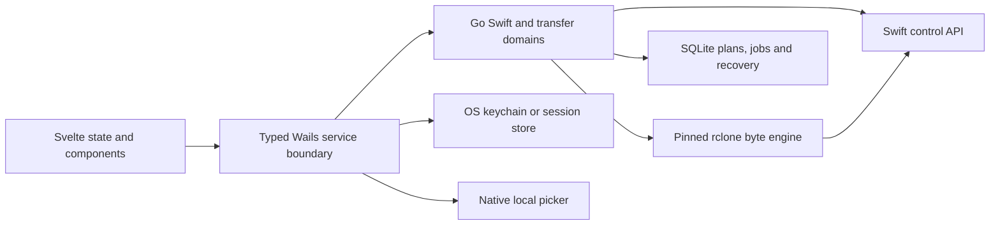

# Aeronautes full project audit — 5 September 2026

**Assessment: a substantial operator-workbench foundation, with release-blocking data-safety and trust-boundary defects.**
The implementation supports much of the intended workflow, but the evidence does not support using its mutation, recovery, or transfer paths on valuable data under the promised safety guarantees.
This agrees with the existing DESIGN §65.10 warning; completion of earlier implementation phases does not mean the v1 acceptance criteria are satisfied.
Read the [ordered remediation plan](remediation-plan.md) for the proposed work sequence.

Audited product revision: `cc6465ac69ec00756d9976bbf6cf7531b07da66d` (`add the §65.10 test war room`).
The audit records the state of that revision, not a claim about a later branch or remote deployment.
Authenticated GitHub inspection found master one badge-only commit ahead, with identical product source; its successful 31 August CI artifact is recorded separately from this audit's local runs.
This change records findings, reproducible evidence, and a plan; it does not implement the product fixes.

Later bounded corrections are recorded in the current [DS-04](data-safety.md#ds-04--high-large-object-verification-accepts-corruption-and-a-stale-destination-fingerprint-preserves-it) and [DS-08](data-safety.md#ds-08--high-outcomes-are-event-counts-and-samples-not-an-exact-identity-ledger) dispositions: PR93 narrows segmented-destination skips, and PR94 corrects bulk reply identities and deletion accounting/storage-failure reporting.
These findings remain open.
Initial content verification, current source/destination binding, local-transfer verification, unresolved deletion re-attempt authority, the parallel unresolved stream and the remaining durable outcome requirements still block valuable-data assurance.
The audit-time evidence below is preserved, and the [valuable-data and release gates](remediation-plan.md#acceptance-gates-and-completion) remain unchanged.

## Highest-priority conclusions

1. **Recovery can damage unrelated live objects.**
   A captured staging prefix is not proof that its segments have no other references.
   The probe preserved an external DLO manifest but recovery deleted its backing data (DS-01).
   SQLite durability also permits a lost-history state which makes this recovery decision unsafe after an OS/power failure; that history was modelled, not produced by a physical power cut.
2. **Final checks do not make overwrites or Mirror deletions atomic.**
   A writer inserted after the final HEAD was overwritten or deleted and the job reported success (DS-02/03).
   Another HEAD, a preview token, or an unsupported conditional DELETE header does not close this remote race.
3. **Successful verification does not consistently prove correct content.**
   Same-size corrupt large-object segments were committed successfully; later same-size corruption was skipped as equal (DS-04).
   Metadata-only changes were also left behind while Copy reported completion (DS-09).
4. **The selected local directory and reviewed UI intent are not consistently enforced.**
   Download followed an existing parent symlink outside the picked directory (DS-05).
   Late previews armed changed operations, and late save/listing replies replaced state belonging to another selection or namespace (UI-01–04).
5. **Write-only credential APIs still need an origin-bound capability model.**
   Changing a bookmark's auth endpoint through the bridge reused its saved key at the new endpoint.
   The real pinned rclone child also forwarded a synthetic auth token across a storage redirect.
   These are demonstrated trust-boundary failures; they are not evidence that a remote attacker already has renderer code execution.

The [data-safety report](data-safety.md), [security and release report](security-release.md), [UI/product report](ui-product.md), and [testing/performance report](testing-performance.md) give conditions, source references, confidence, requirements, and acceptance tests.
Previously documented W/R findings are identified as revalidated rather than counted as newly discovered architecture problems.
Critical/high findings are ordered by irreversible damage or credential exposure; medium/P2 findings include usability, operational reliability, and unmet product requirements.
The labels are audit priorities, not CVSS scores or proof of exploitability in every deployment.

## Evidence that changes the assessment

| Check | Result | What it establishes |
| --- | --- | --- |
| Existing Go internal suite with race detector | 299 top-level tests passed; 33 skipped; 19 packages passed; 75.8% statements | Strong existing package regression base; does not prove skipped real-cluster scenarios |
| Completed local Go suite with two-account SAIO and pinned engine | 332 top-level tests passed; zero skips; 19 packages passed; 81.7% statements | Closes the initial existing-suite skips; the separate damage probes and unimplemented scenarios remain |
| Explicit official-sidecar test after the baseline | Passed against verified rclone 1.74.3 | Resolves one of the 33 baseline skips |
| Existing frontend suite | 48 tests passed; 6 files; 17.18% statements | The current tested helper/state behaviours pass; large component gaps remain |
| Svelte checks and frontend production build | 0 errors/warnings; build passed | Types and production bundle are viable |
| Go vet, formatting, Linux production build | Passed; upstream GTK deprecation warnings | Linux compilation works in this environment; no native interaction proof |
| Six OS/architecture internal-core builds | Passed without CGO | Pure-Go core portability; not six packaged desktop app runs |
| Data, security, UI, and oracle audit probes | 29 intended safe-behaviour assertion failures; 1 passing PRAGMA observation | Specific failure modes absent from the normal suite; archived separately |
| Local scenario reconciliation | Initial run 0/102 without SAIO; completed run 8/102 with SAIO; both valid; all 47 actions have gaps | Correct accounting of each run; the full system contract remains incomplete |
| Retrieved master CI evidence, 31 August | Go/frontend/SAIO/smoke reported success; scenario artifact 8/102, all 47 actions still have gaps | Existing real-cluster/smoke foundation evidence on identical product source; the full safety contract remains incomplete |

Full commands, versions, preserved probe sources, advisory scope, and environmental limits are in [verification.md](verification.md).
The initial nested SAIO container could not unpack under the available UID/GID mappings.
Local review then identified an accessible host SAIO; the complete two-account suite and Linux pinned-engine measurement lane passed there.
Its matrix reports observations rather than failing on behavioural differences, so a successful exit is not a complete compatibility gate.
No native GUI, screen-reader, macOS/Windows runtime, representative SwiftStack deployment, physical power-loss, or full release-artifact validation was completed here.
The completed local run reproduced DESIGN's historical 8/102 system count and retained the remaining gaps explicitly.

## Product suitability and feature coverage

The product fits experienced Swift/SwiftStack operators who need to understand object identity, large-object backing data, ACLs, policies, metadata, and cross-account data movement.
Keeping Swift semantics visible is appropriate for this audience.
The largest product risk is the gap between an operator's selected/reviewed scope and the eventual mutation, followed by incomplete verification and recovery evidence.
Visual polish and transfer speed cannot compensate for that gap.

| Capability | Present and useful | Remaining acceptance work |
| --- | --- | --- |
| TempAuth v1 bookmarks and TLS | OS keychain with explicit session fallback; system/custom-CA/insecure modes; connection diagnostics | Credential origin binding, atomic reauth tuple, returned-endpoint/redirect policy, delete failure lifecycle, native consent capabilities |
| Account/container/object browsing | Paged listings, logical/all/backstage views, prefix navigation, explicit Find, inspector | Short-page completeness, stale page/selection isolation, literal prefix semantics, retained-state/resource budgets |
| Object and container inspection | Plain/DLO/SLO classification, logical/listed sizes, manifest and segment evidence, raw details | Complete transaction diagnostics, large inventories, native keyboard/screen-reader evidence |
| Metadata, ACLs, quotas and settings | Native typed updates; replace-all metadata semantics and DLO preservation have tests | Uniform identity binding, metadata-only replication, failure presentation, safe retry/unknown outcomes |
| Versioning and account services | Legacy versioning controls; modern versioning, TempURL/CORS/staticweb presence surfaced | Real versioning safety matrix; modern versioning editing and account-service management remain explicit scope decisions/deferred work |
| Cross-account Copy | Streaming comparison, staging-only rclone writes, native commit, conditional planned-new PUT | Overwrite concurrency contract, content-strength verification, metadata/symlink fidelity, durable exact outcomes |
| Mirror | Native destination-only phase; source/destination checks; explicit destructive mode | Final-hop races, other-job staging protection, immutable reviewed plan, verification strong enough to permit deletion |
| Local upload/download | Native picker-issued handles, namespace preflight, no-replace leaf placement | Parent symlink/reparse-point containment, collision policy parity, cancellation, chunk limits, upload cleanup, directory upload and six-target evidence |
| Deletion and segment cleanup | Manifest-only native deletion; force-only segment cleanup; bounded delete batches | Safe exact-object delete journey, ownership/concurrency contract, malformed responses, durable retries, recovery preservation |
| Jobs, audit and recovery | SQLite state, job phases/cancellation, settings, audit history, failure spill | Durable intent/outcome/outbox, fail-closed persistence, live diagnostics, precise partial outcomes, restart/process tests |
| Performance | Streaming merge-join, no HEAD-per-row rendering, per-job worker controls, virtualized rows, microbenchmark | Bounded end-to-end memory/queue/scans; shared endpoint budgets; adaptive control; representative throughput/RSS tests |
| Desktop UI | Coherent dense inspector layout, light/dark themes, focus helper and reduced-motion support | Async intent isolation, keyboard/modal semantics, contrast, zoom/resizing, complete actionable errors |
| Packaging/support | Pinned dependencies/checksums, six-target release build definition, Linux reference tooling | Artifact version/source identity, enabled-engine advisory triage, runtime matrix, mandatory release evidence |

This is not an assessment of missing S3, FUSE, Keystone, scheduling, full version-history browsing, TempURL generation, arbitrary rclone flags, clone-container, or SLO upload as defects.
Those are intentional non-goals or separately deferred capabilities in the locked design.
An encrypted fallback vault is still proposed in ADR 0006; its absence is not an instruction to persist plaintext credentials.
Unsigned release artifacts are an existing explicit decision, not a newly introduced regression.

## Architecture and maintainability

The split is sound and should be retained.
Wails stays at the shell boundary; internal packages compiled without CGO for all six targets.
Domain packages and a raw-HTTP independent oracle already provide useful test seams.
The staging-only engine rule is enforced beneath individual callers, which is the right place for it.

The main maintainability problem is safety-policy duplication across Copy, Mirror, local upload/download, segment deletion, and recovery.
One path persists or verifies a fact while a sibling path omits it.
The plan therefore calls for small shared contracts for identity, verification strength, durable intent, and complete outcomes after their semantics are agreed.
It does not call for replacing the framework, a general workflow engine, or a broad rewrite.
The frontend has a parallel issue: initial reads have generation guards, but mutations, pagination, previews, and scans do not consistently use them.

Supportability also needs a stronger link from visible operation to durable result: precise failure identities, request transaction IDs, effective settings, partial/cancelled state, and artifact version.
Avoid hiding storage failures behind success or empty views.
Privacy review must include the native child, redirects, endpoint changes, logs and durable state, not just whether a credential field exists in a DTO.

## Behaviour oracles and decisions

The principal oracles are [REQUIREMENTS](../../REQUIREMENTS.md), [DESIGN](../../DESIGN.md), accepted [ADRs](../../adr/), the repository's real-Swift seam evidence, and independently observed before/after state.
Tests are supporting evidence rather than permission to weaken a requirement.
Design conflicts and unsupported server primitives are decisions to resolve before implementation.

The most important conflict is between §28.6's prohibition on account-wide reference scans and §65.9/65.10's demand for live exclusivity proof.
Even a complete scan does not prevent a subsequent writer from adding a reference.
Define the enforceable ownership/concurrency guarantee, retain ambiguous data by default, and update DESIGN plus an ADR before changing the locked architecture.
Preserve force-only inspector cleanup while that work is pending.
Other explicit decisions are listed with their safe interim behaviour in the plan.

## ECC material loaded for this session

Inspected `~/code/ECC` at `ce64e417fd420a0df98ed0aa00809eea5e74e127` (v2.2.0 checkout).
The following guidance was read and used selectively alongside the project's instructions and the existing coding-review workflow.

| ECC guide | Useful contribution | Adaptation |
| --- | --- | --- |
| `skills/codebase-onboarding/SKILL.md` | Entry points, dependency and architecture mapping | Used for inspection; no replacement project instructions generated |
| `skills/product-lens/SKILL.md` | Operator journeys and product suitability | Evaluated the existing Swift use case; no speculative growth or revenue requirements |
| `skills/security-review/SKILL.md` | Threat boundaries and failure paths | Applied to desktop bridge, keychain, child process and storage endpoints |
| `skills/golang-testing/SKILL.md` | Deterministic error/race probes and interface-level tests | Used real service boundaries and observable data state; no arbitrary coverage percentage as safety proof |
| `skills/click-path-audit/SKILL.md` | State/touchpoint inventory and late-response analysis | Used bounded parallel domain inspections and deferred UI replies |
| `skills/frontend-a11y/SKILL.md` | Semantic controls, focus and keyboard review | Adapted to Svelte and recorded native-webview limits |

These were loaded by reading them for this session.
No global skills, agent policy, hooks, or ECC configuration were installed or changed.
Project requirements and operator preferences remain authoritative.

## Audit navigation

- [Data safety: DS-01–13](data-safety.md)
- [Security and release findings](security-release.md)
- [Six-sidecar advisory assessment and remaining limits](sidecar-assessment.md)
- [Complete candidate sidecar source collection](sidecar-sources.md)
- [UI and product: UI-01–14](ui-product.md)
- [Testing, performance and documentation findings](testing-performance.md)
- [Verification and evidence limitations](verification.md)
- [Preserved reproductions](probes/README.md)
- [Ordered remediation plan and release gates](remediation-plan.md)
